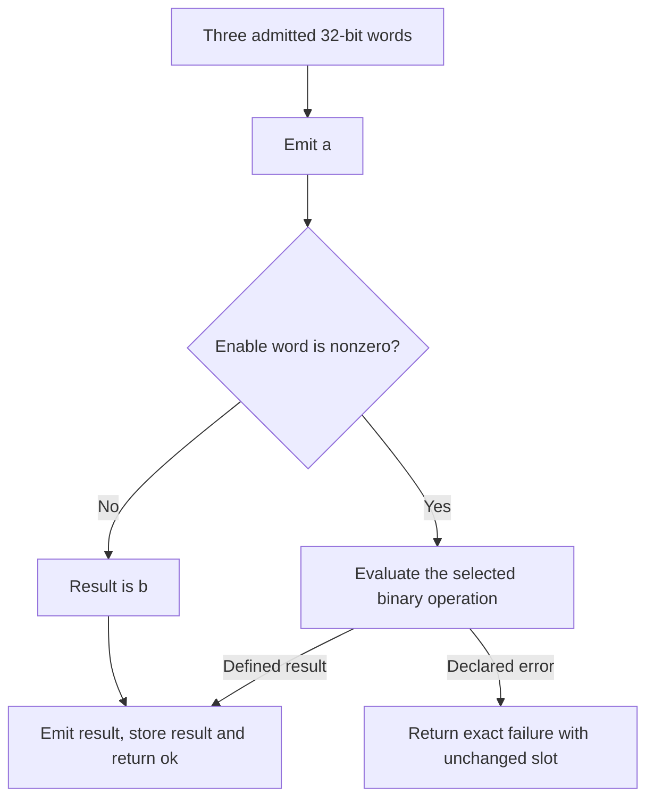

# RT-13 Common checked scalar subset for backend experiments

**Issue** [#329](https://github.com/aivibeflow/LLMLang/issues/329)

The shared backend experiment needs a source contract that an emitter and an independent observer can both use. This report defines the closed scalar pilot used by the existing C++, Go, Java, Rust and direct LLVM profiles. It checks source admission, the reference semantics and how much evidence a reduced observation would miss. It does not select the production language or its backend. [Archived backend profiles](RT-13-COMMON-SUBSET-BACKEND-RECEIPTS-2026-11-25.md)

## Admitted programs and contract

The source accepts one function with parameters `a`, `b` and `enabled`. It emits the first operand word `a`, chooses between one allowed binary operation and the fallback word `b`, emits a successful result, and returns it. The two binary operand selectors are independently chosen from `a` and `b`. Source structure is checked by the [bounded parser](../PROTOTYPES/LLVM-PRESERVATION-01/integer_fixture.py). The runtime input carrier is three unsigned 32-bit words. The function evaluates the operation only when the enable word is nonzero. Signed operations interpret word values with two's-complement semantics. There are 16 operations and four ordered selector pairs, giving 64 admitted fixture programs.

| Operation family | Admitted operations | Exceptional outcome |
| --- | --- | --- |
| Wrapping arithmetic | Add, subtract, multiply modulo 2³² | None |
| Checked arithmetic | Signed and unsigned add, subtract, multiply | Overflow outside the selected domain |
| Checked division and remainder | Signed and unsigned quotient or remainder | Zero divisor. The signed minimum divided by −1 is overflow for both signed operations in this fixture. |
| Checked shifts | Left, arithmetic right, logical right | Shift count of 32 or greater |

A successful call returns status `ok`, stores the resulting word, and emits the ordered pair `(a, result)`. Signed division truncates toward zero. A fault returns its specific status, leaves the output slot at its input sentinel `0xABAD1234`, and retains the single leading callback `a`. Ports may choose a different external carrier when they can recover these observations. The selected native comparisons use the status, final output slot and ordered callback trace together.



The diagram shows the fixture's status, state and observable callback boundary. The reduced comparisons below omit different portions of that boundary. A status-only comparison can be useful as a diagnostic but admits a changed slot or trace. Comparing the complete tuple is the acceptance check for this subset.

## Independent checks

The runner uses mathematical integers, explicit signed conversion and division of absolute values to compute an observation independently of the archived evaluator. It checks 64 programs at 3,085 vectors per program. Inputs come from 19 boundary words, 256 seeded word pairs, and five enable words. The independent evaluator agrees in all 197,440 comparisons. The status counts match the archived backend receipts. Six source mutations and four typed input mutations are refused. The typed input adapter checks width and type before interpreting an input; it is part of this fixture boundary.

| Substitute behavior | Status detects | Status and slot detect | Full comparison detects |
| --- | ---: | ---: | ---: |
| Collapse all failures to overflow | 26,272 | 26,272 | 26,272 |
| Store zero on failure | 0 | 51,392 | 51,392 |
| Reverse callback order | 0 | 0 | 137,992 |
| Treat only enable word 1 as true | 38,544 | 113,430 | 113,430 |

Each column counts disagreeing rows out of the same 197,440. These are deliberately altered observation rules in the independent runner. The experiment does not attribute these behaviors to the archived native implementations. The exact ledger records per-category counts, source pins and the digest of the full generated observation stream. The observations can be regenerated as machine-readable JSON Lines. There are no timing or resource measurements. [Evidence ledger](COMMON-SCALAR-SUBSET-01/evidence.json)

The selected subset gives a reproducible common contract for these backend experiments. It leaves the full SPG source language, general effects and resources, target-specific ABI conformance, broader sample coverage and production selection open. This work independently checks the reference corpus and archived receipt identity. Fresh native builds are covered by the original backend reports and were outside this study.

## Reproduction

Use CPython 3.12.14 and Git from the repository root. The runner verifies pinned evaluator, harness and receipt bytes against `7007a14dffa2417b2dae7da5e0bbed5ce698d667`. Runs with hash seeds 1 and 2 reproduced the same ledger. Local links and Mermaid source structure were checked. GitHub rendering was not manually verified.

```sh
study=research/compiler-and-translation/RT-13/COMMON-SCALAR-SUBSET-01
PYTHONHASHSEED=1 python -B "$study/run.py" --observations /tmp/llmlang-scalar.jsonl >/tmp/llmlang-scalar-ledger.json
cmp "$study/evidence.json" /tmp/llmlang-scalar-ledger.json
sha256sum /tmp/llmlang-scalar.jsonl
```
