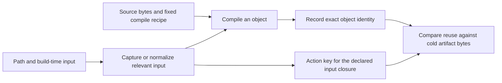

# Check compile-cache reuse across path and timestamp inputs

**Scope:** PLAN §3.3 and [#300](https://github.com/aivibeflow/LLMLang/issues/300). Candidate cache policy tested with pinned Clang at base revision `9f6a3d96c086b38113ba2427a2efd832d8fd127d` on `research/all`.

## Question and method

Can the same source bytes and compile recipe safely identify a byte-exact artifact if the build path or time environment changes? The [CLI action-key study](../../language-design/RT-01/RT-01-CLI-ACTION-KEYS-2026-11-25.md) distinguishes a source subject, provider selection, and executable result. This experiment varies two other inputs that a build action can consume implicitly.

The four profiles compile a header-free C17 body with Clang 19.1.7 on x86-64 Linux. Each profile tests two physical roots and two fixed `SOURCE_DATE_EPOCH` values. It compiles each cell twice, producing 32 object files. The pure body has no path or time macros. The contextual source exposes `__FILE__`, `__DATE__` and `__TIME__` in the object data. The debug profiles include DWARF. In the mapped profile, the driver remaps the physical input root and debug directory to one virtual path. The macro fixture uses UTC for both clock inputs.



The comparison uses exact artifact bytes. Two builds of each cell agree. For each profile, the driver compares all 16 ordered pairs of cells, including comparison to itself. A false hit occurs if the action keys match but the cold object bytes differ.

## Results

| Compile profile | Distinct object byte groups | False hits without path/clock inputs | False hits with scoped declared inputs |
| --- | ---: | ---: | ---: |
| Pure body without debug | 1 | 0 / 16 | 0 / 16 |
| Pure body with unmapped debug | 2 | 8 / 16 | 0 / 16 |
| Contextual macros without remapping | 4 | 12 / 16 | 0 / 16 |
| Contextual macros and debug with remapping | 2 | 8 / 16 | 0 / 16 |

The unmapped debug objects contain their physical roots even though the executable source body is identical. The contextual object data contain both the path and the recorded time. The mapped profile removes the physical path dependence across these roots while preserving the difference between 1 January and 2 January 1970. A separate run with a differently placed temporary directory reproduces the [ledger](COMPILE-ACTION-INPUTS-01/evidence.json) byte for byte. Unmapped objects are recorded by equality group rather than a digest that encodes the scratch path. The scoped key uses the two root labels to represent distinct path inputs within the fixture.

## Candidate action policy

Permit shared byte-exact reuse only for an action whose result-determining inputs are captured or normalized under its documented recipe. Map paths before emission when consumers accept the virtual path contract. Include an explicit time input when the recipe emits time-dependent content. If a relevant input cannot be captured, the action can execute and keep its own observation, but it has no shared exact-result key. The fixture's three context-sensitive profiles refuse shared lookup when their required path or clock field is unavailable. Successful repetition in one environment is a test observation. It leaves the input-closure obligation in force.

Including every physical path could retain the correct bits, but would miss reusable results after a verified remapping. Ignoring debug metadata would require changing the artifact equality contract and supplying a consumer-specific equivalence argument. A nondeterministic action with allowed variation has a different contract from a deterministic exact-result action. Its raw results should carry the actual observations and any replay context.

The result tests two source inputs, four recipes and one compiler target. It leaves full environment discovery, tool dependency closures, generated file and process inputs, seeded stochastic actions, build performance and acceptance of virtual debug paths open.

## Reproduce

Use CPython 3.12.14, Debian Clang 19.1.7 package `1:19.1.7-3+b1` and the corresponding Linux x86-64 LLVM libraries. Set `CLANG` to the pinned executable. The ledger records the executable SHA-256 and [the toolchain replay](../../research-management/RT-00/RT-00-C-LLVM-FP-FLAGS-REPLAY-2026-11-25.json) records the matching package fingerprints.

```sh
set -eu
fixture=research/compiler-and-translation/RT-13/COMPILE-ACTION-INPUTS-01
out=$(mktemp)
scratch=$(mktemp -d)
TMPDIR="$scratch" python3 -B "$fixture/run.py" --clang "$CLANG" > "$out"
cmp "$out" "$fixture/evidence.json"
```

The counts enumerate the fixture, not a performance sample. Mermaid source was inspected directly.
