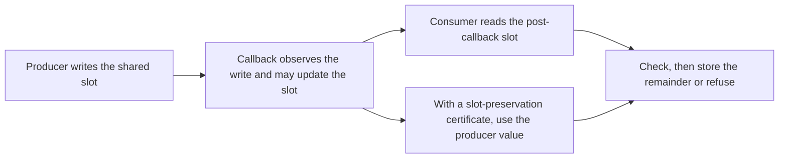

# RT-13 forwarding state across semantic nodes

An optimizer can forward a producer's value to a consumer and remove a reload. The legality depends on what can happen between those semantic nodes. This study checks a shared slot whose first write is observable through a callback. The consumer then checks whether enough value is available, either writing the remainder or refusing while retaining the effects already performed. The combined contract observes status, final slot value and ordered event payloads. [Related observation refinement](../../formal-verification/RT-07/RT-07-JOINT-OBSERVATION-REFINEMENT-2026-11-25.md)



The original route reloads the slot after the callback. The optimized route can forward the producer's value when the callback leaves the relevant slot unchanged for that invocation. The optimization keeps the first write and its event. The scope can allow other effects from the callback, since the trace includes all callback events in the abstract fixture. A guarded native implementation forwards for a read-only callback and reloads when the callback may mutate the slot.

## Checked results

Lean proves equality of the original and forwarded observations when the callback preserves the exact slot. It also proves that a refused consumer retains the post-callback slot and prefix events. Both theorems depend on `propext`. The model quantifies over the callback's slot value and event list. [Lean proof](CROSS-NODE-FORWARDING-01/Forward.lean)

An independent Python oracle supplies 1,024 cases per route in each of four native compiler profiles. The input grid includes zero, values near the checked failure boundary, high-bit unsigned values and the maximal 32-bit value.

| Native route | Wrong rows with a read-only callback | Wrong rows with a mutating callback |
| --- | ---: | ---: |
| Original reload | 0 | 0 |
| Guarded forwarding | 0 | 0 |
| Unconditional forwarding | 0 | 336 |
| Consumer rejection before producer | 224 | 224 |

When the producer emits 10, a callback can replace the slot with 1 and make a later request for 5 fail. Forwarding 10 from the producer admits the request and writes 5. For a read-only callback, an early check can return the same failure status as the original while removing the producer write and callback event. A cross-node optimization needs evidence for the exact intervening slot, alias and effect scope, plus preservation of the operation's observable failure behavior. A reachable unverified callback requires the conservative reload in this fixture. The scope leaves concurrent accesses, callback failures, arbitrary aliasing, exact optimized machine validation and production proof transport open. [Native fixture](CROSS-NODE-FORWARDING-01/probe.c) · [Evidence](CROSS-NODE-FORWARDING-01/evidence.json)

## Reproduction

Use GCC 14.2.0, Clang 23.1.1 at LLVM revision `6dfe1677ab8dffbc6ec13d53a1e0215d75147689`, Lean 4.36.0 at revision `611c117bfaf7b7ae1cfcf246ce6fba31e8f509e9` and CPython 3.12.14 on Linux x86-64. The harness builds GCC and Clang at O0 and O2.

```sh
study=research/compiler-and-translation/RT-13/CROSS-NODE-FORWARDING-01
build=$(mktemp -d)
for seed in 37 75; do
  LC_ALL=C PYTHONHASHSEED="$seed" python "$study/run.py" --lean /path/to/lean \
    --clang /path/to/clang --output "$build/result-$seed.json"
done
cmp "$build/result-37.json" "$build/result-75.json"
cmp "$build/result-37.json" "$study/evidence.json"
```

[Runner](CROSS-NODE-FORWARDING-01/run.py)
