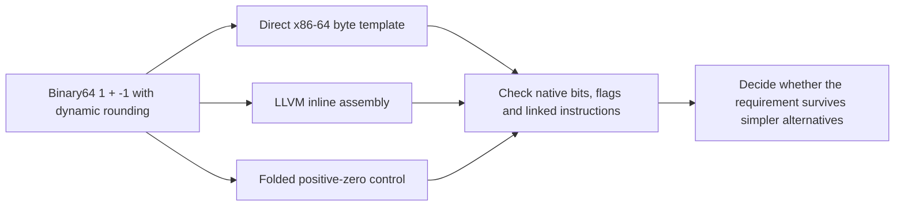

# RT-13 evidence threshold for a direct native backend

For a function that adds binary64 literals `1` and `-1`, dynamic rounding requires negative zero in downward mode. The prior LLVM experiment found that forced literal inlining through full and ThinLTO changed that result to positive zero in three toolchain versions. Two existing routes retain the operation, a kept function call and a volatile load for each operand. This study tests a narrower requirement on Linux x86-64 System V with SSE2. The leaf must retain the addition inside its own symbol using immediate operands, with no helper call or data load. This is a concrete unmet property of the three earlier lowering routes on this witness. Whether any LLMLang workload needs that particular property remains an open question. [Earlier LLVM result](RT-13-LLVM-DYNAMIC-ROUNDING-LTO-2026-11-25.md) · [Backend architecture](LLVM-BACKEND-ARCHITECTURE.md)



The direct path emits the instruction bytes into an ELF leaf using an assembler for object and call-frame metadata. The existing-backend path gives LLVM a local side-effecting assembly operation with explicit register constraints. Both materialize binary64 bit patterns as immediates, move them to XMM registers, and execute `addsd`, which uses the rounding mode in MXCSR. A third implementation returns positive zero with `pxor` as a seeded fault. The same native caller controls the rounding mode and exception state. The fixture reuses its earlier symbol names `keep_call` for the direct template and `inline_loads` for the inline assembly route. Both tested leaves execute without a helper call or data load. [Inline LLVM module](DIRECT-NATIVE-THRESHOLD-01/inline.ll) · [Emitter and runner](DIRECT-NATIVE-THRESHOLD-01/run.py)

| Route | Native link | Full LTO | ThinLTO | Instruction bytes through return |
| --- | --- | --- | --- | ---: |
| Direct template | 8/8 | 8/8 | 8/8 | 35 |
| LLVM inline assembly | 8/8 | 8/8 | 8/8 | 35 |
| Constant-zero fault | 6/8 | 6/8 | 6/8 | 5 |

Each route per link covers four rounding modes, each with cleared flags and a seeded invalid flag. The direct and LLVM inline assembly routes have identical machine bytes in all three links. They return negative zero only in downward mode and preserve the initial flags. The fault returns positive zero in both downward observations in each link. It preserves the initial flags in all cases. The direct object stays outside LTO, and the inline assembly IR is compiled inside the tested LLVM link modes. These observations cover one finite exact-cancellation expression called from a separately compiled host. They leave broader floating-point operations, exception raising, motion across changes to the floating-point environment, and additional targets open. [Evidence](DIRECT-NATIVE-THRESHOLD-01/evidence.json)

## Admission threshold and cost estimate

A direct native backend study should identify a concrete acceptance predicate tied to at least one reproducible representative workload and an explicit target profile. The reference evaluator and adversarial controls must check that predicate and existing source observations. Compare the same workload with existing compiler settings, constrained lowering, a retained boundary and a local target-specific operation where applicable. For a gap in resource use or latency include repeated measurements and a workload-specific acceptance bound. Advance a direct candidate when those alternatives fail a material gate, the direct prototype passes the common checks, and the remaining integration and recurring cost fit the claimed delivery scope. This rounding witness supports continued testing of the existing backend with a local operation. Its direct template shows no unique capability for the tested requirement.

The table estimates a **single-profile hosted AOT backend for a bounded scalar subset**, with the semantic IR and its reference evaluator available, Linux x86-64 System V, one object/link interface, one debug/unwind profile and delegation of OS interfaces to the existing runtime. It excludes schedules for additional architecture or ABI profiles, JIT, SIMD, threads and large aggregate FFI. The estimates are planning assumptions in engineer-weeks, based on the separate deliverables listed below. They are separate from the experiment and have no calibrated accuracy.

| Deliverable | Initial engineer-weeks | Engineer-weeks per toolchain or runtime update cycle |
| --- | ---: | ---: |
| Selection, registers, ABI calls, stack frames, branch and relocation fixups | 4–8 | 0.5–1.5 |
| ELF and linker integration, runtime helpers, portability and failure diagnostics | 3–6 | 0.5–1.5 |
| DWARF origins, frame tables and native tooling end to end | 3–6 | 0.5–1.5 |
| Reference conformance, adversarial ABI tests, artifact validation and reproducible CI | 4–8 | 1–2 |
| Deployment integration, ownership, fallback and support documentation | 2–4 | 0.5–1 |
| **Scoped total before contingency** | **16–32** | **3–7.5** |

Every added ISA or ABI adds encoding, lowering, linking and debug evidence at that profile. A production JIT also adds code publication and retirement, memory protections, unwind registration and concurrent lifetime testing. A single instruction template supplies little information about those costs. An actual estimate for selection requires the proposed supported operations and target matrix, named maintenance ownership, CI capacity, an update cadence and a contingency for any new runtime or proof obligations. Local target-specific LLVM operations also need observation-level checks and a maintenance owner, with the supported target and compiler profile recorded. [Target profiles](RT-13-TARGET-SUPPORT-EVIDENCE-MATRIX-2026-11-25.md) · [Native JIT integration](RT-13-JIT-UNWIND-AND-CALLBACK-ORIGINS-2026-11-25.md)

## Reproduction

Use the exact Clang/LLD 23.1.1 from Lean 4.36.0 at LLVM revision `6dfe1677ab8dffbc6ec13d53a1e0215d75147689`, GCC 14.2.0, GNU Binutils 2.44, glibc 2.41 and CPython 3.12.14 on Linux x86-64 with SSE2.

```sh
study=research/compiler-and-translation/RT-13/DIRECT-NATIVE-THRESHOLD-01
build=$(mktemp -d)
for seed in 37 75; do
  LC_ALL=C PYTHONHASHSEED="$seed" python "$study/run.py" \
    --llvm-bin /path/to/lean-4.36.0/bin --output "$build/result-$seed.json"
done
cmp "$build/result-37.json" "$build/result-75.json"
cmp "$build/result-37.json" "$study/evidence.json"
```
