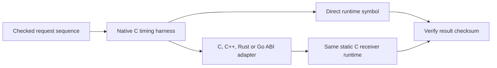
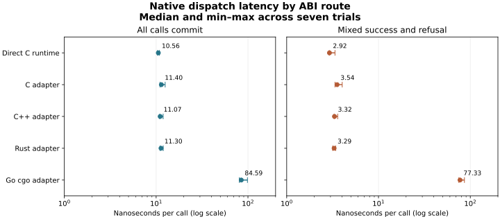

# RT-13 — Native dispatch and ABI adaptation cost

- **Date** — 2026-11-25
- **Tracking** — [PLAN §6.4](../../../PLAN.md#64-implementation-discovery-selection-and-optimization) · [#331](https://github.com/aivibeflow/LLMLang/issues/331)
- **Status** — Reproduced one native calling pattern with archived timing samples

## Question and method

How much time does one checked receiver operation take when called through C, C++, Rust and Go cgo adapters? The comparison builds the same checked C runtime used in the earlier cross-language fixture. A native C program calls the direct provider symbol or the shared library's exported adapter through the same function-pointer interface. The timing interval excludes input loading, library loading and warm-up. The loop accumulates the packed status, state and effect results for checksum verification. [Shared C runtime and footprint](../RT-30/RT-30-SHARED-C-RUNTIME-2026-11-25.md)

The two input sequences each contain 256 distinct-position records. One always commits. The other contains successful operations and four explicit refusal paths. The harness separately checks all 2,560 input/profile observations before timing. Each measured process warms 16,384 calls and then measures 524,288 calls. The runner checks both checksums against the source oracle.



Seven shuffled trials per workload and profile run in fresh processes pinned to one logical CPU on a Linux x86-64 AMD EPYC 9V74 runner. The clock is `CLOCK_MONOTONIC_RAW`, with `GOMAXPROCS=1` for the native process. Results include the common input indexing, call and checksum loop. The direct baseline uses the same loop and provider.

## Timing results

| ABI route | All calls commit, ns per call | Mixed success and refusal, ns per call |
|---|---:|---:|
| Direct C runtime | 10.56 (10.34–10.86) | 2.92 (2.91–3.36) |
| C adapter | 11.40 (11.01–12.54) | 3.54 (3.36–4.03) |
| C++ adapter | 11.07 (10.95–11.92) | 3.32 (3.29–3.60) |
| Rust adapter | 11.30 (11.08–11.95) | 3.29 (3.17–3.42) |
| Go cgo adapter | 84.59 (80.64–98.76) | 77.33 (75.08–86.35) |

Cells report the median and minimum-to-maximum sample range. All 70 intervals return the checked checksum. Across this workload, C, C++ and Rust are within one nanosecond per call of the direct median. The Go route enters Go through its exported C ABI and calls back into C for the shared runtime. Its measured path is substantially more expensive for this small operation. The mixed sequence spends fewer calls in the receiver method. [Measurement settings and checks](DISPATCH-TIMING-01/evidence.json) · [Raw samples](DISPATCH-TIMING-01/samples.csv)



## Limits

The benchmark measures repeated calls from one native host into small shared libraries on one runner. It supplies no isolated per-instruction cost or guaranteed timing bound. The measured difference is sensitive to operation size, call batching, scheduler activity, payload conversion, runtime setup and compiler settings. Real Toolchain workloads, concurrent calls, other targets and direct generated dispatch remain open.

## Reproduction

Run on Linux x86-64 with CPython 3.12.14, GCC and G++ 14.2.0, Go 1.27.4, Rust 1.85.1, util-linux `taskset` and Matplotlib 3.10.8. New runs produce fresh timing samples. The evidence receipt records the schedule-independent fields and the measured host, while the archived graph can be reproduced from the tracked sample file. [Native timing harness](DISPATCH-TIMING-01/measure.c) · [Runner](DISPATCH-TIMING-01/run.py) · [Plot source](DISPATCH-TIMING-01/plot.py)

```sh
set -eu
dir=research/compiler-and-translation/RT-13/DISPATCH-TIMING-01
scratch=$(mktemp -d)
trap 'rm -rf "$scratch"' EXIT
python3 -B "$dir/run.py" --go-cache "$scratch/go-cache" --samples "$scratch/samples.csv" > "$scratch/evidence.json"
cmp "$dir/evidence.json" "$scratch/evidence.json"
MPLCONFIGDIR="$scratch" python3 -B "$dir/plot.py" "$dir/samples.csv" "$scratch/archived.svg"
cmp "$dir/dispatch-latency.svg" "$scratch/archived.svg"
MPLCONFIGDIR="$scratch" python3 -B "$dir/plot.py" "$scratch/samples.csv" "$scratch/dispatch-latency.svg"
```
