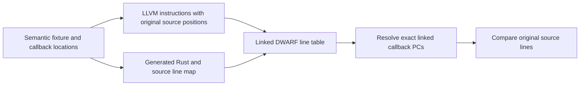

# RT-13 — Source origins for callback instructions in linked debug information

- **Evidence** — Exact linked instruction and DWARF line checks for a single checked-add workload.
- **LLMLang baseline** — `036abba5ca0c90bf74f3e8de7039914822c33e04`.
- **Tracking** — [PLAN §6.3](../../../PLAN.md#63-llvm-backend) · [Generated Rust integer lowering](RT-13-GENERATED-RUST-INTEGER-LOWERING-2026-11-24.md).

## Question and approach

Can a tool presented with a linked instruction address recover the original source location of an observable effect? The experiment compares LLVM locations embedded at lowering with generated Rust's native DWARF and a line-map sidecar. Both start from the existing typed checked-add fixture. Its two callback effects occur at original source lines 2 and 7. The harness parses those positions from the source, compiles both routes, and finds the two indirect callback instructions in the linked function.



LLVM carries an original file and source location for each callback in its debug metadata. Rust's compiler records locations in the generated file, so the second route composes a checked PC-to-generated-line lookup with a mapping from generated lines to original locations. The paths are fixed synthetic paths. The experiment runs the real linked entry against four independent observations representing normal progress, overflow, bypass and non-unit enable.

## Results

`llvm-dwarfdump --verify` accepts all four linked profiles. The two callback PCs in each resolve to the expected original locations.

| Profile | Linked callback PCs, hexadecimal | DWARF lines | Original lines recovered |
| --- | --- | --- | --- |
| Direct LLVM O0 | `111a`, `114f` | 2, 7 | 2, 7 |
| Direct LLVM O3 | `1116`, `1129` | 2, 7 | 2, 7 |
| Generated Rust O0 | `11a0`, `11df` | 9, 13 in generated Rust | 2, 7 |
| Generated Rust O3 | `1116`, `1124` | 9, 13 in generated Rust | 2, 7 |

The LLVM control assigns the second source location to the first callback's instruction. Its DWARF still passes structural verification, its linked `.text` is byte-identical, and its native observations still match the fixture. The source-origin check reports both calls at line 7 and detects the mistake. The Rust control changes only the sidecar so that the first generated callback maps to original line 7. The same linked Rust library now reproduces the corresponding origin mismatch. [Exact PCs, text hashes and mapped lines](DWARF-ORIGINS-01/evidence.json)

## Implementation consequence

Original source locations embedded in optimized machine debug information are usable for the two checked effects in this fixture. The Rust route can recover the same locations with a separately validated mapping. That mapping needs to bind exact generated and original artifacts. Structural debug validation and runtime conformance do not establish source attribution by themselves.

This comparison uses x86-64 ELF, distinct indirect callback instructions, and one function. It does not test source stepping, debugger breakpoints, variable lifetimes, inlining, line discriminators, source-map support in editors, Go debug information, or Cranelift JIT debug registration. Those can distinguish production Debug and Release paths separately.

## Reproduction

Use Debian LLVM 19.1.7, Rust 1.85.1, GCC 14.2.0 and CPython 3.12.14. Rust debug assertions are disabled to isolate the debug information path, as in the prior runtime-free object study. Five runs reproduce the same linked addresses, source locations, control evidence and code hashes. [Runner](DWARF-ORIGINS-01/run.py)

```sh
study=research/compiler-and-translation/RT-13/DWARF-ORIGINS-01
python3 -B "$study/run.py" --output /tmp/llmlang-dwarf-origins.json
cmp "$study/evidence.json" /tmp/llmlang-dwarf-origins.json
```
