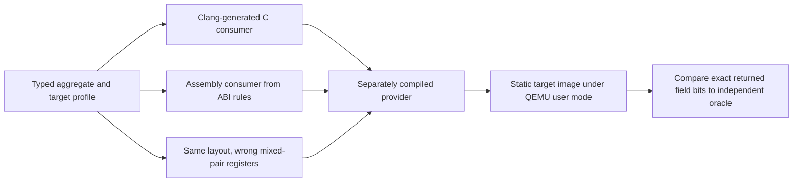

# AArch64 and RV64 aggregate calling conventions

[Plan §6.6](../../../PLAN.md#66-cross-platform-native-interoperability-and-bidirectional-ffi-cross-cutting) · [Backend conformance issue #329](https://github.com/aivibeflow/LLMLang/issues/329)

A foreign caller can reproduce an aggregate's field offsets, size and alignment yet place its values in the wrong argument or result registers. A stable LLMLang FFI profile therefore needs calling rules in addition to a layout contract. This experiment compares independently written assembly consumers and compiled C consumers of the same separately compiled C provider.

The fixture has a mixed pair of one binary64 and one unsigned machine word, a homogeneous pair of two binary64 values, and a result of three machine words. Both pairs are 16 bytes with alignment eight. The three-word result is 24 bytes with alignment eight. Every profile keeps the same declared layouts. The output is a small binary record written through the Linux syscall ABI. No target libc or dynamic loader participates.



| Target ABI | Mixed pair argument and result | Homogeneous binary64 pair | Hidden address for 24-byte result |
| --- | --- | --- | --- |
| AArch64 Linux AAPCS64 | `x0`, `x1` | `d0`, `d1` | `x8`, with ordinary arguments `x0`, `x1` |
| RV64 Linux LP64D | `fa0` for binary64 and `a0` for the word | `fa0`, `fa1` | `a0`, with ordinary arguments `a1`, `a2` |
| RV64 Linux LP64 on `rv64gc` | `a0`, `a1` | `a0`, `a1` | `a0`, with ordinary arguments `a1`, `a2` |

The table gives only the mappings exercised by these calls. The RV64 LP64 profile uses the integer calling convention with a floating-point-capable instruction set. The separate ABI flags report the call profile, independently of which instructions the provider may use internally. [AAPCS64 revision](https://github.com/ARM-software/abi-aa/blob/c51addc3dc03e73a016a1e4edf25440bcac76431/aapcs64/aapcs64.rst) · [RISC-V psABI revision](https://github.com/riscv-non-isa/riscv-elf-psabi-doc/blob/56561cb3e7330fe99a98fd27457229707b2786ae/riscv-cc.adoc)

The three ABIs and two provider optimization modes produce six profiles. Each profile tests both consumers on all 24 vectors. All 288 positive observations preserve the expected binary64 bits and unsigned words, including signed zero in the homogeneous pair. A same-target assembly control selects the wrong register convention for the mixed call while retaining the correct ELF profile. All 144 control vectors differ in the mixed result. Their homogeneous and indirect results still match. Separately, compiling consumer and provider with opposite RV64 floating ABI flags causes LLD to reject the object combination. The link check detects that metadata mismatch. The equal-flag control demonstrates that hand-written calling errors can still compile and link.

An admitted binding needs a target triple, exact call profile, by-value layout and argument and result classifications, including any indirect result location. A profile that does not establish a mapping should preserve that uncertainty instead of inferring it from size and alignment. The experiment gives user-mode emulation and exact static image evidence. Physical-device execution, platform SDK and runtime deployment, variadic boundaries, additional aggregate classification cases and callbacks remain open.

## Reproduce

The host uses Linux x86-64 and CPython 3.12.14. Cross-tool versions are Debian Clang and LLD 19.1.7. The Debian [QEMU 10.0.13 user package](https://deb.debian.org/debian/pool/main/q/qemu/qemu-user_10.0.13+ds-0+deb13u1_amd64.deb) has SHA-256 `ca6ede739327a20ae5a3498230c8a3a9a072c586e131bc6bcc1201eb1725e336`. Use `qemu-aarch64` and `qemu-riscv64` from the extracted distribution. The [runner](FFI-AGGREGATE-CROSS-ABI-01/run.py) generates its vectors, builds static images with no platform sysroot, validates ELF target and flags and compares native output bytes to the independent oracle. The [observations](FFI-AGGREGATE-CROSS-ABI-01/observations.json) retain exact input and expected words, linked image and provider digests, and each wrong mapping observation. Outcome counts are categorical.

```sh
study=research/compiler-and-translation/RT-13/FFI-AGGREGATE-CROSS-ABI-01
python3 -B "$study/run.py" --clang "$CLANG_EXE" --lld "$LLD_EXE" \
  --qemu-aarch64 "$QEMU_AARCH64" --qemu-riscv64 "$QEMU_RISCV64" \
  --out /tmp/rt13-cross-abi.json
cmp "$study/observations.json" /tmp/rt13-cross-abi.json
```

An extracted Clang build can use `--clang-libdir` for its libraries. Preserve the linker executable's `ld.lld` driver name.
