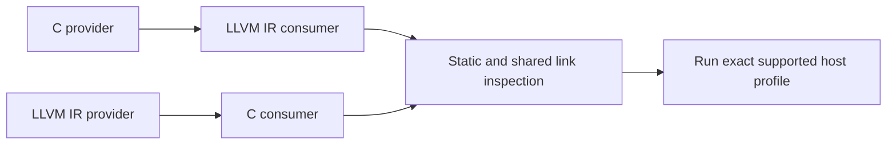

# RT-13 Bidirectional hosted FFI build and conformance boundaries

The same bounded C ABI operation has separate C and explicit LLVM IR providers. Each consumer calls the other implementation. For all 16 hosted target cells, both directions compile and link through a static provider archive and through a target shared-provider route. This yields 64 distinct consumer artifacts, with format and provider dependency evidence for every cell. A missing provider symbol refuses in all 16 profiles.



The operation accepts a 32-bit input and delta through an explicit pointer ABI. On success it updates the slot and records the old and new values in two trace fields. On overflow it leaves the slot and fields untouched and returns a typed error code. The four matched Linux x86-64 consumer artifacts run in separate CPython processes and match 96 exact observations from an independent oracle. Each shared route resolves a provider from its own package directory. The traces cover field contents and publication effects without a concurrent observer.

| Evidence level | Checked scope |
|---|---|
| Native execution | Linux x86-64, both directions and both link modes in this fixture. The archived ELF namespace study separately covers explicit runtime loading and unloading. |
| User-mode emulation | Earlier Linux AArch64 and RV64 provider fixtures check exact glibc and loader identities with independent runtime observations. |
| Cross-link | Both directions and both link modes across all 16 OS/CPU cells. The system-library-free route checks artifact format and exact provider dependency. |
| Native OS SDK and deployment | The relevant platform's approved SDK, loader and execution environment must supply separate evidence before a hosted platform claim. |

The earlier native studies retain wrong call convention, symbol version, stale provider and ownership/cancellation controls. Their evidence levels remain tied to their original targets. [Hosted profile matrix](RT-13-FFI-HOSTED-PROFILE-MATRIX-2026-11-25.md) · [Linux triple execution](RT-13-FFI-LINUX-TRIPLE-REPLAY-2026-11-25.md) · [ELF runtime loader](RT-13-FFI-LOADER-SCOPE-2026-11-25.md) · [Tagged calls](RT-13-FFI-TAGGED-SUM-AND-CALL-ABI-2026-11-25.md) · [Allocator pairing](RT-13-FFI-ALLOCATOR-LEASES-2026-11-25.md) · [Callback boundaries](RT-13-FFI-CALLBACK-LIFETIME-2026-11-25.md)

The C and LLVM modules are experimental counterparts for a bounded interoperability contract. A production LLMLang emitter, hosted SDK execution outside the admitted scopes, signed platform rollout and per-platform failure and lifetime suites remain separate. The compatibility audit should preserve exact artifact direction, profile, link mode, SDK, evidence level and unresolved runtime assumptions.

Two hash seeds agree on the [ledger](FFI-BIDIRECTIONAL-HOSTED-01/evidence.json) with Debian Clang and LLD 19.1.7, llvm-ar, llvm-readobj and CPython 3.12.14.

```sh
LC_ALL=C PYTHONHASHSEED=37 python -B research/compiler-and-translation/RT-13/FFI-BIDIRECTIONAL-HOSTED-01/check.py \
  --clang /path/to/clang-19 --elf /path/to/ld.lld-19 --macho /path/to/ld64.lld-19 \
  --coff /path/to/lld-link-19 --readobj /path/to/llvm-readobj-19 --ar /path/to/llvm-ar-19
```
