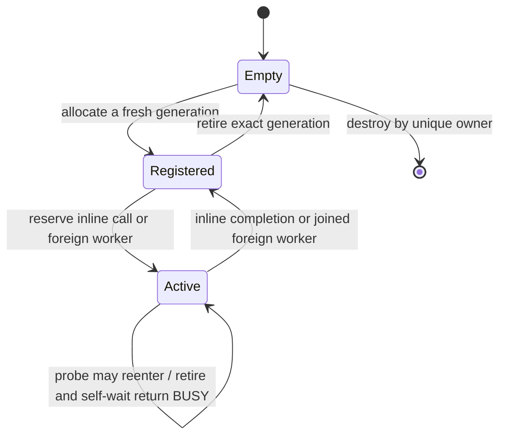

# Foreign-thread FFI callbacks and registration lifetime

[Plan §6.6](../../../PLAN.md#66-cross-platform-native-interoperability-and-bidirectional-ffi-cross-cutting) · [Backend conformance issue #329](https://github.com/aivibeflow/LLMLang/issues/329)

An LLMLang adapter may register code and state with a native provider and receive calls on another thread. The registration remains live through native completion. A callback can reenter an allowed observation, and errors need an agreed return representation. Premature retirement can invalidate foreign state, while an unbounded blocking operation can deadlock if used from its own callback.

The fixture shares one native C provider and driver across three independently implemented callback bodies. The [C consumer](FFI-CALLBACK-LIFETIME-01/consumer.c) returns a status directly. The [CPython consumer](FFI-CALLBACK-LIFETIME-01/consumer.py) uses a retained `ctypes` callback and context, including a native-thread check against the registering Python thread. The [Rust consumer](FFI-CALLBACK-LIFETIME-01/consumer.rs) uses an `extern "C"` function with `catch_unwind` inside the callback. The C driver exercises the same lifecycle for every route.



The registration identity is the instance and its current generation. Each instance starts at generation one and the primary instance later renews at generation two. The provider rejects the retired generation even when the same callback function is installed again. It releases its mutex before calling the foreign function, so the callback can perform a scoped reentrant observation. Retirement, replacement and destruction refuse while a call is reserved. A callback's attempt to finish its own invocation also returns `BUSY`. The unique owner controls destruction, and context bytes stay live until after completion.

Each driver case registers two distinct native instances and starts both workers behind separate condition barriers. One worker is released and joined first. The still-reserved peer remains busy, and the second join produces its own context-dependent result. The test reverses that order and uses independent values in the two contexts. It invokes the primary callback inline before dispatch and again after renewal. Successful return values encode the native thread class, input and context. The independent Python oracle computes them without reading the provider's state.

| Route | Driver cases | Completed upcalls | Typed errors |
| --- | ---: | ---: | ---: |
| Native C | 42 | 144 | 24 |
| CPython `ctypes` | 42 | 144 | 24 |
| Rust with `panic=unwind` | 42 | 144 | 24 |
| Total | 126 | 432 | 72 |

The corpus crosses seven inputs, two join orders and three initial context values. All 504 returns agree with the independent oracle. In each of the three consumers the input `-7` produces the defined `-77` result. C returns it directly, Python catches the seeded `ValueError`, and Rust catches the seeded panic within the foreign function. The Rust `panic=abort` control completes for a success input and terminates by `SIGABRT` in the two cases that trigger the failure. One of those failures occurs on a foreign worker. That distinction makes the Rust panic profile part of the adapter contract.

The candidate FFI boundary needs an exact callback signature and context lifetime, an instance-scoped generation, explicit reservation and join, documented reentry permissions and typed error conversion. Unique ownership of the final destructor is a premise. The experiment covers two concurrent reservations with deterministic joins and separately built Linux processes. It leaves multiple loaded runtimes, arbitrary concurrent calls after destruction, allocator or GC interactions, process shutdown, cross-platform ABIs, Go and JVM routes, and timing outside the measured scope. The wider FFI-06 matrix remains open.

## Reproduce

Linux x86-64, GCC 14.2.0, glibc 2.41, Rust 1.85.1 at `4eb161250` and CPython 3.12.14. The [runner](FFI-CALLBACK-LIFETIME-01/run.py) builds the common library and consumers in temporary storage, verifies required dynamic exports and compares live observations. The [ledger](FFI-CALLBACK-LIFETIME-01/observations.json) preserves every result, registration generation, process-control disposition and library hash. These are categorical outcome counts.

```sh
study=research/compiler-and-translation/RT-13/FFI-CALLBACK-LIFETIME-01
python3 -B "$study/run.py" --rustc "$RUSTC_EXE" --out /tmp/rt13-ffi-callbacks.json
cmp "$study/observations.json" /tmp/rt13-ffi-callbacks.json
```
