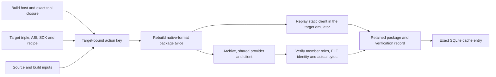

# Cross-ABI FFI packages and exact build-cache admission

[Plan §6.6](../../../PLAN.md#66-cross-platform-native-interoperability-and-bidirectional-ffi-cross-cutting) · [Backend conformance issue #329](https://github.com/aivibeflow/LLMLang/issues/329) · [Aggregate-calling baseline](RT-13-FFI-AGGREGATE-CROSS-ABI-2026-11-25.md)

One build host can produce several incompatible target libraries from identical source bytes. A target triple can also cover more than one call profile. The package and action-cache boundary needs to identify the specific target and distinguish the recipe, published outputs and their verification record. The companion package study tests the common artifact cache over ELF, Mach-O and PE/COFF. This study varies the ABI within one RISC-V target triple and observes the static client. [FFI target package cache](RT-13-FFI-TARGET-PACKAGE-CACHE-2026-11-25.md)

This pilot uses one x86-64 build host, AArch64 AAPCS64, and two RV64 ABI profiles for the same `riscv64-linux-gnu` triple. The provider is already checked at the call boundary by the earlier aggregate study. Each target and compiler optimization produces a deterministic archive with one provider object, a PIC shared provider with no dynamic library requirements, and a statically linked consumer. The consumer uses Linux syscalls and no external SDK. The action input records that explicit SDK disposition, the tool binaries and resolved runtime dependency digests, the target ABI, exact source and recipe hashes and scoped compiler and linker settings. The package result records three named output roles, exact artifact digests and the emulator identity and result used for verification.



The source fixture contains 24 input vectors and an independent expected output. Two fresh builds for each of six target and optimization choices reproduce all package bytes. The harness inspects 36 artifact roles and matches all 288 emulated static-client observations. The shared providers receive structural closure and header checks here. The experiment keeps that evidence separate from the executed client. The RV64 non-PIC control is refused by LLD when offered as a shared provider because the object contains absolute relocations.

| Action key or admission check | Checked result |
| --- | --- |
| Build host and source bytes | Five false reuse hits among six requests, including wrong CPU or wrong optimization |
| Target triple, optimization and source bytes | Two false reuse hits between RV64 LP64D and LP64 |
| Full target, toolchain and recipe identity | Six cold misses, six exact hits after publication and six exact hits after reconnecting SQLite |
| Changed SDK or recipe descriptor | An unseen SDK gets a cold miss. A mismatched descriptor under a known key refuses. |
| Missing artifact role or changed CAS bytes | Both refuse |
| Self-consistent CAS with wrong ELF format or ABI | Both refuse after independent artifact inspection |
| Same ABI and matching content hash produced by another recipe | ABI inspection succeeds. The receipt comparison refuses the substituted bytes. |

The cache stores package manifests and content-addressed binaries in one local SQLite transaction. Fresh reads check the requested action, the complete role set, actual bytes and the expected ELF machine, type and ABI flags, including the object inside an archive. The replay compares against the expected exact package record from its controlled dual builds. A production cache would need an independent authority for that receipt and the integrity of its inputs. ELF flags cannot establish behavioral correspondence or the producing recipe on their own.

A candidate package manifest can publish the artifact and compatibility claims for its selected target, with execution evidence as a distinct receipt. The build-cache key depends on exact generation inputs and target settings. Verifying or replacing package evidence can bind a different checker without changing generated binary identity. Non-freestanding SDK invocation, arbitrary compiler plugins, library search races, signature policy, remote CAS and native hardware execution remain open. Existing evidence records the additional Windows, Mach-O and Linux package profiles separately. [Hosted Linux triple replay](RT-13-FFI-LINUX-TRIPLE-REPLAY-2026-11-25.md) · [Windows COFF profiles](RT-13-FFI-WINDOWS-COFF-PROFILES-2026-11-25.md) · [Mach-O profiles](RT-13-FFI-MACHO-PROFILES-2026-11-25.md)

## Reproduce

Linux x86-64, CPython 3.12.14, SQLite 3.53.1, Debian Clang and LLD 19.1.7, GNU ar 2.44 and QEMU 10.0.13. Use the [pinned cross-tool profile](RT-13-FFI-AGGREGATE-CROSS-ABI-2026-11-25.md#reproduce). The [runner](FFI-CROSS-BUILD-CACHE-01/run.py) builds independent directories, captures the target fields and verifies cache inputs and results. The [ledger](FFI-CROSS-BUILD-CACHE-01/observations.json) records exact toolchain, manifest and artifact hashes, the categorical decisions and all counts.

```sh
study=research/compiler-and-translation/RT-13/FFI-CROSS-BUILD-CACHE-01
python3 -B "$study/run.py" --clang "$CLANG_EXE" --lld "$LLD_EXE" \
  --qemu-aarch64 "$QEMU_AARCH64" --qemu-riscv64 "$QEMU_RISCV64" \
  --out /tmp/rt13-cross-ffi-cache.json
cmp "$study/observations.json" /tmp/rt13-cross-ffi-cache.json
```

Use `--clang-libdir` for an extracted Clang distribution if needed.
