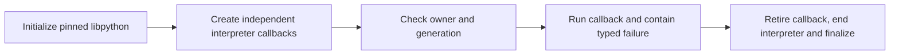

# RT-13 Embedded CPython callback ownership and runtime lifecycle

A native host can load CPython and hold callbacks from several interpreters. A callback handle must bind the owning runtime instance, interpreter and live generation before invocation. Its teardown needs a point after which an older generation cannot reenter code.



The Linux C host links and resolves the exact `libpython3.12.so.1.0`. It creates two subinterpreters and loads the same Python callback in each. Their counters advance independently. The host contains `ValueError` while that callback's owner is current, clears the interpreter exception, and returns a typed outcome. It retires the first interpreter, checks a stale handle, recreates that slot, refuses the old generation again and calls the new owner. The second interpreter retains its original count. The host retires both interpreters, calls `Py_FinalizeEx`, then starts the runtime again in the same process.

Both native GCC O0 and O2 builds match the independent trace across two initialization and shutdown cycles each. The 36 observations include 20 callback values, four contained errors, eight stale refusals and four finalized cycles. This fixture confines Python object use to the selected interpreter on one native thread, with the standard shared-GIL route and pure Python callback code. Arbitrary extension modules and simultaneous interpreter execution require separate evidence.

Other archived native scopes cover foreign-thread reentry, per-provider state, propagation through C++, Rust, Go and Java bridges, cancellation and join-before-teardown. The combined evidence favors an explicit instance and lifetime boundary checked before invocation, a host-specific exception adapter and closure only after every admitted callback has settled. [Foreign-thread lifetimes](RT-13-FFI-CALLBACK-LIFETIME-2026-11-25.md) · [Loaded-provider callbacks](RT-13-FFI-LOADED-CALLBACK-2026-11-25.md) · [Go and JVM callbacks](RT-13-FFI-MANAGED-CALLBACKS-2026-11-25.md)

Use GCC 14.2.0, GNU readelf 2.44 and CPython 3.12.14 with its embedding headers and shared library. Two hash seeds produce the same [ledger](FFI-EMBEDDED-CPYTHON-01/evidence.json) on the captured platform. Rebuilding with another installation path can change the linked host digest.

```sh
LC_ALL=C PYTHONHASHSEED=37 python -B research/compiler-and-translation/RT-13/FFI-EMBEDDED-CPYTHON-01/check.py \
  --python-config /path/to/python3-config
```
