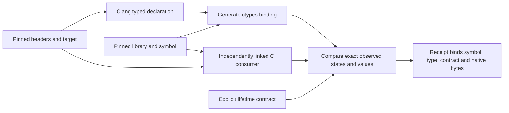

# Importing C declarations and checking foreign handle lifetimes

[Plan §6.6](../../../PLAN.md#66-cross-platform-native-interoperability-and-bidirectional-ffi-cross-cutting) · [Backend conformance issue #329](https://github.com/aivibeflow/LLMLang/issues/329)

An imported C signature can supply enough information for a call adapter while leaving object ownership, timing of destruction and persistent context state unknown. The distinction matters to LLMLang when a generated caller must account for transitions or when it wants to reuse proof evidence after rebinding a provider.

The [fixture translation unit](FFI-HEADER-IMPORT-01/input.c) includes POSIX, SQLite and OpenSSL headers. A Clang AST import reads named nonvariadic functions and their result and parameter types, preserves the declared pointer and function names, and emits the corresponding Python `ctypes` carriers. Opaque provider pointer types retain their original declaration identities in the inventory. The generated call uses the pinned native symbols. An independent C consumer compiles against the original headers and links to the same exact library files. The experiment checks every paired result against a small expected state or byte observation.



| Equal declared shape | Checked pair observations | Differences hidden by shape |
| --- | ---: | ---: |
| `int (sqlite3 *)` for `sqlite3_close` and `sqlite3_close_v2` | 12 | 8 |
| `int (EVP_MD_CTX *, unsigned char *, unsigned int *)` for `EVP_DigestFinal` and `EVP_DigestFinal_ex` | 4 | 4 |
| `int (int)` for `close` and `dup` | 4 | 4 |

Across 40 named calls per route, the generated and native C observations match. SQLite runs with zero, one and two prepared statements. With a live statement, `sqlite3_close` returns `SQLITE_BUSY`, the statement remains usable, and the ordinary close succeeds after finalization. `sqlite3_close_v2` returns success and defers final destruction until its statements are finalized. The fixture retires the caller's connection handle on that success and reads the already-held statements independently. With no statements both paths close successfully. [SQLite close contract](https://sqlite.org/c3ref/close.html)

The OpenSSL calls produce identical expected SHA-256 bytes for each input. `EVP_DigestFinal_ex` retains the digest selection, so an initialization with implicit selection can run it again. `EVP_DigestFinal` clears the context and the same implicit initialization fails. The fixture checks configured state, the initialization outcome and the second digest when available. The two POSIX calls respectively close or preserve the original descriptor. The duplicate remains able to receive bytes from the same pipe after the original is closed. [OpenSSL digest contract](https://docs.openssl.org/3.5/man3/EVP_DigestInit/) · [POSIX duplicate descriptor](https://pubs.opengroup.org/onlinepubs/9799919799/functions/dup.html)

The importer resolves all 19 supported declarations. It rejects the variadic `open` signature and the function-pointer parameter of `sqlite3_exec` in this subset. A separate missing-symbol query also refuses. The six [scoped contracts](FFI-HEADER-IMPORT-01/contracts.json) supply behavior that declaration parsing alone cannot determine. Eighteen single-field identity changes refuse reuse when the symbol, explicit contract or native library digest changes. The observed histories concern this Linux ABI, these library builds and the exercised inputs. Other C declarators, other platform ABIs, richer contracts, asynchronous lifetime and production provider admission remain open.

## Reproduce

Linux x86-64, CPython 3.12.14, GCC 14.2.0, Debian Clang 19.1.7 `3+b1`, glibc 2.41, SQLite 3.46.1 `3.46.1-7+deb13u2`, and OpenSSL 3.5.7 `3.5.7-1~deb13u3`. Use the header from the [matching SQLite development package](https://deb.debian.org/debian/pool/main/s/sqlite3/libsqlite3-dev_3.46.1-7+deb13u2_amd64.deb), SHA-256 `56e1945d52292b506c1f0bcb77543fea289ccee857c478dcddded40226e1594d`, with the runtime library. The runner verifies that the C consumer resolves the same library files used by the generated binding. The [observations](FFI-HEADER-IMPORT-01/observations.json) pin the 128 preprocessing inputs, native libraries, declaration inventory, exact receipts and categorical outcomes.

```sh
study=research/compiler-and-translation/RT-13/FFI-HEADER-IMPORT-01
python3 -B "$study/run.py" --clang "$CLANG_EXE" --sqlite-include "$SQLITE_INCLUDE" \
  --sqlite-library "$SQLITE_LIBRARY" --crypto-library "$CRYPTO_LIBRARY" \
  --libc-library "$LIBC_LIBRARY" --out /tmp/rt13-ffi-header-import.json
cmp "$study/observations.json" /tmp/rt13-ffi-header-import.json
```

For an extracted Clang distribution, add `--clang-libdir` with its shared-library directory. The inventory addresses the compiler resource inputs relative to their toolchain directory.
