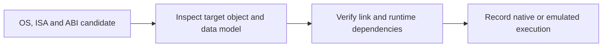

# RT-13 Hosted FFI target profile matrix

A target triple, object file, linked program and native execution establish different parts of an FFI profile. The [machine-readable matrix](FFI-HOSTED-PROFILE-MATRIX-01/evidence.json) registers all 16 PLAN cells with their target spelling, declared call convention, deployment or release target, libc family, data model, object format and exact observed boundary. One compiler probe and its wrong-width control run for every listed cell.

| OS and target version in this study | CPU cells | Format, data model and libc profile | Strongest retained interoperability evidence |
|---|---|---|---|
| Linux, Debian glibc 2.41 profiles | x86-64, AArch64, RV64 | ELF, LP64, glibc. A separate x86-64 study checks musl 1.2.5. | Native x86-64. QEMU Linux-user AArch64 and RV64. |
| macOS deployment 13.0 | x86-64, AArch64 | Mach-O, LP64, Apple libSystem candidate | Linked static and dylib artifacts. Deployment metadata captured. |
| Windows, SDK version unselected | x86-64, AArch64 | PE/COFF, LLP64, UCRT/MSVC candidate | Linked static, DLL, import library and consumers. OS SDK and execution unverified. |
| FreeBSD 14.4 target spelling | x86-64, AArch64 | ELF, LP64, FreeBSD libc candidate | Target objects and layout only. |
| Android API 29 target spelling | x86-64, AArch64 | ELF, LP64, Bionic candidate | Target objects and layout only. |
| iOS deployment 16.0 | AArch64 | Mach-O, LP64, Apple libSystem candidate | Linked static and dylib artifacts. SDK, signing, packaging and execution unverified. |
| OpenBSD 7.7 target spelling | x86-64, AArch64 | ELF, LP64, OpenBSD libc candidate | Target objects and layout only. |
| NetBSD 10.1 target spelling | x86-64, AArch64 | ELF, LP64, NetBSD libc candidate | Target objects and layout only. |

The BSD and Android version strings are inputs to the compiler probe. The SDK and library identities for those cells remain unresolved. Selection of supported versions and native runners remains a human gate. [FreeBSD releases](https://www.freebsd.org/releases/) · [Android NDK ABIs](https://developer.android.com/ndk/guides/abis) · [OpenBSD 7.7](https://www.openbsd.org/77.html) · [NetBSD 10.1](https://www.netbsd.org/releases/formal-10/)



## Reproduced object checks

All 16 target objects are little-endian and use 64-bit pointers aligned to eight bytes. The selected record occupies 16 bytes, has eight-byte alignment and places its flags at offset eight. Both Windows cells use a 32-bit `long`, while the other 14 use a 64-bit `long`. Each intentionally mismatched C data model refuses compilation. Equal record layout still leaves different calling behavior. The probe's Windows x64 LLVM IR uses hidden result storage, and the Windows ARM64 route returns this pair without it. General aggregate, floating-point, variadic and callback details need their own conformance evidence.

The probe uses Clang and llvm-readobj 19.1.7 with no system headers. For COFF, disabling incremental-linker compatibility yields zero object timestamps, preserving the per-cell artifact digest across two runs. The earlier profiles provide exact dynamic-loader and libc identities for the three Linux cells and link-format and deployment checks for the Apple and Windows cells. [Linux FFI](RT-13-FFI-LINUX-TRIPLE-REPLAY-2026-11-25.md) · [Mach-O FFI](RT-13-FFI-MACHO-PROFILES-2026-11-25.md) · [COFF FFI](RT-13-FFI-WINDOWS-COFF-PROFILES-2026-11-25.md) · [Linux libc comparison](../../runtime-and-systems/RT-10/RT-10-POSIX-CROSS-LIBC-2026-11-25.md)

Each admitted platform claim needs exact OS or deployment version, SDK and sysroot, artifact format, compiler and linker, C library and loader, failure and ownership contracts, selected interoperability modes and actual execution scope. This matrix supplies target definitions and controlled observations for the research decision.

```sh
LC_ALL=C PYTHONHASHSEED=37 python -B research/compiler-and-translation/RT-13/FFI-HOSTED-PROFILE-MATRIX-01/check.py \
  --clang /path/to/clang-19 --readobj /path/to/llvm-readobj-19
```
