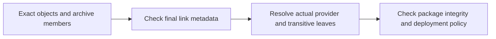

# RT-13 FFI linking, loading and package signature boundaries

The research compares distinct points where an FFI link can acquire its provider. A static archive supplies object members to the linker. A platform import library can supply records that leave a runtime dependency. A dynamic API can resolve a named symbol and version later, in a designated loader context. Package qualification also depends on artifact identity, complete runtime closure and release policy.

| Scope | Checked evidence |
|---|---|
| ELF static, load-time shared, and runtime loading | Version scripts, symbol versions, exact resolved leaves and namespace identity distinguish the tested providers. A base namespace can reuse an earlier leaf despite a new top-level inspection. Close observations separate a removed library from retained NODELETE state. [ELF loader scope](RT-13-FFI-LOADER-SCOPE-2026-11-25.md) |
| PE/COFF static archives and import libraries | The final executable preserves a DLL requirement for the import-library route. Wrong-architecture import records can give identical link outputs and require independent load-package identity checking. [PE/COFF profiles](RT-13-FFI-WINDOWS-COFF-PROFILES-2026-11-25.md) |
| Mach-O static and dynamic artifacts | Deployment version, architecture and platform evidence live in the load and package metadata. Matching install names can hide a different CPU or minimum release. [Mach-O profiles](RT-13-FFI-MACHO-PROFILES-2026-11-25.md) |
| Mach-O code-directory seals | Six newly linked dylibs compare explicit ad-hoc and unsigned modes for macOS x86-64, macOS ARM64 and iOS ARM64. Every present page hash verifies, and each exact single-byte text control fails its corresponding page. |



## Code-directory check

| Profile | Verified signed pages | Changed-text page identified | Unsigned comparison |
|---|---:|---:|---|
| macOS x86-64 | 2 | 0 | No signature load command |
| macOS ARM64 | 5 | 0 | No signature load command |
| iOS ARM64 | 9 | 4 | No signature load command |

The fresh fixture examines the exact `LC_CODE_SIGNATURE` ranges and computes every SHA-256 code page hash directly. The negative control changes one byte in the temporary code section while preserving the parsed load commands and signature bytes. Its page comparison rejects the changed content. An ad-hoc seal supplies local integrity evidence. Signing authority, entitlements, notarization, package policy, native enforcement and Windows Authenticode need their own evidence. [Apple code signing hashes](https://developer.apple.com/documentation/technotes/tn3126-inside-code-signing-hashes)

An FFI package can report a static provider member, declared dynamic dependency, actual symbol resolution and package eligibility independently. Native execution holds only for the archived ELF routes under their exact environment. Production signing and deployment depend on the selected platform and human-gated access.

Use Debian Clang and Mach-O LLD 19.1.7 with CPython 3.12.14. Two hash seeds produce identical [code-directory evidence](FFI-MACHO-CODE-DIRECTORY-01/evidence.json).

```sh
LC_ALL=C PYTHONHASHSEED=37 python -B research/compiler-and-translation/RT-13/FFI-MACHO-CODE-DIRECTORY-01/check.py \
  --clang /path/to/clang-19 --linker /path/to/ld64.lld-19
```
