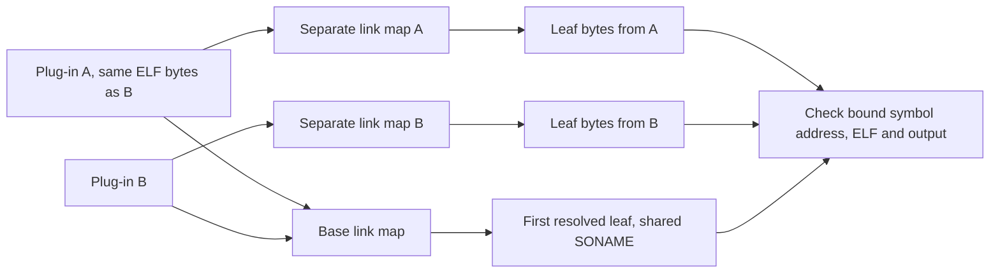

# Versioned native FFI and loader namespaces on Linux

[Plan §6.6](../../../PLAN.md#66-cross-platform-native-interoperability-and-bidirectional-ffi-cross-cutting) · [Backend validation issue #329](https://github.com/aivibeflow/LLMLang/issues/329)

An LLMLang binding can name a shared library and a versioned operation while the dynamic loader resolves a different transitive provider. If that provider participates in the behavior or assumptions of the call, the evidence must cover the actual resolution. A graph that records only the primary plug-in's hash and the requested symbol version omits this dependency.

This bounded experiment compares a static archive, an ELF executable with a link-time shared dependency, two late-loaded plug-ins in the base namespace, and the same plug-ins loaded in separate glibc namespaces. A loader namespace has its own link map and symbol resolution scope. The three synthetic provider directories contain byte-identical plug-ins. Each plug-in has `DT_NEEDED libfixture_leaf.so` and `DT_RUNPATH $ORIGIN`. Their leaf libraries share the SONAME and exported function shape. Providers A and C both return 11 but carry different hidden marker bytes. B returns 29. The versioned operation is `input + provider() + 100` for `FIXTURE_1.0` or `input + provider() + 200` for the default, `FIXTURE_2.0`.



In the base namespace, the earlier load's leaf satisfies the later plug-in's dependency in this fixture even with `RTLD_LOCAL`. The runtime test identifies the actual bound function using its address and `dladdr`, then checks the resolved leaf path and file digest. `dlmopen(LM_ID_NEWLM, ...)` creates separate namespaces for the two loads. It resolves each leaf from the requested provider directory.

| Route | Scoped observation |
| --- | --- |
| Static provider archive and ordinary executable | Both explicitly named implementations match the integer oracle for all inputs. The archive contributes `operation.o` and `leaf.o`. The executable retains its ordinary shared libc dependency. |
| Link-time shared dependency | The executable requires `liboperation.so`, which requires the leaf. All 21 calls resolve the intended leaf when each executable runs in its own process. |
| Runtime load in the base namespace | Across 42 processes, the second plug-in always binds the first leaf. Twenty-eight second calls differ from the intended result. Fourteen return the intended value with different leaf bytes. |
| Runtime load with `RTLD_NODELETE` on the first plug-in | The same 42 second-load observations occur. The first plug-in and its leaf stay mapped after both handles close. |
| Runtime load in separate namespaces | Across 42 processes, both plug-ins bind their own leaves and match the source oracle. After the first handle closes, the second plug-in continues to use its own leaf. |

The 126 runtime processes cover three modes, six ordered pairs and seven inputs. Each process checks three call phases and three mapping snapshots, for 378 of each. Every phase checks the default and explicit versions independently and confirms that `FIXTURE_3.0` has no symbol. Without `RTLD_NODELETE`, the normally loaded first plug-in unmaps after close while its leaf remains mapped through the second handle. The separate namespace route unmaps the first plug-in and first leaf immediately after that handle closes in this fixture. The harness uses exact paths from its own process mappings and calls only through a live handle.

| Identity or behavior check on the second runtime binding | Accepted cases out of 126 |
| --- | ---: |
| Plug-in hash, requested symbol, and supported version | 126 |
| Intended integer behavior for the seven inputs | 70 |
| Exact requested leaf hash at the resolved symbol address | 42 |

The 28 behavior matches with the wrong identity arise from A and C. If a receipt is scoped to exact provider bytes, even matching output in a finite corpus supplies no evidence that the requested provider ran. A candidate ELF binding receipt should record the link mode, effective namespace or resolution context, version, the actual transitive identities and the loader/toolchain profile. A static archive identifies linked object contributors. A link-time shared dependency records a dynamic reference which still needs runtime resolution, and late-loaded plug-ins can depend on the current link map. Separate namespaces can support this form of provider isolation. Their lifecycle and compatibility costs need measurement on realistic providers.

This experiment uses simple C operations, native Linux/glibc and ordinary GNU ELF versioning. It tests controlled local files and process mappings. Cross-platform import libraries and signing, other libcs, concurrency, TLS, separate libc instances, leaked handles, swapping mapped bytes and proof of arbitrary foreign implementations remain open. The results do not change the status of the wider FFI-05 matrix. [GNU loader interfaces](https://man7.org/linux/man-pages/man3/dlopen.3.html) · [GNU version scripts](https://sourceware.org/binutils/docs/ld/VERSION.html)

## Reproduce

Measured on x86-64 Linux with GCC 14.2.0 (Debian 14.2.0-19), GNU binutils 2.44, glibc 2.41 and CPython 3.12.14. The [runner](FFI-LOADER-SCOPE-01/run.py) builds in a fresh directory, starts independent processes, inspects dynamic sections and symbols, and compares their results with the integer oracle. It records its tool versions, exact plug-in, leaf and archive digests, dependency and export inventories, call values, resolved leaf digests and mapping snapshots. Absolute temporary paths and namespace pointer values are omitted. The tables report categorical observations and counts with no timing claim.

```sh
study=research/compiler-and-translation/RT-13/FFI-LOADER-SCOPE-01
python3 -B "$study/run.py" --out /tmp/rt13-ffi-loader.json
cmp "$study/observations.json" /tmp/rt13-ffi-loader.json
```

[Machine-readable observations](FFI-LOADER-SCOPE-01/observations.json)
