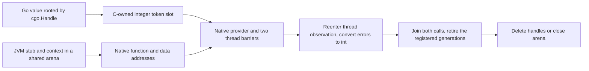

# Go and JVM callbacks from native Linux threads

[Plan §6.6](../../../PLAN.md#66-cross-platform-native-interoperability-and-bidirectional-ffi-cross-cutting) · [Backend conformance issue #329](https://github.com/aivibeflow/LLMLang/issues/329) · [C, CPython and Rust baseline](RT-13-FFI-CALLBACK-LIFETIME-2026-11-25.md)

This experiment reuses the exact C provider and lifecycle driver and adds Go cgo and Java Foreign Function and Memory (FFM) upcalls. It asks how each managed runtime keeps callback context live, recognizes a native thread, reenters a permitted operation and contains a failure before returning to C. The source contract and integer oracle are unchanged from the baseline, and the rebuilt provider must match the baseline's SHA-256.



The Go wrapper retains each context in `runtime/cgo.Handle`. The C bridge stores the integer handles in native slots for the duration of the whole driver call. It does not store a Go pointer. Go checks the callback's Linux TID against the pinned registering thread. A zero-payload callback forces Go garbage collection before retrieving its rooted context. The context handles are deleted after the native driver joins both workers and retires their registrations. The checked routes use default cgo and its compile-time `cgocheck2` experiment.

The Java wrapper uses `Arena.ofShared` for the native library, upcall stub and both context allocations. It checks the managed thread identity against the native thread class returned by the provider. The callback can reenter its narrow C functions through the configured downcall handles. It reads the context through an explicitly sized view of the native address. The arena outlives the call and closes after its two worker joins. The tested Java SE 21 APIs are preview features. The two profiles use `-Xint` and `-Xcomp -Xbatch`.

| Route | Driver cases | Normal callback returns | Typed callback errors |
| --- | ---: | ---: | ---: |
| Go cgo | 42 | 144 | 24 |
| Go with `cgocheck2` | 42 | 144 | 24 |
| Java FFM, interpreted | 42 | 144 | 24 |
| Java FFM, forced compilation | 42 | 144 | 24 |
| Total | 168 | 576 | 96 |

Every route reproduces the earlier C ledger and the independent expected integer values. The native driver continues to require busy responses for premature retirement, replacement and destruction, as well as for self-joining from the callback. After completion and renewal the stale generation refuses. Contexts remain distinct even when two native instances are registered at the same numeric generation, and joining one leaves the peer reserved.

Go's contained panic and Java's caught exception return the explicit `-77` value. With containment removed, the fixture launches fresh processes for failures on the registering thread and on a foreign worker. Go exits with status 2 and names the panic. The Java VM exits with status 1 and reports an unrecoverable uncaught exception. A separate successful Go control omits the bridge's native `fflush` while stdout is captured. It exits 0 with zero output bytes. The working bridge explicitly flushes the native transcript before returning its result.

LLMLang callback bindings need to bind the language runtime profile, ABI carriers, rooting or storage policy, registration generation, reentry privileges, and error conversion semantics. The fixture exercises callbacks from already started runtimes with a single controlled provider. Starting or destroying an embedded runtime from a C host, additional toolchain versions, general GC safety, production concurrent shutdown and cross-platform behavior remain open. The managed lifetime relies on the tested native join and unique owner conditions.

## Reproduce

Linux x86-64 with GCC 14.2.0, glibc 2.41, Go 1.27.4, OpenJDK 21.0.13 and CPython 3.12.14. The runner uses the JDK compiler module with `--source 21 --enable-preview` and enables native access for the running Java fixture. It builds and runs in temporary directories using the adjacent baseline source. The [ledger](FFI-MANAGED-CALLBACK-01/observations.json) records all return values and generations, provider and baseline digests, and process-control results. The comparison is categorical.

```sh
study=research/compiler-and-translation/RT-13/FFI-MANAGED-CALLBACK-01
python3 -B "$study/run.py" --go "$GO_EXE" --out /tmp/rt13-managed-callbacks.json
cmp "$study/observations.json" /tmp/rt13-managed-callbacks.json
```
