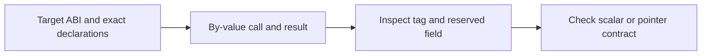

# RT-13 Tagged sums and calling-convention boundaries

A tagged C ABI value binds byte layout, active variant and call convention. Its representation contains a 32-bit tag and reserved field, followed by an aligned union of a signed integer, binary64 value and pointer. The candidate validates the tag before reading that union member. The same C layout can be passed and returned by different machine conventions.



Separate provider and consumer builds exercise System V AMD64 and Microsoft x64 declarations on native Linux x86-64. Ten inputs cover signed extremes, finite binary64, out-of-range and NaN values, pointer identity, null pointer, reserved bits and unknown tags. Across GCC O0 and O2, all 40 results match the independent trace. The compiler refuses assigning the Microsoft x64 function to the System V function-pointer type in both builds. The pointer case checks identity and does not dereference foreign bytes.

| ABI concern | Reconciled checked scope |
|---|---|
| Fixed scalar, pointer, record and sum layout | Hosted object matrix and the native sum fixture check exact size, alignment, field offset and variant types. [Hosted profile matrix](RT-13-FFI-HOSTED-PROFILE-MATRIX-2026-11-25.md) |
| Aggregate arguments and return | Native System V and Microsoft x64 routes discriminate identical layout with different calling conventions. Independent AArch64 and RV64 consumers check mixed and homogeneous aggregate carriers under their pinned profiles. [By-value call conventions](RT-13-BY-VALUE-CALL-ABI-2026-11-25.md) · [Cross-ABI aggregates](RT-13-FFI-AGGREGATE-CROSS-ABI-2026-11-25.md) |
| Freestanding ARM ABI | STM32F103 and STM32F407 probe Thumb-2 and exact soft/hard call profiles. The Cortex-M4 softfp control uses a different parameter convention. [MCU target manifests](../../runtime-and-systems/RT-37/RT-37-MCU-TARGET-MANIFESTS-2026-11-25.md) |
| Variadic boundaries | Compiler promotions and independent native or emulated assembly observations distinguish admitted register and stack profiles. [Variadic ABI](RT-13-FFI-VARIADIC-ABI-2026-11-25.md) |
| Callback signatures and state | The managed and native callback studies bind exact bridge signatures, loaded provider and lifetimes. [Loaded-provider callbacks](RT-13-FFI-LOADED-CALLBACK-2026-11-25.md) · [Go and JVM callbacks](RT-13-FFI-MANAGED-CALLBACKS-2026-11-25.md) |

The candidate admission record binds target profile, layout, argument and result classification, active variant, variadic restrictions and callback type. Matching size and alignment supply a layout fact. Unknown carrier mappings and invalid tag values preserve explicit refusal. The Linux Microsoft x64 call experiment covers the convention inside that process. Native Windows loading and broader platform ABI support require their own evidence.

Use GCC 14.2.0, glibc 2.41 and CPython 3.12.14. Two hash seeds reproduce the [ledger](FFI-TAGGED-SUM-01/evidence.json).

```sh
LC_ALL=C PYTHONHASHSEED=37 python -B research/compiler-and-translation/RT-13/FFI-TAGGED-SUM-01/check.py
```
