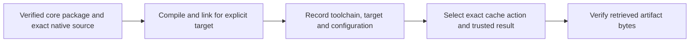

# RT-13 Target-specific FFI builds through package and cache admission

A shared semantic package can deliver different native artifacts to different targets. The action key needs to bind the exact source, target profile, ABI-relevant configuration, compiler and linker, and declared runtime closure. Package identity and optional cache-result admission stay independent.



On an x86-64 Linux build host, one C provider cross-builds to ELF x86-64, ELF AArch64, Mach-O ARM64 and PE/COFF x86-64. Each route uses an exact compiler target and linker entry point. It inspects object format and the linked provider's dependency table. The tiny provider uses the scoped system-library-free build configuration. The result record carries the source and package root as separate inputs.

The fixture reuses the existing RT-12 static package verifier and RT-11 detached action cache. The package verifies to the same root and logical index across 32 delivery checks. The selective client retrieves four exact targets, one per action. Twenty modified requests miss after changing the source, target, configuration, toolchain or runtime identity. Four structurally valid records that point to another target's artifact refuse under the scoped result authorization. Four payload changes refuse after exact byte verification.

| Checked distinction | Scope |
|---|---|
| Build host and output target | An x86-64 Linux host produces all four artifact formats and architecture variants. |
| Package root and selected build result | The root remains exact across target selections and every refusal. |
| Content hash and authorized action result | A different well-formed artifact can exist in the same catalog. It needs an authorized binding for the requested action. |
| Cross-link and execution | This provider study inspects linked artifacts. Native and emulated execution, selected platform SDK closure and release signing have independent evidence gates. |

The fixture supports explicit target and SDK scope in the semantic build key and exact result validation at package delivery. Its local verification map stands for a result authority. Distributed trust, real SDK provisioning and cross-platform runtime validation remain separate. [Optional package result delivery](../../toolchain-and-collaboration/RT-11/RT-11-PACKAGE-CACHE-DELIVERY-2026-11-25.md) · [Hosted target matrix](RT-13-FFI-HOSTED-PROFILE-MATRIX-2026-11-25.md)

Use Debian Clang, LLD entry points and llvm-readobj 19.1.7 plus CPython 3.12.14. Two hash seeds produce matching [evidence](FFI-TARGET-PACKAGE-CACHE-01/evidence.json).

```sh
LC_ALL=C PYTHONHASHSEED=37 python -B research/compiler-and-translation/RT-13/FFI-TARGET-PACKAGE-CACHE-01/check.py \
  --clang /path/to/clang-19 --elf /path/to/ld.lld-19 --macho /path/to/ld64.lld-19 \
  --coff /path/to/lld-link-19 --readobj /path/to/llvm-readobj-19
```
