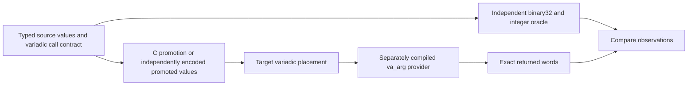

# Variadic argument promotions and placement across C ABIs

[Plan §6.6](../../../PLAN.md#66-cross-platform-native-interoperability-and-bidirectional-ffi-cross-cutting) · [Backend conformance issue #329](https://github.com/aivibeflow/LLMLang/issues/329) · [Cross-ABI fixed-call evidence](RT-13-FFI-AGGREGATE-CROSS-ABI-2026-11-25.md)

A variadic FFI call must represent the actual promoted arguments and then apply the target's variadic calling rules. Correctly selecting an ordinary fixed-call ABI is insufficient when the argument position is variadic. A caller must establish the expected argument types and layout through an explicit API contract.

The [provider](FFI-VARIADIC-ABI-01/provider.c) reads a promoted signed `int`, a `double`, and an unsigned 64-bit word after the two fixed arguments in the fixture. The [compiled C consumer](FFI-VARIADIC-ABI-01/consumer.c) passes a `signed char`, a `float` first rounded from the source binary64, and the word. An independent [assembly consumer](FFI-VARIADIC-ABI-01/registers.S) passes the independently encoded promoted bits and implements placement for each ABI. The provider records its fixed marker and the exact integer, binary64 and final word observations.



| Profile | Checked floating argument placement for this call |
| --- | --- |
| System V AMD64 on native Linux | `xmm0`, with `al = 1` to describe use of a vector argument register |
| Microsoft x64 calling convention on native Linux | Fourth position in `xmm3` and duplicated as binary64 bits in `r9`. The following word occupies the fifth stack position. |
| Linux AArch64, QEMU user mode | `d0`, independently of the fixed and trailing integer argument positions |
| RV64 LP64D and LP64, QEMU user mode | `a3` by the integer variadic calling convention. LP64D uses floating registers in the earlier fixed-call comparison. |

The Microsoft x64 experiment selects its calling convention within a Linux ELF process using Clang's `ms_abi`. It uses the fixture's declared 64-bit word type. Native Windows, LLP64 source types and additional OS runtime variants are separate target profiles. [Microsoft x64 varargs rules](https://learn.microsoft.com/en-us/cpp/build/x64-calling-convention#varargs) · [AMD64 psABI](https://gitlab.com/x86-psABIs/x86-64-ABI) · [AAPCS64](https://github.com/ARM-software/abi-aa/blob/c51addc3dc03e73a016a1e4edf25440bcac76431/aapcs64/aapcs64.rst) · [RISC-V psABI](https://github.com/riscv-non-isa/riscv-elf-psabi-doc/blob/56561cb3e7330fe99a98fd27457229707b2786ae/riscv-cc.adoc)

Five calling profiles, two provider optimizations and two preserving consumers produce 480 correct observations on 24 vectors, including negative signed bytes, signed zero and binary32 subnormal and rounding cases. The wrong-register assembly control sends a known `0.5` canary in the actual slot. All 240 control observations report that value instead of the expected one. For Microsoft x64, the correct `xmm3` value is still present when the duplicated integer register is wrong. The second control bypasses the binary32 source conversion while preserving binary64 placement. It differs in 90 of 240 vectors, exactly those whose original value differs from its binary32-rounded value. The marker, signed argument and trailing word match in every control.

The binding metadata needs variadic status, fixed arity, the typed sequence of promoted arguments and target placement rules. A declaration with `...` cannot supply the actual argument semantics. Compiler-generated calls and reviewed target-specific trampolines both match this corpus. The scope leaves additional variadic types, register exhaustion on every target, runtime callbacks, general source checking and native cross-device verification open.

## Reproduce

Linux x86-64, CPython 3.12.14, Debian Clang and LLD 19.1.7 and QEMU 10.0.13. The [cross-ABI baseline](RT-13-FFI-AGGREGATE-CROSS-ABI-2026-11-25.md#reproduce) records the pinned Debian QEMU package and linkage. The [runner](FFI-VARIADIC-ABI-01/run.py) builds static ELF images and independently evaluates each observation. The [ledger](FFI-VARIADIC-ABI-01/observations.json) preserves the input and expected word vectors, exact emitted image hashes and binary64 output for each route. These are categorical comparisons.

```sh
study=research/compiler-and-translation/RT-13/FFI-VARIADIC-ABI-01
python3 -B "$study/run.py" --clang "$CLANG_EXE" --lld "$LLD_EXE" \
  --qemu-aarch64 "$QEMU_AARCH64" --qemu-riscv64 "$QEMU_RISCV64" \
  --out /tmp/rt13-variadic-abi.json
cmp "$study/observations.json" /tmp/rt13-variadic-abi.json
```

Use `--clang-libdir` for an extracted Clang distribution if needed.
