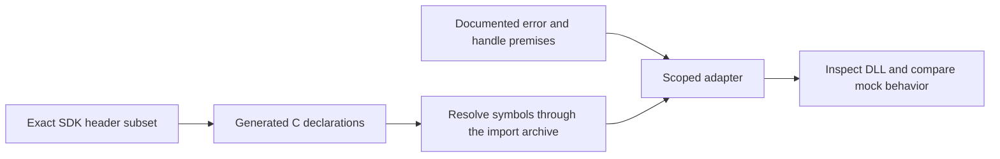

# RT-13 Win32 header import, symbols and error contracts

A C import can establish declarations and link identity. Win32 error and ownership effects need a distinct contract. This fixture extracts three declarations from MinGW-w64 headers using Clang's AST. It generates typed function-pointer declarations and compiles checks against the imported names. The released vendor documentation supplies the separate behavioral premises.

| Imported name | Structural result | Scoped adapter premise |
|---|---|---|
| `CreateFileW` | `HANDLE` result, seven parameters, imported symbol | For the existing-file read route, `INVALID_HANDLE_VALUE` indicates failure. A successful handle has the chosen close obligation. |
| `CloseHandle` | `BOOL` result and one `HANDLE` parameter | Zero indicates failure for an admitted file handle. |
| `GetLastError` | 32-bit `DWORD` result and no parameters | Read the current thread's last error immediately after a documented failure. |

[CreateFileW](https://learn.microsoft.com/en-us/windows/win32/api/fileapi/nf-fileapi-createfilew) · [CloseHandle](https://learn.microsoft.com/en-us/windows/win32/api/handleapi/nf-handleapi-closehandle) · [GetLastError](https://learn.microsoft.com/en-us/windows/win32/api/errhandlingapi/nf-errhandlingapi-getlasterror)



The target DLL resolves all three names through the recorded `libkernel32.a` and lists precisely those imports from `KERNEL32.dll`. It exports the two adapter functions. A generated 64-bit error result fails the Clang compatibility assertion. File-name marshaling and platform handles remain in the Win32 adapter boundary.

The same adapter source links against an independent Linux mock. Eight controlled observations compare invalid and valid handles, close success or failure, and an unrelated prior last-error value. Success returns the adapter's defined zero error without sampling stale state. Failure reads once within the same path. The model calls a close operation only for its admitted successful handle. These observations establish control flow under the mock premises. Native Windows behavior, OS loader resolution, API-specific handle kinds, threading and general header/IDL import remain separate.

The project comparison now covers real bounded POSIX, SQLite and OpenSSL imports alongside one Windows API header and PE import route. [POSIX and third-party import](RT-13-FFI-TYPED-HEADER-IMPORT-2026-11-25.md) · [Header and lifetime import](RT-13-FFI-HEADER-IMPORT-2026-11-25.md)

## Replay

Use Debian Clang, LLD and llvm-readobj 19.1.7, GCC 14.2.0 for the mock and CPython 3.12.14. Extract `mingw-w64-common_12.0.0-5_all.deb` and `mingw-w64-x86-64-dev_12.0.0-5_all.deb` into one scratch root. Their respective SHA-256 values are `97dce5d0d8aff1cade4786ad4ef5078345477a598829afcac2e7f2fbc5399990` and `0bf89cf7454cccb49cd2a46a6f7b33896f6ae3a1a2fe33e02c40be6155bbb385`. Two hash seeds reproduce the [receipt](FFI-WIN32-HEADER-IMPORT-01/evidence.json). [Debian MinGW-w64 archives](https://deb.debian.org/debian/pool/main/m/mingw-w64/)

```sh
LC_ALL=C PYTHONHASHSEED=37 python -B research/compiler-and-translation/RT-13/FFI-WIN32-HEADER-IMPORT-01/check.py \
  --mingw /path/to/root/usr/x86_64-w64-mingw32 \
  --clang /path/to/clang-19 --lld /path/to/lld-link-19 --readobj /path/to/llvm-readobj-19
```
