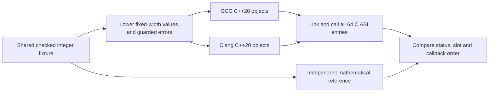
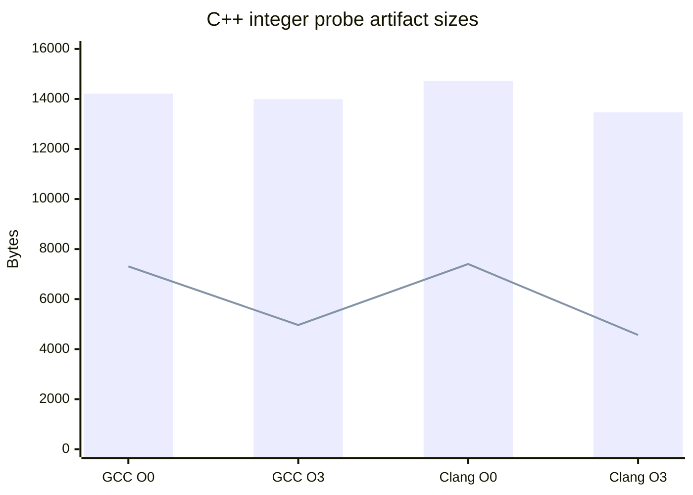

# RT-13 — Lower checked scalar integers to C++20 with GCC and Clang

**Evidence** — Four hosted C++ profiles on the exact scalar workload used for Rust, direct LLVM and Go.

## Question and admitted subset

Does a C++ output route preserve the source integer and callback behavior when compiled by two compiler families? The shared Scenario 96A source covers 16 operations, each with the four ordered arrangements of two operands. Per program it runs 3,085 input vectors. Each observation includes the operation status, final output-slot bytes and ordered callback values. The ABI uses two 32-bit integer operands, a 32-bit enable field, a returning callback and a valid aligned writable output slot. [Generated Rust and LLVM](RT-13-GENERATED-RUST-INTEGER-LOWERING-2026-11-24.md) · [Generated Go](RT-13-GENERATED-GO-INTEGER-LOWERING-2026-11-24.md)

The C++ emitter models signed input bits explicitly. It uses unsigned arithmetic for wrapping operations, 64-bit widened math for checked arithmetic, and guards for zero divisors, signed minimum divided by minus one and shift counts at least 32. In C++20 the signed right shift of the decoded value preserves arithmetic shift. An error returns before the final callback and output write. The input-alias form `x - x` has an exact zero result and needs no underflow test. This source-level simplification also avoids an always-false self-comparison diagnostic under the pinned warning-as-error builds.



## Observations

All four profiles match all 197,440 reference observations each. Each object links with undefined symbols disallowed and exports all 64 required C entry names. The relative sizes refer to object files and distinct linked exported address/size pairs, respectively. A symbol can point at the same machine code as another symbol. The comparison retains both counts.

| C++ compiler profile | Object bytes | Bytes in distinct linked export extents |
| --- | ---: | ---: |
| GCC O0 | 14,216 | 7,308 |
| GCC O3 | 13,992 | 4,963 |
| Clang O0 | 14,728 | 7,402 |
| Clang O3 | 13,464 | 4,565 |



The bars show object bytes. The line shows linked export extents. Neither measures runtime latency or the final library's total size.

The four changed C++ controls distinguish the required observations. Accepting a wrapped signed result instead of overflow, or masking an invalid shift, changes status, slot and effects. Writing on error changes the slot alone. Reversing callbacks changes the trace alone. The test derives the latter changes from exact witness inputs. The shared source and reference module hashes match the archived Rust/LLVM and Go ledgers.

This establishes a C++20 emitter option for the stated hosted integer fragment and demonstrates that the checked observation holds under GCC and LLVM-family compilation. Runtime linkage must be checked again if the emitter introduces exceptions, RTTI, allocation, instrumentation or external calls. Native platform ABIs beyond Linux x86-64, C++ interoperability features, generalized pointer semantics, ownership, and performance remain outside the measured scope.

## Reproduction

Use CPython 3.12.14, Debian GCC 14.2.0, Debian Clang and LLVM 19.1.7, and x86-64 Linux. The runner applies `-std=c++20 -march=x86-64 -fPIC -fno-exceptions -fno-rtti -Wall -Wextra -Werror` and runs O0 and O3 per compiler.

```sh
study=research/compiler-and-translation/RT-13/GENERATED-CPP-INTEGERS-01
python3 -B "$study/run.py" --output /tmp/llmlang-cpp-integers.json
cmp "$study/evidence.json" /tmp/llmlang-cpp-integers.json
python3 -B "$study/plot.py" "$study/evidence.json"
python3 -B research/compiler-and-translation/PROTOTYPES/LLVM-PRESERVATION-01/llvm_integer_probe.py
```

The [emitter](GENERATED-CPP-INTEGERS-01/lower_cpp.py) generates the exact guarded expressions. The [harness](GENERATED-CPP-INTEGERS-01/run.py) uses the existing source oracle and C ABI observation helpers, with an independent compiler path. The [ledger](GENERATED-CPP-INTEGERS-01/evidence.json) retains source and object hashes, exact observations and controls, and the [chart generator](GENERATED-CPP-INTEGERS-01/plot.py) reproduces the size series.
