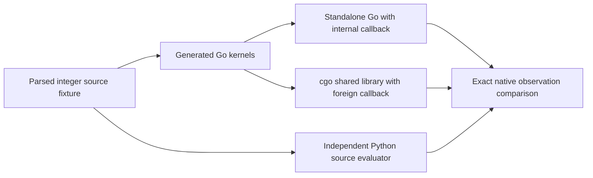

# RT-13 — Generated Go for the checked integer and callback fixture

- **Evidence** — Native replay through a standalone program and a C-callable shared library.
- **LLMLang baseline** — `0b3bc173fdb1012eac8b822513b031567cad8c1a`.
- **Tracking** — [PLAN §6.2](../../../PLAN.md#62-backend-selection-and-cross-backend-validation) · [Scenario 96A](RESEARCH-SCENARIO-96A-LLVM-INTEGER-PRESERVATION.md).

## Question and workload

Can a source emitter for Go preserve the existing checked integer observations with a compiler independent of LLVM? The same typed `Program` and reference evaluator used for the LLVM fixture drive Go source generation. Two packaging profiles exercise the same generated kernels. The standalone profile is built with cgo disabled and uses a binary stdin/stdout harness. The shared library is built with cgo enabled and exposes the existing five-argument C ABI. [Prior direct LLVM comparison](RESEARCH-SCENARIO-96A-LLVM-INTEGER-PRESERVATION.md)



The corpus covers 16 arithmetic, division, remainder and shift operations in all four ordered operand arrangements. A program receives 3,085 inputs comprising the boundary operands, seeded pairs, and five ABI enable patterns. The observation includes status, final contents of the output slot, and ordered callback values. C callers provide a valid writable aligned slot and a returning callback. The adapter uses them only during the call. The standalone harness uses a local slot and records the observations through a fixed binary record.

The Go emitter performs wrapping operations at the declared width and widens checked operations before testing the range. Explicit guards distinguish zero divisors, signed division overflow, and invalid shift counts from successful Go operations. This matters because native Go signed division of the minimum integer by minus one gives the minimum value, and native Go shifts can accept counts outside the fixture's admitted range.

## Results

| Go 1.27.4 profile | Source observations matched | Stripped artifact, bytes | ELF needed libraries |
| --- | ---: | ---: | --- |
| Standalone, `CGO_ENABLED=0` | 197,440 | 1,568,892 | None recorded |
| `c-shared`, `CGO_ENABLED=1` | 197,440 | 1,452,096 | `libc.so.6` |

Both profiles report 146,048 successes, 25,120 overflow errors, 25,056 shift-count errors, and 1,216 zero-divisor errors. The shared library exposes all 64 expected names in the generated header and dynamic symbol table. The runner exercises every entry through the host's C function pointer ABI. These are total artifact sizes for different adapters, each with its runtime and linked code. They do not measure the sum of kernel function sizes or the incremental cost of an export. An empty ELF needed-library list does not establish operation without an operating system.

Three changed emitters produce the expected counterexamples. Removing the signed-overflow guard turns minimum signed integer divided by −1 into a success with the same minimum bits. Removing the shift bound turns a left shift by 32 into a success returning zero. Reversing callbacks preserves the value and changes the trace. The baseline rejects both arithmetic changes at the intended status and leaves the observed slot untouched. [Evidence](GENERATED-GO-INTEGERS-01/evidence.json)

## Implementation consequence

The fixture establishes a non-LLVM compiled route for one effect-observing scalar subset. The standalone path avoids dynamically linked libraries in this build. The C ABI path introduces a cgo bridge, `libc` and the Go runtime lifecycle. Native Go arithmetic conventions require deliberate mapping of error and bit-width semantics. These results apply to the stated hosted platform. Broader source semantics, ownership, ABI lifetime cases beyond a returning callback, unsupported platforms, runtime latency and production target selection remain open.

## Reproduction

Use the official Go 1.27.4 Linux amd64 archive, SHA-256 `7226736c2339719cda28fbf3a54d71aa63bcefe376e98cef00034268dab24840`, GCC 14.2.0, LLVM 19.1.7 symbol tools, GNU `readelf`, and CPython 3.12.14. The Go runner pins `GOAMD64=v1`, disables network module lookup and builds both packaging forms from one kernel source. Four full replays produced identical evidence and artifact hashes. [Official archive](https://go.dev/dl/go1.27.4.linux-amd64.tar.gz) · [Go emitter](GENERATED-GO-INTEGERS-01/lower_go.py) · [Runner](GENERATED-GO-INTEGERS-01/run.py)

```sh
study=research/compiler-and-translation/RT-13/GENERATED-GO-INTEGERS-01
work=$(mktemp -d)
python3 -B "$study/run.py" --go /absolute/path/to/go1.27.4/bin/go \
  --cache "$work/cache" --output "$work/evidence.json"
cmp "$study/evidence.json" "$work/evidence.json"
```
