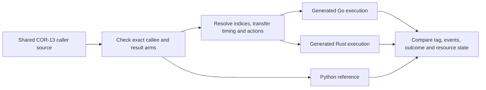

# RT-13 — Compare generated Go and Rust owned-result execution

**Evidence** — Two compiled Go profiles and two Rust profiles on the same verified COR-13 sources.

## Question and admitted subset

Can a hosted Go route preserve the owned outcome and subsequent admission behavior already tested through generated Rust? COR-13 distinguishes moving the handle before local cleanup from moving it after cleanup succeeds. It also distinguishes a caller that forwards a retained handle from one that tries to release it before making another call. The shared source fixtures exercise both policies and vary aliases across two resource pairs. [Scenario 132 source](../../language-design/RT-04/RESEARCH-SCENARIO-132-TYPED-CALLER-RECOVERY.md) · [Scenario 133 Rust baseline](RESEARCH-SCENARIO-133-GENERATED-RUST-OWNED-RESULTS.md)

The existing source checker admits one fixed callee shape and exhaustively checks caller result arms. The Go generator consumes the resolved role indices, transfer timing and legal per-arm actions. Its runtime represents the reserved role pair independently of the returned result tag. A usable retained handle may be released. An indeterminate outcome holds its possible resource footprint while exposing a reconciliation obligation. The typed source check rejects attempts to release a reconciliation-only result. The Go runtime also verifies that an emitted release uses a usable handle.



The compiled adapters share the comparison encoding with the Python reference. The Go runtime implements ordered effects and role admission independently of the Rust executable and Python execution path. Both target programs use supplied resource IDs and close outcomes, so this experiment exercises hosted language lowering and result carriers without issuing real FFI or native resource releases.

## Observations

Each cell has 10,496 workload inputs, including every equality partition of four roles, both domain outcomes and four possible dispositions at each of three close sites. The table reports second-call starts, a result that depends on both transfer timing and resource identity.

| Caller source | Transfer before cleanup | Transfer after cleanup |
| --- | ---: | ---: |
| Forward every obligation | 1,856 | 2,576 |
| Release a usable handle on the error arm | 2,816 | 2,996 |
| Retarget the recovery case's second destination | 2,368 | 2,590 |

Both Go profiles match all 62,976 reference traces. On the same checkout both Rust profiles also match all 62,976 per profile, for 251,904 comparisons across four compiled profiles. The trace includes the original result and obligations, ordered events and diagnostics, the domain-error flag, second-call admission, final role reservations and obligations forwarded by the caller.

Three changed Go emitters give distinguishing observations. Omitting caller release leaves its live reservation and forwarded handle obligation. Ignoring the prior role pair starts a second call that conflicts with a retained destination. Forcing staged transfer reverses the transfer and local cleanup events on a case with an otherwise unchanged result. The source boundary rejects both a changed callee and an attempt to release an indeterminate handle.

The Go result supports an explicit outcome carrier with runtime reservation and operand-order checks. Rust additionally gives the fixture a moving handle representation. Both routes depend on the admitted source checker, matching runtime semantics, and an accurate external contract for dispositions. Comparison of actual foreign close behavior, concurrent alias changes, covered platform APIs, memory costs and the selected bootstrap path remains open.

## Reproduction

Use CPython 3.12.14, Rust 1.85.1 and Go 1.27.4 on Linux x86-64. The official Go archive has SHA-256 `7226736c2339719cda28fbf3a54d71aa63bcefe376e98cef00034268dab24840`. The Go runner fixes `GOAMD64=v1`, disables cgo and module downloads, and compares the default build with optimization and inlining disabled in the generated package. [Go release](https://go.dev/dl/go1.27.4.linux-amd64.tar.gz)

```sh
study=research/compiler-and-translation/RT-13/GENERATED-GO-OWNERSHIP-01
work=$(mktemp -d)
python3 -B "$study/run.py" --go /absolute/path/to/go1.27.4/bin/go \
  --cache "$work/cache" --output "$work/evidence.json"
cmp "$study/evidence.json" "$work/evidence.json"
python3 -B research/PROTOTYPES/RT-04-01/rt04_rust_owned_probe.py --rustc /absolute/path/to/rustc
```

The [Go harness](GENERATED-GO-OWNERSHIP-01/run.py) records exact source, generated program, binary and reference trace digests. The [ledger](GENERATED-GO-OWNERSHIP-01/evidence.json) retains per-profile counts and counterexample inputs and traces. [Go runtime template](GENERATED-GO-OWNERSHIP-01/runtime.go.in)
