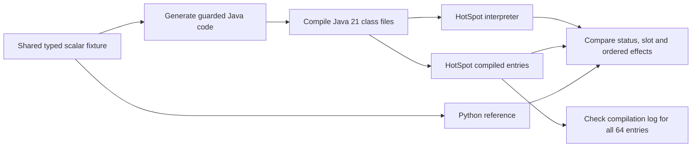

# RT-13 — Lower checked scalar integers to Java bytecode

**Evidence** — Interpreted and HotSpot-compiled runs of the shared hosted integer workload.

## Question and scope

Can Java preserve the fixed-width arithmetic, explicit failure statuses and ordered observations that the existing Rust, Go and LLVM fixtures exercise? The tested route uses Java 21 class files and a hosted JVM process. The source admits 16 operations and four operand arrangements, with 3,085 input vectors per program. It observes status, output-slot content and ordered effect words. Java supplies a local output slot and an effect recorder in the binary adapter. The comparison uses the same packet layout as the Go standalone runner. [Go standalone and C ABI](RT-13-GENERATED-GO-INTEGER-LOWERING-2026-11-24.md) · [Rust and direct LLVM](RT-13-GENERATED-RUST-INTEGER-LOWERING-2026-11-24.md)

The emitter interprets Java `int` as a 32-bit word. It uses `long` for checked results and checks the unsigned multiplication bound before multiplying. It checks zero divisors and the source's signed minimum divided by minus one rule explicitly. It checks a shift count as unsigned before applying a Java shift, so Java's built-in count masking cannot silently change a rejected input into a success.



The interpreted run uses `-Xint`. The compiled run uses `-Xcomp`, disables tiered compilation and selects the 64 generated entry methods. The test checks HotSpot's compilation log for those actual methods. Support code still uses the ordinary JVM runtime. Both profiles operate on the same emitted class files.

## Observations

| Execution profile | Complete observations matched | Generated entries confirmed compiled |
| --- | ---: | ---: |
| Interpreter | 197,440 | 0 |
| Forced compiled entry methods | 197,440 | 64 |

Every profile gives 146,048 successes, 25,120 overflow errors, 25,056 rejected shift counts and 1,216 zero-divisor errors, with exact agreement for individual inputs. The two class files use class-file major version 65 and occupy 9,620 and 559 bytes. Those byte counts describe generated bytecode and its adapter class. Native object sizes and JVM working memory are separate measures.

Three changed emitters separate language conventions from source semantics. Removing the signed division guard accepts minimum signed integer divided by minus one. Removing the shift guard treats count 32 as zero through Java's normal count masking. Both changes affect status, written slot and trace. Reversing successful callback observations keeps status and output while changing the trace. The recorded scalar source hashes match the existing hosted comparison.

Java is a viable hosted alternative for this scalar profile where a JVM is part of the deployment. The experiment supports the source semantics through an explicit checked adapter. Native C ABI integration, reference and resource lifetimes, JVM startup and footprint, platform coverage and cross-compilation remain separate selection gates.

## Reproduction

Use CPython 3.12.14 and Debian OpenJDK HotSpot 21.0.13+9-1 on Linux x86-64. The runner invokes the installed `jdk.compiler` module with `-source 21 -target 21`. This headless runtime contains the compiler module, while its installed release-signature data did not support the attempted `--release 21` invocation. The replay checks the emitted class version and runs it on the same pinned Java feature release.

```sh
study=research/compiler-and-translation/RT-13/GENERATED-JAVA-INTEGERS-01
python3 -B "$study/run.py" --java /usr/bin/java --output /tmp/llmlang-java-integers.json
cmp "$study/evidence.json" /tmp/llmlang-java-integers.json
```

The [emitter](GENERATED-JAVA-INTEGERS-01/lower_java.py), [binary adapter](GENERATED-JAVA-INTEGERS-01/host.java.in) and [harness](GENERATED-JAVA-INTEGERS-01/run.py) reproduce the checked profiles. The [ledger](GENERATED-JAVA-INTEGERS-01/evidence.json) retains source and class hashes, compiler and runtime identities, profile outcomes and negative controls.
