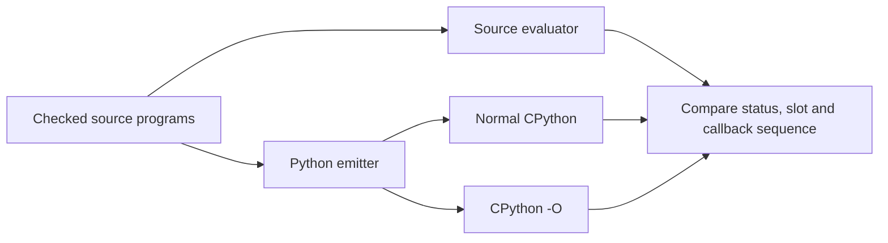

# RT-13 — Evaluate generated Python for the checked integer subset

- **Date** — 2026-11-25
- **Tracking** — [PLAN §6.2](../../../PLAN.md#62-backend-selection-and-cross-backend-validation) · [#329](https://github.com/aivibeflow/LLMLang/issues/329)
- **Status** — Reproduced for CPython 3.12.14 on Linux x86-64

## Question and method

Can a generated Python program preserve the checked fixed-width semantics of the hosted integer fixture in both ordinary and optimized interpreter modes? The input set contains 64 checked programs, covering 16 operations and four operand arrangements. A shared driver tests each program with 3,085 vectors. The existing source evaluator supplies expected status, output slot and ordered callback observations. Generated functions run in a separate isolated CPython process with the same four-word request and five-word response shapes used by the Go and Java adapters. [Scenario 96A](RESEARCH-SCENARIO-96A-LLVM-INTEGER-PRESERVATION.md) · [Go adapter](RT-13-GENERATED-GO-INTEGER-LOWERING-2026-11-24.md) · [Java adapter](RT-13-GENERATED-JAVA-INTEGER-LOWERING-2026-11-24.md)

The emitter represents input as unsigned 32-bit words. It converts signed operands explicitly, performs wide arithmetic with Python integers, guards checked conversions, and masks successful output to one word. It adjusts the quotient and remainder produced by Python's floor-based `divmod` for mixed signs. The source evaluator instead divides magnitudes and restores the sign before calculating the remainder. Failure returns before the output slot is stored or the success callback is delivered.



## Results

| Interpreter profile | Cases matched | Success | Overflow | Shift count rejected | Zero divisor |
|---|---:|---:|---:|---:|---:|
| Normal, isolated mode | 197,440 | 146,048 | 25,120 | 25,056 | 1,216 |
| Optimized, isolated mode | 197,440 | 146,048 | 25,120 | 25,056 | 1,216 |

The generated module has 64 entries. Its marshalled code-object digest and response stream digest agree across the two interpreter modes on the pinned build. The driver identifies the actual interpreter optimization level and compares each observation with the source result. [Evidence ledger](GENERATED-PYTHON-INTEGERS-01/evidence.json)

Five control runs isolate three classes of defect. The native `//` quotient and `%` remainder each change the output slot and success event for signed input −7 divided by 2. A shift check implemented as an assertion preserves the rejection in ordinary mode. Optimized mode removes that assertion and changes status, slot and events for a shift by 32. Reversing callbacks changes only the event sequence. [Python assertion semantics](https://docs.python.org/3.12/reference/simple_stmts.html#the-assert-statement)

## Interpretation and limits

Python is a viable experimental execution target for this hosted subset when the emitter applies fixed-width bounds, explicit exceptions as statuses, and ordinary control-flow guards. The existing source evaluator and generated implementation share an interpreter and corpus. Agreement measures the lowering here, and the checked Rust, Go, C++, Java and LLVM routes provide independent target implementations for the same scalar fixture. Production target selection, mutable aliases, native ABI, resource semantics and performance remain open. The marshalled code-object digest is specific to the pinned interpreter build.

## Reproduction

Run from the repository root with CPython 3.12.14. The runner starts separate interpreter processes, creates generated files in a temporary directory and emits the complete receipt. [Emitter](GENERATED-PYTHON-INTEGERS-01/lower_python.py) · [Host](GENERATED-PYTHON-INTEGERS-01/host.py) · [Runner](GENERATED-PYTHON-INTEGERS-01/run.py)

```sh
set -eu
dir=research/compiler-and-translation/RT-13/GENERATED-PYTHON-INTEGERS-01
observed=$(mktemp)
trap 'rm -f "$observed"' EXIT
python3 -B "$dir/run.py" > "$observed"
cmp "$dir/evidence.json" "$observed"
```
