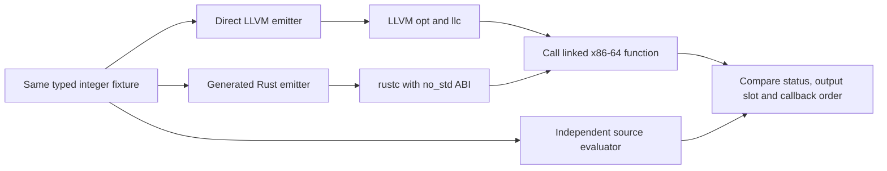

# RT-13 — Generated Rust and direct LLVM for the 32-bit integer fixture

- **Evidence** — Native differential replay, linked symbol extents and object import checks.
- **LLMLang baseline** — `c6338994487f76f3f53077c78dd2723d2ac1ae97`.
- **Tracking** — [PLAN §6.2](../../../PLAN.md#62-backend-selection-and-cross-backend-validation) · [RT-29 Rust foundation](../RT-29/RT-29-RUST-FOUNDATION-FOR-LLMLANG-CAPABILITIES.md).

## Question and workload

Can LLMLang generate Rust for a mixed integer and effect subset and preserve the same ABI observations as direct LLVM lowering? The experiment uses the existing Scenario 96A source parser and independent Python evaluator. It lowers the same parsed `Program` through two independently written emitters. The Rust compiler also uses LLVM, with the version label 19.1.7 in this release. The experiment compares frontend and runtime boundaries over a shared compiler family. [Scenario 96A](RESEARCH-SCENARIO-96A-LLVM-INTEGER-PRESERVATION.md)



The corpus covers 16 wrapping, checked arithmetic, division, remainder and shift operations, with all four ordered operand choices. Each of the 64 programs receives 3,085 argument vectors. The vectors combine 19 boundary operands on each side and 256 seeded pairs with five raw enable patterns. The ABI takes a returning C callback and an aligned writable output pointer. A bypass returns the second argument. A successful operation emits its result and writes it to the slot. A failed operation reports a distinct status and preserves the observed slot.

The Rust emitter uses explicit `wrapping_*` and `checked_*` operations. A separate guard distinguishes zero divisor from signed overflow. For each shift the chosen method preserves the bound and signedness. The direct LLVM emitter uses explicit branches or intrinsics instead. The source evaluator computes the mathematical or modular value independently of both.

## Results

All four native profiles agree on 197,440 complete observations each. In every profile, 146,048 return success, 25,120 report overflow, 25,056 reject the shift count, and 1,216 report zero divisor. The four main objects have no undefined symbols and link with undefined symbols disallowed.

| Profile on generic x86-64 | Object bytes | Distinct linked exported extents | Sum of those extents, bytes |
| --- | ---: | ---: | ---: |
| Direct LLVM O0 | 13,592 | 64 | 6,920 |
| Direct LLVM O3 | 12,456 | 64 | 3,871 |
| Generated Rust O0 | 26,368 | 64 | 8,604 |
| Generated Rust O3 | 9,824 | 51 | 3,187 |

All 64 symbols remain callable. The 51 distinct Rust O3 extents reflect aliasing of exported names to identical linked address and size pairs. The extent sum counts each pair once. Object size also includes object-file metadata, relocations and any other sections.

Enabling Rust debug assertions at O0 introduces an undefined `core::panicking::panic_nounwind` symbol, and the same link without a runtime provider rejects that object. The four successful profiles include Rust with assertions disabled. This is a concrete toolchain and ABI instrumentation dependency for the fixture. `no_std` alone does not establish that an emitted object can link without runtime support.

Five generated Rust controls produce the expected differences. Treating signed overflow as wrapping or masking an out-of-range shift changes the status, output slot and trace. Reporting overflow for zero division changes status alone. A write on overflow changes the slot alone. Reversing two successful callbacks changes only their order. [Results and exact controls](GENERATED-RUST-INTEGERS-01/evidence.json)

## Implementation consequence

Generated Rust is a viable emitter for this checked integer subset under the recorded ABI and compiler options. The two routes expose different code size and instrumentation trade-offs. Debug and freestanding candidates need explicit helper-symbol policies at the linked boundary. The finite checks leave general translation correctness, arbitrary pointer behavior, actual hardware targets outside x86-64, ownership, runtime costs and production toolchain selection open. The harness observes final output-slot contents and callback history, so it does not enumerate every machine memory operation.

## Reproduction

Use CPython 3.12.14, Rust 1.85.1, Debian LLVM 19.1.7 and GCC 14.2.0 on Linux x86-64. Three runs reproduce the exact generated-source hashes, checked observations, linked symbol counts, object hashes and negative controls. [Rust lowering](GENERATED-RUST-INTEGERS-01/lower_rust.py) · [Runner](GENERATED-RUST-INTEGERS-01/run.py)

```sh
study=research/compiler-and-translation/RT-13/GENERATED-RUST-INTEGERS-01
python3 -B "$study/run.py" --output /tmp/llmlang-generated-rust-integers.json
cmp "$study/evidence.json" /tmp/llmlang-generated-rust-integers.json
```
