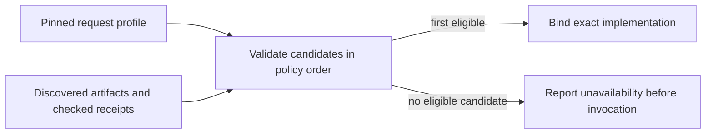

# RT-13 — Evidence-gated implementation fallback

- **Date** — 2026-11-25
- **Tracking** — [PLAN §6.4](../../../PLAN.md#64-implementation-discovery-selection-and-optimization) · [#331](https://github.com/aivibeflow/LLMLang/issues/331)
- **Status** — Checked model and finite comparison for an ordered candidate list

## Question and contract

If the preferred concrete implementation is unavailable or unsuitable, which alternatives may satisfy the same call? The model receives a fixed request profile and an ordered list of candidates. A profile contains the operation, target, ABI, runtime, capability scope, evidence policy and observation model. Each candidate contains an artifact identity, materialization status and a typed evidence receipt. Discovery and cost policy supply the order before this boundary. [Operation and implementation binding](../../semantic-representation/RT-05/RESEARCH-SCENARIO-92-OPERATION-IDENTITY-AND-IMPLEMENTATION-BINDING.md) · [Runtime version identity](../../runtime-and-systems/RT-10/RT-10-RUNTIME-VERSION-IDENTITY-2026-11-25.md)

The candidate rule selects the first materialized artifact whose profile matches exactly and whose checked evidence binds that artifact to the same profile. If none qualifies, it reports unavailability for that request before invoking a candidate. A changed request, such as one with a different runtime or relaxed effects, requires its own declared scope and evidence. For comparison, the finite fixture also tries selecting the first available artifact and the first available artifact that matches only operation, target and ABI.



## Checked results

Lean checks four statements for every list in the model. A selected candidate belongs to the list and passes the gate. It binds the exact available artifact and checked receipt. Refusal is equivalent to having no eligible candidate. An eligible preferred candidate remains selected regardless of the fallback tail. The successful replay records each theorem's axiom dependencies.

The finite driver varies eight profile relationships, six receipt states and two availability states for each of two candidates. It compares all 9,216 pairs with an oracle that independently marks the eligible variant and gives preference to the first candidate.

| Rule | Preferred | Reserve | Refused | Incorrect dispatches |
|---|---:|---:|---:|---:|
| Available artifact only | 4,608 | 2,304 | 2,304 | 6,768 |
| Available and matching operation, target and ABI | 2,880 | 1,980 | 4,356 | 4,698 |
| Exact profile and checked artifact receipt | 96 | 95 | 9,025 | 0 |

The exact gate agrees with the oracle in every case. The broader ABI rule can still admit stale runtime, mismatched capability or observation profiles, missing evidence, and evidence for another artifact. [Evidence ledger](IMPLEMENTATION-FALLBACK-01/evidence.json)

## Limits

The proof assumes the caller receives authentic availability and evidence inputs and that profile identities accurately represent their contracts. It concerns the selection algorithm and modeled evidence equality. Runtime invocation, physical materialization races, signature verification, permitted adapter construction, narrower behavioral refinement and distribution policy need separate evidence.

## Reproduction

Run from the repository root with Lean 4.36.0 and CPython 3.12.14. The runner checks the Lean proof file and the finite witness matrix and emits a deterministic receipt. [Lean model](IMPLEMENTATION-FALLBACK-01/Fallback.lean) · [Runner](IMPLEMENTATION-FALLBACK-01/run.py)

```sh
set -eu
dir=research/compiler-and-translation/RT-13/IMPLEMENTATION-FALLBACK-01
observed=$(mktemp)
trap 'rm -f "$observed"' EXIT
python3 -B "$dir/run.py" --lean lean > "$observed"
cmp "$dir/evidence.json" "$observed"
```
