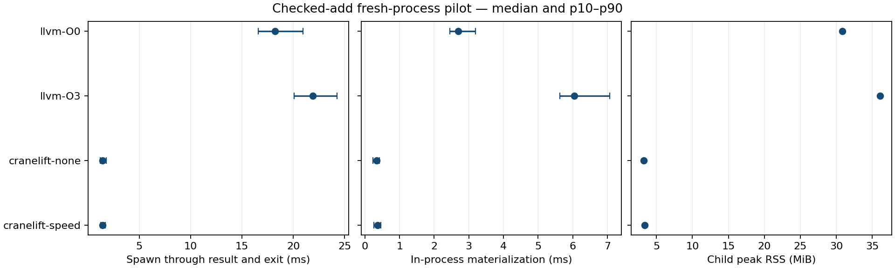

# RT-13 checked-add JIT from process launch to exit

A host tool can pay for dynamic loading, process initialization and JIT materialization on its first invocation. Earlier checked-add measurements start inside the probe, after process launch. This experiment measures fresh processes through result output and exit for the same checked-add lowering, and records the child's peak resident memory. It uses one pinned Linux x86-64 runner and compares two LLVM ORC profiles with two Cranelift profiles. [Earlier study](RT-13-JIT-MATERIALIZATION-LATENCY-2026-11-24.md) · [Benchmark protocol](RT-13-BACKEND-BENCHMARK-PROTOCOL-2026-11-25.md)


Process duration includes launch, dynamic loader and program initialization, parsing the input IR in the ORC probe, compilation, four calls, text output and cleanup. The inner JIT timer begins at the existing harness boundary and stops at the callable address. The Cranelift harness builds the IR inside its process. The ORC harness reads its LLVM IR file before starting that inner timer. The parent timer ends just after `wait4` returns, and an independent Python evaluator checks the reported statuses, stored bits and ordered callback effects outside the timed interval. The wrapper's own process launch is outside its timer. It records Linux `ru_maxrss` for the one probe process, in KiB. [Process wrapper](JIT-FRESH-PROCESS-01/process.c) · [Collector](JIT-FRESH-PROCESS-01/measure.py)

## Results

Two runs used 30 paired batches each, with randomized profile order within each batch. Every sample starts a fresh process after priming the executables and libraries. The runner was CPU 4 of an Intel Xeon Platinum 8573C on Linux. The two recorded cgroup intervals show zero throttled periods. The host's uncontrolled scheduling and storage cache behavior remain potential variation sources.

Each row reports 60 processes. Values show the median and p10–p90.

| Profile | Process through exit, ms | Inner JIT, ms | Child peak RSS, MiB |
| --- | ---: | ---: | ---: |
| LLVM ORC O0 | 18.21 (16.61–20.96) | 2.69 (2.46–3.20) | 30.86 (30.86–30.90) |
| LLVM ORC O3 | 21.92 (20.06–24.24) | 6.05 (5.63–7.07) | 36.09 (36.08–36.09) |
| Cranelift `none` | 1.42 (1.17–1.80) | 0.34 (0.23–0.42) | 3.23 (3.16–3.34) |
| Cranelift `speed` | 1.42 (1.23–1.70) | 0.37 (0.25–0.46) | 3.35 (3.28–3.40) |



All 240 processes passed the four independent callback checks. The ordering of the reported process-duration and RSS ranges applies to these full probe builds. The ORC executable is 56,560 bytes and dynamically links `libLLVM.so.19.1`. The 3,648,328-byte Cranelift executable embeds the compiler crates and has different dynamic dependencies. Those file sizes describe the probe executables. Installation footprint, generated code size and private memory each need a separate measurement. The duration outside the inner timer includes multiple stages and cannot isolate the effect of a particular library. Incremental rebuilds, representative runtime throughput, background effects and other toolchain packaging remain open. [Summary](JIT-FRESH-PROCESS-01/evidence/summary.json) · [Run 37](JIT-FRESH-PROCESS-01/evidence/run-37/) · [Run 75](JIT-FRESH-PROCESS-01/evidence/run-75/)

## Reproduction

Use Debian LLVM 19.1.7, GCC and libgcc 14.2.0-19, glibc 2.41, Rust 1.85.1, CPython 3.12.14 and Matplotlib 3.10.8. The earlier fixture pins Cranelift 0.116.1 in its Cargo lock. Reserve a CPU within the runner's permitted affinity and write a new ledger for each measurement. Timing samples vary across runs.

```sh
study=research/compiler-and-translation/RT-13/JIT-FRESH-PROCESS-01
fixture=research/compiler-and-translation/RT-13/JIT-MATERIALIZATION-01
build=$(mktemp -d)
cc -O2 -std=c17 -Wall -Wextra -Werror "$study/process.c" -o "$build/process"
c++ $(llvm-config-19 --cxxflags) -O2 "$fixture/orc.cpp" -o "$build/latency-orc" \
  $(llvm-config-19 --ldflags --link-shared --libs orcjit native --system-libs)
cargo fetch --locked --manifest-path "$fixture/Cargo.toml"
CARGO_TARGET_DIR="$build/target" CARGO_BUILD_JOBS=2 CARGO_PROFILE_RELEASE_OPT_LEVEL=1 \
  cargo rustc --locked --offline --release --manifest-path "$fixture/Cargo.toml" -- -D warnings
for seed in 37 75; do
  LC_ALL=C PYTHONHASHSEED="$seed" PYTHONDONTWRITEBYTECODE=1 python "$study/measure.py" \
    --cpu 4 --batches 30 --seed "$seed" --wrapper "$build/process" \
    --orc "$build/latency-orc" --cranelift "$build/target/release/latency-cranelift" \
    --output "$build/run-$seed"
done
LC_ALL=C MPLBACKEND=Agg MPLCONFIGDIR="$build/plot-cache" python "$study/summarize.py" --evidence-dir "$build"
```

The workspace used extracted LLVM development headers and the packaged LLVM shared library. The final command plots the new ledgers. Running the summarizer without an evidence directory verifies and replots the checked-in ledgers. [Summarizer](JIT-FRESH-PROCESS-01/summarize.py)
