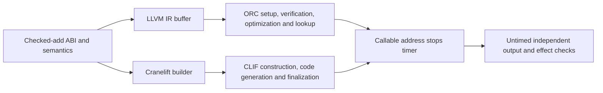
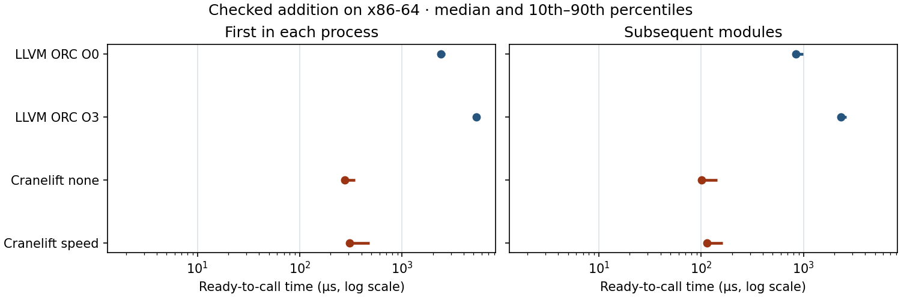

# RT-13 — Ready-to-call latency for LLVM ORC and Cranelift

- **Evidence** — Matched host measurements for one checked-add function, with exact result and effect checks.
- **LLMLang baseline** — `01ce9f847a453c62bcba997137e9a346443368b7`.
- **Tracking** — [PLAN §6.3](../../../PLAN.md#63-llvm-backend) · [Prior checked-add correctness comparison](RT-13-CRANELIFT-CHECKED-ADD-2026-11-24.md).

## What was timed

Both probes materialize an in-process JIT entry with the same x86-64 ABI and observable checked-add contract. The function reports overflow independently of a writable output slot and records ordered callbacks. The LLVM probe uses ORC LLJIT in LLVM 19.1.7. The Cranelift probe uses the pinned 0.116.1 frontend and engine from the prior study. Both use a generic x86-64 target.

The timer begins just before per-module setup and stops when the function entry is callable. LLVM parses the already-read IR buffer, verifies the module, runs the O0 or O3 IR pipeline, and looks up the function to force native materialization. Cranelift constructs CLIF, compiles and finalizes the module, formats the CLIF for inspection, and checks its machine buffer against finalized code. These are complete fixture pipeline timings. The profile names identify each engine's settings and give no guarantee of equivalent code quality.



Executable start, LLVM's process-level target registration, file I/O, probe calls and release of JIT memory are outside the timer. The first sample is the first module in a new process. Every subsequent sample also uses a new module and no reused compiled code. These samples measure repeated compilation within one process. Incremental recompilation, cache hits, runtime throughput and full startup remain separate.

## Measurements

Each of two primary runs used 24 batches. It shuffled the four profiles with a recorded seed and started a fresh process for each profile in each batch. Each process compiled 31 times, which gives 48 first samples and 1,440 subsequent samples per profile across the two runs. The probes ran serially on logical CPU 4 of an Intel Xeon Platinum 8573C Linux x86-64 cloud runner. Other task-owned builds were paused for these two runs and resumed afterwards. The cgroup recorded zero throttled CPU periods in both primary runs. The host scheduler and clock frequency were outside experimental control.

Values are median elapsed time, with 10th–90th percentiles in parentheses, in microseconds.

| Profile | First module in each process, µs | Subsequent modules, µs |
| --- | ---: | ---: |
| LLVM ORC O0 | 2,405.3 (2,290.3–2,649.5) | 840.5 (786.3–992.9) |
| LLVM ORC O3 | 5,297.8 (5,127.5–5,543.0) | 2,327.6 (2,211.9–2,619.5) |
| Cranelift `none` | 277.0 (264.2–347.5) | 101.5 (94.7–143.4) |
| Cranelift `speed` | 306.6 (286.4–482.7) | 113.4 (105.7–163.0) |



Both Cranelift profiles finish earlier than both ORC profiles at the reported percentiles. Two additional runs while other builds were active preserve the ordering of the medians. Their cgroup was throttled during every measured period. Their raw samples and distributions are reported separately. The purpose of those runs is to show the observed comparison under a second condition. No statistical claim about the cause of the difference between those conditions is made. [Primary distributions](JIT-MATERIALIZATION-01/evidence/builds-paused/summary.json) · [Concurrent-build distributions](JIT-MATERIALIZATION-01/evidence/concurrent/summary.json)

Each timed sample is followed by four concrete checks for normal signed addition, overflow, bypass and a non-unit enable value. The independent source evaluator checks status, contents of the output slot and ordered effects. The runner also verifies 4,596 concrete observations per ORC profile outside the timing loop. The existing Cranelift lowering was reused byte for byte. [Sampling and checks](JIT-MATERIALIZATION-01/run.py)

## Implementation consequence

Cranelift merits further latency-sensitive host JIT experiments. This result applies to one function, two builds and the recorded materialization boundary. LLVM's stronger optimization pipeline takes more time here. Its AOT byte sizes from the prior study and the ORC latency here describe different quantities. Comparable generated code quality, Debug and Release workflows, runtime throughput, memory, incremental builds, instrumentation, other targets and representative applications remain open.

## Reproduction

Use Debian LLVM 19.1.7 with development headers and shared component libraries, GCC 14.2.0, Rust 1.85.1, and CPython 3.12.14. The Cranelift build pins the original dependency lock and uses Rust release compiler optimization level 1 for the harness and dependencies. The chart uses Matplotlib 3.10.8. Choose a CPU inside the process's permitted affinity and record background load.

```sh
study=research/compiler-and-translation/RT-13/JIT-MATERIALIZATION-01
build=$(mktemp -d)
c++ $(llvm-config-19 --cxxflags) -O2 "$study/orc.cpp" -o "$build/latency-orc" \
  $(llvm-config-19 --ldflags --link-shared --libs orcjit native passes --system-libs)
CARGO_TARGET_DIR="$build/cargo" CARGO_BUILD_JOBS=1 CARGO_PROFILE_RELEASE_OPT_LEVEL=1 \
  cargo build --release --locked --manifest-path "$study/Cargo.toml"
python3 -B "$study/run.py" --orc "$build/latency-orc" \
  --cranelift "$build/cargo/release/latency-cranelift" --cpu 4 --seed 20261125 --output "$build/replay"
python3 -B "$study/summarize.py" "$study"/evidence/builds-paused/run-*/samples.csv \
  --output "$build/summary.json" --figure "$build/latency.png"
cmp "$study/evidence/builds-paused/summary.json" "$build/summary.json"
```

The two primary configurations and the two concurrent configurations record raw elapsed nanoseconds, run order, binary and input hashes and cgroup deltas. The data are archived under [the experiment directory](JIT-MATERIALIZATION-01/evidence).
