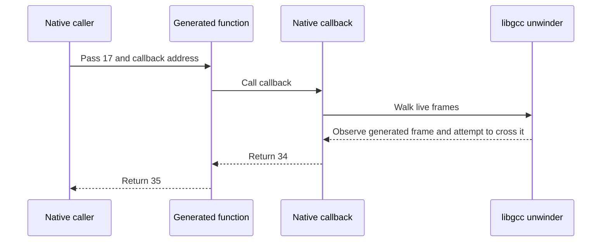

# RT-13 native JIT stack traversal and callback origins

This experiment compares Cranelift 0.116.1 and LLVM ORC 19.1.7 on Linux x86-64 System V. A native caller passes a callback to one generated function. The callback doubles its input while inspecting the active stack. The generated function adds one to that result and returns to the caller. For input 17 the reference observation is one callback and result 35. The experiment checks whether the native unwinder traverses the generated frame, and whether the callback instruction address identifies the original source line. Both observations matter for an LLMLang Debug/JIT profile that interleaves generated code and native calls.



The callback records its direct return address and sees whether `_Unwind_Backtrace` reports that same generated frame and reaches the native caller below it. GNU libgcc's `_Unwind_Find_FDE` separately checks whether the call-site address has a frame description entry. An FDE supplies the rules for reconstructing the caller's register state. The probe also asks `dladdr` whether the exact generated call site belongs to the generated entry's native dynamic-loader symbol. All profiles preserve frame pointers to keep that setting independent of unwind metadata registration.

## Observed results

| Profile | Native caller reached | FDE found during call | Source origin at call site |
| --- | --- | --- | --- |
| LLVM ORC with `uwtable` | Yes | Yes | Line 4 from saved object DWARF |
| LLVM ORC without `uwtable` | No | No | Line 4 from saved object DWARF |
| LLVM ORC with incorrect source location | Yes | Yes | Line 5 from saved object DWARF, rejected against the source |
| Cranelift `none` / `speed`, unwind operations disabled | No in both profiles | No | Line 4 from internal code spans |
| Cranelift `none` / `speed`, unwind operations enabled | No in both profiles | No | Line 4 from internal code spans |
| Cranelift `none` / `speed`, unwind operations enabled and explicitly registered | Yes in both profiles | Yes | Line 4 from internal code spans |

All nine profiles recorded the expected return value, callback count and generated frame address. The three ORC objects had identical text bytes. Removing `uwtable` from the `nounwind` fixture removed the emitted `.eh_frame`; the origin-only change kept both frame traversal and the DWARF structurally valid. The ORC origin check adds the generated call-site offset to the symbol address in the exact pre-link object. Cranelift instead matches the same kind of offset against the compiler's internal machine-code spans. None of the nine generated call sites identified the generated function through `dladdr`. The two source lookup routes use their explicit artifacts. [Source](JIT-UNWIND-01/source.c) · [Observer](JIT-UNWIND-01/observer.c) · [Machine-readable evidence](JIT-UNWIND-01/evidence.json)

The Cranelift API returned a System V unwind info value with either flag setting. The disabled build carried zero unwind operations and the enabled build carried two per profile. The additional adapter serializes the code generator's System V description with Gimli, registers it with libgcc and deregisters it before freeing the allocation. At the exact callback call site the FDE lookup returned absent after deregistration. Emission, registration lifetime and source-origin recovery require separate evidence. [Cranelift harness](JIT-UNWIND-01/src/main.rs) · [LLVM ORC harness](JIT-UNWIND-01/orc.cpp)

A candidate LLMLang host JIT that promises native stack traces can require exact callable-range registration and verify it across publication and retirement. A source map still needs a separate origin check. For Cranelift the demonstrated adapter adds platform-specific integration work. For ORC the measured default layer already supplies frame registration for this object. The experiment covers one frame shape and one callback while its generated allocation is live. It leaves exceptions, asynchronous unwinding, concurrent retirement, debugger registration and stepping, other ABIs, and representative Debug workloads open.

## Reproduction

Use Debian LLVM 19.1.7 with development headers and LLVM tools, GCC and libgcc 14.2.0-19, glibc 2.41, Rust 1.85.1 and CPython 3.12.14. Cargo uses the checked-in lock with Cranelift 0.116.1 and Gimli 0.31.1. The development archive used in this run was Debian `llvm-19-dev_19.1.7-3+b1_amd64.deb` with SHA-256 `b518fad63beae8e64ec40766c634d00b64ec4ca91ed6d32b3c93efafc1b9e20d`.

```sh
study=research/compiler-and-translation/RT-13/JIT-UNWIND-01
build=$(mktemp -d)
cc -g -O1 -fno-optimize-sibling-calls -Wall -Wextra -Werror \
  -c "$study/observer.c" -o "$build/observer.o"
c++ $(llvm-config-19 --cxxflags) -O2 "$study/orc.cpp" "$build/observer.o" \
  -rdynamic -o "$build/orc" \
  $(llvm-config-19 --ldflags --link-shared --libs orcjit native --system-libs) -ldl
cargo fetch --locked --manifest-path "$study/Cargo.toml"
CARGO_TARGET_DIR="$build/target" CARGO_BUILD_JOBS=2 CARGO_PROFILE_RELEASE_OPT_LEVEL=1 \
  cargo rustc --release --locked --offline --manifest-path "$study/Cargo.toml" -- \
  -C "link-arg=$build/observer.o" -C link-arg=-rdynamic -D warnings
for seed in 37 75; do
  LC_ALL=C PYTHONHASHSEED="$seed" python "$study/run.py" --orc "$build/orc" \
    --cranelift "$build/target/release/llmlang-rt13-cranelift-probe" \
    --output "$build/result-$seed.json"
done
cmp "$build/result-37.json" "$build/result-75.json"
cmp "$build/result-37.json" "$study/evidence.json"
```

In the isolated workspace the C++ driver used the extracted development include directory and explicit `-lLLVM-19` with the packaged shared-library directory. The receipt contains source and object hashes. Native absolute addresses and the temporary module path are omitted from the receipt so that both runs can be compared byte for byte. [Runner](JIT-UNWIND-01/run.py)
