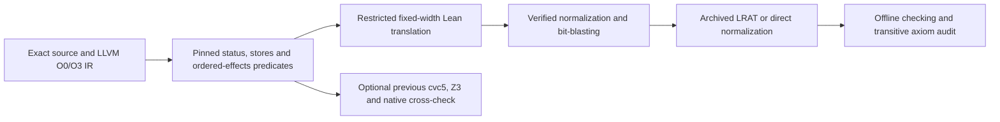

# RT-13 — Replay exact LLVM checked-add goals with Lean and LRAT

Lean accepts the same full observation predicates for the exact LLVM O0 and O3 checked-add artifacts. Twelve claims replay with archived LRAT certificates and an unavailable SAT executable. Each of those claims retains one native reflection axiom. Eight claims close by normalization with standard Lean axioms only.

## Scope and prior evidence

The [whole-domain LLVM study](RT-13-LLVM-CHECKED-ADD-OBSERVATIONS-2026-11-24.md) reads the real pinned LLVM output, symbolically evaluates its acyclic control flow and compares it with a signed checked-add observation. The [CPC follow-up](RT-13-LLVM-CHECKED-ADD-CPC-BINDING-2026-11-24.md) binds actual cvc5 certificates to those mismatch formulas. This experiment compares a separate Lean bit-vector checking route over exactly the same formula inputs. It retains the previous LLVM and SMT hashes and rechecks the unsupported `add nsw` control.

A complete observation contains an exact status, the ordered callback payloads and the ordered writes to the output slot. Inputs are all bit patterns of the two 32-bit signed operands and the 32-bit ABI enable flag. The source overflow check uses a 33-bit sign-extended sum. The LLVM intrinsic model checks the sign change of the 32-bit sum. The proof applies to the existing defined-input, output-slot and callback assumptions.

## Method

Recreate the IR at both optimization levels and extract the previous symbolic path predicates. For each formula, require the SHA-256 of the exact SMT-LIB query to match the prior ledger. The generator then renders the restricted symbolic expressions as typed Lean Boolean and bit-vector operations. For the valid lowering it proves path partition and absence of a full-observation mismatch. For the existing mutants it proves the same partition property, checks the six concrete full mismatches and proves two intentionally weaker projections at each optimizer level.



The producer uses Lean's `bv_decide?` to obtain either a normalization proof or an LRAT certificate. Replay uses `bv_check` for the 12 saved certificates and configures the SAT executable to an unavailable path. The certificate bytes are checked against the exact goals. Reusing the O0 preservation certificate for the changed overflow rule is refused by the LRAT checker.

## Results and trust boundary

| Replay mode | Theorems | Native axioms per theorem |
| --- | ---: | ---: |
| `bv_check` | 12 | 1 |
| `bv_normalize` | 8 | 0 |

Both preserving artifacts pass the whole-domain status, store and effect comparison. The reversed-callback mutant passes a status-plus-stores comparison, and the store-on-error mutant passes a status-plus-effects comparison. The pinned witnesses distinguish all three mutants under complete observation at both optimizer levels. Both ordinary proof-only runs and the full prior native and SMT cross-check produce the same ledger.

Lean's LRAT route checks a certificate against the bit-blasted goal. The pinned implementation uses compiled evaluation for the reflection check and introduces its Boolean result as a native axiom. The audit records one such axiom for each `bv_check` statement. The standard Lean axioms are `propext`, `Classical.choice` and `Quot.sound`. The independent proof-generation solver remains replaceable because checking consumes the certificate. The native reflection computation remains in the trusted base. [Lean 4.36 tactic implementation](https://github.com/leanprover/lean4/blob/611c117bfaf7b7ae1cfcf246ce6fba31e8f509e9/src/lean/Lean/Elab/Tactic/BVDecide.lean)

## Implications and limits

The LRAT route is an alternative to solver agreement or CPC checking for the admitted fixed-width formula. It supports offline certificate replay and exposes the compiled checking assumption. The Lean proof starts at the generated typed formula. The LLVM reader, its observation model and the translation of its restricted formula syntax remain part of the correspondence boundary. General LLVM semantics, source-to-SPG correspondence, proof routes without native reflection, other widths and independent review remain open.

## Reproduce

Use CPython 3.12.14, LLVM 19.1.7 and Lean 4.36.0 at revision `611c117bfaf7b7ae1cfcf246ce6fba31e8f509e9`. The default proof replay uses the 12 archived LRAT files and no solver. Adding `--generate-certificates` reruns Lean's certificate producer and compares the exact bytes. Adding `--cross-check` also repeats the previous solver and native ledger with Z3 4.13.3, cvc5 1.4.2 and GCC 14.2.0.

```sh
fixture=research/compiler-and-translation/RT-13/LLVM-CHECKED-ADD-LEAN-01
output=$(mktemp)
python3 -B "$fixture/run.py" --opt "$(command -v opt)" --lean "$(command -v lean)" > "$output"
cmp "$fixture/evidence.json" "$output"
python3 "$fixture/chart.py"
```

[Replay and generator](LLVM-CHECKED-ADD-LEAN-01/run.py) · [LRAT certificates](LLVM-CHECKED-ADD-LEAN-01/lrat/) · [Exact axiom and artifact ledger](LLVM-CHECKED-ADD-LEAN-01/evidence.json)
