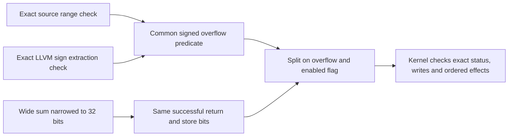

# RT-13 — Prove exact LLVM checked-add predicates without native reflection

Lean proves the same 20 O0 and O3 claims as the previous LRAT route. Symbolic signed arithmetic and Boolean case analysis replace the 12 LRAT-dependent proofs. All claims and supporting lemmas use only standard Lean axioms. Three incorrect whole-domain claims still fail.

## Boundary and alternatives

The [previous bit-vector replay](RT-13-LLVM-CHECKED-ADD-LEAN-2026-11-25.md) checks the exact observation predicates with saved LRAT certificates and exposes one native reflection axiom per certificate theorem. This study asks whether a small symbolic proof covers the same facts for this particular operation.

The runner reconstructs the same LLVM modules, source and SMT query hashes. It uses the previous module's generator for the exact Lean proposition, including branches for enabled and disabled execution, output-slot stores and ordered callback payloads. It retains the same undefined-behavior admission, ABI and callback assumptions. It performs no change to the source or target formula. The existing `add nsw` rejection is also replayed.

## Proof

The source checks the signed range after widening both operands to 33 bits. The LLVM model checks that operand sign bits agree and the 32-bit result sign differs. Lean proves the 33-bit sum has the exact integer value, since every sum of two signed 32-bit integers fits in that width. It uses the integer bounds and Lean's standard proof of signed addition overflow to show that both tests equal `BitVec.saddOverflow`. A third lemma shows that retaining the low 32 bits of the widened sum equals the wrapping 32-bit operation.



The generated proof rewrites only these equivalent operations, then checks both Boolean choices of the overflow predicate and of the enable flag. The prior eight normalization goals still use normalization. The proof config points the SAT executable to an unavailable path. It reads neither the saved LRAT files nor a solver verdict.

## Results

| Prior proof | Checked replacement | Claims | Native axioms per replacement |
| --- | --- | ---: | ---: |
| `bv_check` | symbolic | 12 | 0 |
| `bv_normalize` | normalize | 8 | 0 |

The full preserving claims cover both optimizer levels. The checked path partitions, weaker projections of the mutants and six concrete mismatch witnesses are unchanged. The proof script rejects a falsely asserted whole-domain preservation claim for each of the three O0 mutants. Across the three arithmetic lemmas and 20 claims, the observed axioms are `propext`, `Classical.choice` and `Quot.sound`.

## Implications and limits

A specialized symbolic proof can remove the compiled reflection premise for this checked-add operation. It requires an arithmetic bridge for every lowering family that uses it. The general LRAT tactic remains useful for formulas without an available symbolic bridge and retains its own compiled checking assumption in the pinned version. The SMT and CPC routes remain distinct alternatives for other predicates and theories.

The proof starts at the pinned LLVM path model and exact generated Lean propositions. Parser correctness, general LLVM semantics, source-to-SPG correspondence, other operations and widths, and independent review remain outside this result. The proof does not change the trust of Logos or of the general LRAT checker.

## Reproduce

Use CPython 3.12.14, LLVM 19.1.7 and Lean 4.36.0 at revision `611c117bfaf7b7ae1cfcf246ce6fba31e8f509e9`. The ledger records exact module and model hashes and every theorem's dependencies.

```sh
fixture=research/compiler-and-translation/RT-13/LLVM-CHECKED-ADD-SYMBOLIC-01
output=$(mktemp)
python3 -B "$fixture/run.py" --lean "$(command -v lean)" --opt "$(command -v opt)" > "$output"
cmp "$fixture/evidence.json" "$output"
python3 "$fixture/chart.py"
```

[Arithmetic proof](LLVM-CHECKED-ADD-SYMBOLIC-01/Overflow.lean) · [Exact proof generator](LLVM-CHECKED-ADD-SYMBOLIC-01/run.py) · [Axiom ledger](LLVM-CHECKED-ADD-SYMBOLIC-01/evidence.json)
