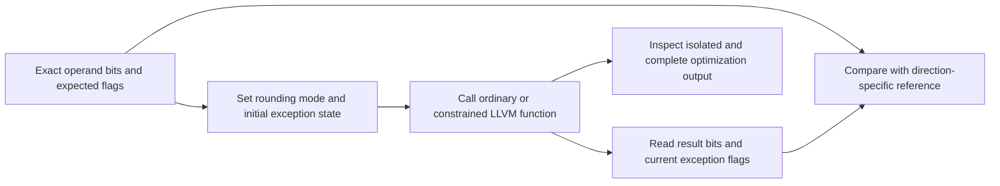

# RT-13 — Dynamic rounding, exception flags and constrained LLVM operations

Parameterized constrained LLVM operations match every tested dynamic rounding and exception result. The literal constrained counterpart returns positive zero for exact cancellation under downward rounding after O3, where the reference requires negative zero. The packaged and separately built upstream LLVM 19.1.7 optimizers reproduce the same result.

## Method

The earlier [binary64 comparison](RT-13-BINARY64-CONTRACTION-2026-11-25.md) uses round-to-nearest and leaves exception state open. Here a native C host sets each of the four rounding modes and verifies that the environment reports it. Before each call it clears the sticky exception flags. Half of the calls then start with the invalid flag already set, checking that an operation preserves existing state. A sticky flag remains visible until explicitly cleared.

Ten exact input pairs cover positive and negative midpoints, overflow and tiny products, division by zero, invalid division, exact addition and exact cancellation. The reference records the expected binary64 value and flags for each named case. Its rules include the direction-dependent sign of an exact cancellation and the rounding of half a minimum subnormal. Invalid division is compared by NaN classification. The observed flags are invalid, divide by zero, overflow, underflow and inexact.

The same generator produces three LLVM routes. `plain` uses ordinary instructions on literal operands. `strict` uses the matching constrained instructions with `round.dynamic`, `fpexcept.strict` and `strictfp`, also on literal operands. `parameterized` gives the same operands to constrained functions through a separately compiled host and no link-time optimization. Each module is verified before and after optimization. The raw ledger preserves expected and observed bit patterns and the five flag states for every call. [LLVM 19.1.7 floating-point environment](https://github.com/llvm/llvm-project/blob/cd708029e0b2869e80abe31ddb175f7c35361f90/llvm/docs/LangRef.rst#floating-point-environment)



## Results

| Pipeline | Route | Value mismatches | Flag mismatches |
| --- | --- | ---: | ---: |
| O0 | parameterized | 0 | 0 |
| O0 | plain | 0 | 0 |
| O0 | strict | 0 | 0 |
| O3 | parameterized | 0 | 0 |
| O3 | plain | 18 | 60 |
| O3 | strict | 2 | 0 |

Every row represents 80 observations across ten operand pairs, four modes and two initial flag states. Starting flags survive all calls. In the O0 plain case the machine operations happen to honor the tested environment. O3 folds the ordinary halfway sum to the round-to-nearest result and can remove the operations that would set flags. These observations document why default LLVM arithmetic does not implement a contract that exposes the dynamic environment.

The two constrained literal mismatches are both the downward `1 + (-1)` result, with and without a seeded invalid flag. The O0 call and both parameterized calls produce negative zero. The optimized literal function returns positive zero. Isolated `early-cse` replaces the returned value with positive zero while leaving the constrained call. Isolated `instcombine` removes the call and returns the same constant. The signed-zero discrepancy therefore already exists in optimized IR. It does not require a code-generation difference or an exception-state mismatch.

The separately built upstream LLVM optimizer at `cd708029e0b2869e80abe31ddb175f7c35361f90` reproduces both isolated forms and every native observation while the remaining tools are unchanged. Only the optimizer version banner differs in the complete replays. [Pinned upstream build](RT-13-STOCK-ALIVE2-LLVM-EH-2026-11-24.md#build-and-replay)

## Implications for implementation choice

A profile that exposes mode changes and sticky flags needs a dedicated lowering and validation contract. Checking constrained instruction metadata is insufficient on the tested LLVM release. Preserving operands across a separate call boundary serves as a bounded control for the cancellation witness. Extending that approach requires checking the retained code path against folding, inlining and later optimization.

The study covers Linux x86-64, nontrapping exceptions, three operations and one optimizer release. It leaves additional flags and instruction classes, state restoration across calls, LTO, other LLVM releases, targets and formal preservation open. It supplies a regression case for comparing versions and profile contracts.

## Reproduce

Use CPython 3.12.14 and Debian LLVM 19.1.7 on Linux x86-64 with `clang`, `llvm-as`, `opt` and `llc` available.

```sh
fixture=research/compiler-and-translation/RT-13/LLVM-DYNAMIC-ROUNDING-01
output=$(mktemp)
python3 "$fixture/run.py" --output "$output"
cmp "$fixture/evidence.json" "$output"
python3 "$fixture/chart.py"
```

Pass `--opt /path/to/upstream/build/bin/opt` to repeat the optimizer cross-check. The resulting ledger differs in `versions.opt` only. [Generator and reference](LLVM-DYNAMIC-ROUNDING-01/run.py) · [Native host](LLVM-DYNAMIC-ROUNDING-01/host.c) · [Evidence ledger](LLVM-DYNAMIC-ROUNDING-01/evidence.json)
