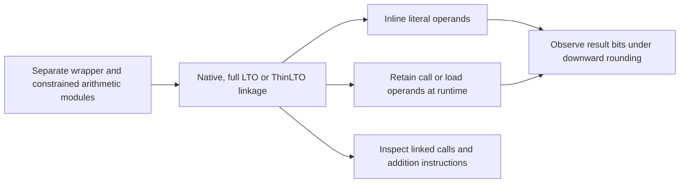

# RT-13 — Dynamic signed zero through full and ThinLTO

Separately compiled native objects preserve negative zero for downward exact cancellation. Full LTO and ThinLTO both change that result to positive zero when the linker can inline literal operands. A retained call and an inlined operation fed by volatile loads both preserve the expected result in all nine version and link profiles.

## Method

The earlier dynamic rounding experiment isolates a constrained literal cancellation and the version comparison tests forced inlining inside one module. This study separates the use and definition into two LLVM modules. One module owns the parameterized constrained addition with `round.dynamic`, `fpexcept.strict` and `strictfp`. The second module defines three wrappers that supply the same operands, `1` and `-1`. [Dynamic rounding fixture](RT-13-LLVM-DYNAMIC-ROUNDING-2026-11-25.md) · [Version comparison](https://github.com/aivibeflow/LLMLang/blob/36f3be796a99874b462ff34518bdc599aaad7d3a/research/compiler-and-translation/RT-13/RT-13-LLVM-DYNAMIC-ROUNDING-VERSIONS-2026-11-25.md)

The literal-inline path marks the call `alwaysinline`. The kept-call path passes the same literals and marks the call `noinline`. The third path also allows inlining and obtains the operands from explicit volatile loads. The inputs' exact bit patterns remain fixed in the initialized fixture. The loads ensure the optimizer emits actual reads along that tested route.

Each compiler and its matching LLD linker build the two modules with O3. The host stays a separate native object. The link variants use regular native objects, full LTO or ThinLTO for the two LLVM modules. The host sets each rounding mode and runs every wrapper twice, once after clearing all flags and once with the invalid flag seeded. It records raw binary64 results and equality with the expected flag state. The runner also inspects each linked wrapper for a transfer to the original function or a retained floating-point addition.



## Results

| Version and link | Literal inline | Kept call | Inline with volatile inputs |
| --- | --- | --- | --- |
| 19/full | +0 | -0 | -0 |
| 19/native | -0 | -0 | -0 |
| 19/thin | +0 | -0 | -0 |
| 22/full | +0 | -0 | -0 |
| 22/native | -0 | -0 | -0 |
| 22/thin | +0 | -0 | -0 |
| 23/full | +0 | -0 | -0 |
| 23/native | -0 | -0 | -0 |
| 23/thin | +0 | -0 | -0 |

The table shows downward rounding, where the reference requires negative zero. All other rounding modes return positive zero on this exact cancellation. Both initial flag states give the same value in each case and all 216 observations preserve the expected flags.

Every native wrapper transfers control to the original parameterized function. With either LTO mode the literal-inline wrapper contains neither a transfer to that function nor an addition. The retained-call wrapper still transfers control to the function. The volatile-input wrapper has its own `addsd` after inlining. These observations distinguish an optimizer boundary that survives compilation from one that survives the final link.

## Implications for implementation choice

Multi-module source structure alone cannot preserve this dynamic observation through link-time optimization. On this profile either the retained-call policy or runtime operand loading can retain the operation. The latter adds explicit memory accesses, and the former leaves a call boundary. Their cost, portability, impact on general optimized floating-point code and broader semantic preservation remain open. The result covers one cancellation witness on Linux x86-64 and the exact three compiler/linker pairs.

## Reproduce

Use CPython 3.12.14, GNU `objdump` and the exact LLVM-based Clang and LLD pairs on Linux x86-64. Version 19 is Debian 19.1.7. Versions 22.1.4 and 23.1.1 come from the pinned Lean 4.34.0 and 4.36.0 distributions.

```sh
fixture=research/compiler-and-translation/RT-13/LLVM-ROUNDING-LTO-01
output=$(mktemp)
python3 "$fixture/run.py" \
  --llvm19-bin /path/to/llvm19/bin --llvm22-bin /path/to/llvm22/bin \
  --llvm23-bin /path/to/llvm23/bin --output "$output"
cmp "$fixture/evidence.json" "$output"
python3 "$fixture/chart.py"
```

[Operation module](LLVM-ROUNDING-LTO-01/operation.ll) · [Wrapper module](LLVM-ROUNDING-LTO-01/wrappers.ll) · [Runner](LLVM-ROUNDING-LTO-01/run.py) · [Evidence ledger](LLVM-ROUNDING-LTO-01/evidence.json)
