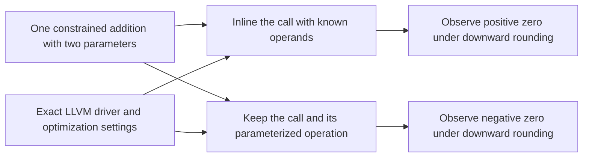

# RT-13 — Dynamic signed-zero preservation across LLVM versions

Clang drivers based on LLVM 19.1.7, 22.1.4 and 23.1.1 all reproduce the constrained literal cancellation mismatch. Forced inlining also returns positive zero in all three O0 profiles. Retaining the parameterized call preserves negative zero under downward rounding in all six version and optimization combinations.

## Method

The earlier dynamic rounding fixture supplies the same IR generator, C host, bit and flag reference, and evidence ledger. Each profile compiles the exact IR through one Clang driver and links the fixed host using packaged Clang 19. The harness repeats the 80 cases per arithmetic route and profile. The sources and previous ledger are checked by SHA-256 before use. [Archived dynamic rounding fixture](https://github.com/aivibeflow/LLMLang/tree/afd1f797e7d63e3ca1da3487cc802f5dfb9043a3/research/compiler-and-translation/RT-13/LLVM-DYNAMIC-ROUNDING-01)

The version inputs are Debian Clang 19.1.7 and the Clang distributions bundled with Lean 4.34.0 and 4.36.0. Their exact LLVM revisions are `35990504507d79e0b9deb809c8ee5e1b34ceef20` for 22.1.4 and `6dfe1677ab8dffbc6ec13d53a1e0215d75147689` for 23.1.1. Both emit code for the same x86-64 Linux ABI in this experiment. The result applies to these exact drivers and flags.

The follow-up adds two wrappers within the IR module. Each calls the parameterized constrained addition with literals `1` and `-1`. One call site has `alwaysinline`, and the other has `noinline`. Both caller and callee carry `strictfp`, and the callee uses `round.dynamic` and `fpexcept.strict`. A separate host checks both wrappers under all four rounding modes and requires all exception flags to remain clear. The expected zero is negative only when rounding downward.



## Results

| Version and profile | Plain differences, values / flags | Literal constrained differences, values / flags | Downward forced inline | Downward retained call |
| --- | ---: | ---: | --- | --- |
| 19/O0 | 0 / 0 | 0 / 0 | +0 | -0 |
| 19/O3 | 18 / 60 | 2 / 0 | +0 | -0 |
| 22/O0 | 0 / 0 | 0 / 0 | +0 | -0 |
| 22/O3 | 18 / 60 | 2 / 0 | +0 | -0 |
| 23/O0 | 0 / 0 | 0 / 0 | +0 | -0 |
| 23/O3 | 18 / 60 | 2 / 0 | +0 | -0 |

The original parameterized route matches all 80 value and flag observations in every profile. The O3 constrained literal mismatches are exactly the two downward cancellation trials with different initial flags. In the new forced-inline control even O0 retains a constrained call whose result is discarded in favor of positive zero. At O3 the wrapper consists of the constant return. In each `noinline` control the retained call remains present in IR and preserves the negative-zero result. All four-mode wrapper calls leave the exception flags clear.

## Implications for implementation choice

Upgrading among these builds leaves the observed mismatch. A source profile with observable dynamic rounding can test for a preserved runtime operation or a verified alternative. The tested call boundary preserves the one cancellation witness. Ordinary inlining policy and the full link-time optimization pipeline remain separate questions. The result also leaves additional architectures, releases, floating-point operations and a formal preservation argument open.

## Reproduce

Use CPython 3.12.14, the pinned Clang drivers and Linux x86-64. With the archived baseline directory available, run:

```sh
fixture=research/compiler-and-translation/RT-13/LLVM-ROUNDING-VERSIONS-01
output=$(mktemp)
python3 "$fixture/run.py" \
  --clang19 /path/to/clang-19 --clang22 /path/to/clang-22 \
  --clang23 /path/to/clang-23 --output "$output"
cmp "$fixture/evidence.json" "$output"
python3 "$fixture/chart.py"
```

The runner defaults to the adjacent `LLVM-DYNAMIC-ROUNDING-01` directory. If those files change, pass an exact archived copy through `--baseline`. [Runner](LLVM-ROUNDING-VERSIONS-01/run.py) · [Inlining host](LLVM-ROUNDING-VERSIONS-01/inline_host.c) · [Evidence ledger](LLVM-ROUNDING-VERSIONS-01/evidence.json)
