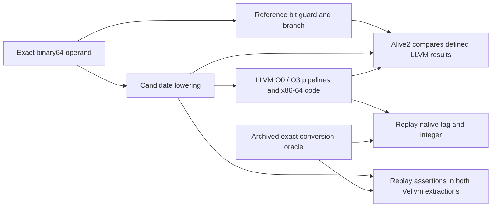

# Compare LLVM lowerings of checked F64 to signed I64 conversion

A checked conversion needs to distinguish a valid integer, a finite range refusal and a nonfinite refusal. LLVM's plain `fptosi` can produce poison for an out-of-range conversion. Poison is an invalid IR value that can propagate to dependents and trigger undefined behavior when used by certain instructions. This study compares where candidate LLVM lowerings prevent that poison from becoming observable, and which routes the pinned validators can check. [Native conversion policies and corpus](../../semantic-representation/RT-05/RT-05-F64-I64-CONVERSION-2026-11-25.md) · [LLVM conversion instructions](https://llvm.org/docs/LangRef.html#conversion-operations)

## Candidate IR and evidence

The fixture returns a pair `{tag, value}`. Success has tag zero and a signed I64 truncated toward zero. A finite range refusal has tag one, a nonfinite refusal has tag two, and both return a zero value. The zero on refusal is a defined part of this fixture. It makes accidental poison in the value field independently testable, even when the tag already signals refusal.

- **Bit guard and branch** forms the reference IR. It clears the sign bit for unsigned magnitude comparison against the encoding of `2^63`. It admits equality only for negative input. An independent magnitude comparison with the infinity encoding classifies nonfinite values.
- **Ordered comparisons and branch** uses `fcmp oge` against `−2^63` and `fcmp olt` against `+2^63`. Unordered NaN comparisons fail. The checked branch evaluates `fptosi` only on success.
- **Ordered comparisons and masked value** uses the same range test. It forms the conversion in SSA and selects zero on refusal. LLVM `select` masks poison in the unselected operand. The fixture tests whether the returned tag and value agree with the reference.
- **Guarded saturation** replaces the conversion inside the masked route with `llvm.fptosi.sat.i64.f64`. Saturation makes conversion total. The separate guard still supplies the refusal tag and zero value.
- **Plain saturation** always reports success and returns the saturated integer. The controls use the correct tag with an unmasked value, or an inclusive positive check that wrongly admits `+2^63`.



The corpus is the exact 216-word archive from RT-05, covering both zeros, subnormals, fractions, range limits, infinities and NaNs. The native comparison independently reads the tag and value across five routes and two Clang configurations, O0 and O3. That yields 2,160 result pairs. Deliberate poison controls run in Alive2 and Vellvm. They are excluded from the native calls.

Alive2 compares the unoptimized alternatives with the bit-based reference, for defined, non-poison inputs. The runner also optimizes the exact module with LLVM's O0 and O3 pipelines. It projects each of the three supported functions out of those modules, normalizes the compared symbol name and supplies the reference and target as a single matching pair. The ledger records the exact optimizer module and projection digests. Concrete Vellvm tests exercise the unoptimized IR in both native and bytecode builds of the same extraction. These two builds establish build-mode agreement for the assertions.

## Results

The native denominator is 216 inputs per route and configuration. The Vellvm denominator counts assertions over tag or result separately. A dash indicates that the route was outside that comparison. The optimized Alive2 columns list O0 then O3.

| LLVM route | Original Alive2 result | Optimized Alive2 results | Native mismatches per configuration | Vellvm assertions per extraction |
|---|---|---|---:|---:|
| Bit guard and branch | reference | refines, refines | 0 | 432/432 |
| Ordered comparisons and branch | refines | refines, refines | 0 | 432/432 |
| Ordered comparisons and masked value | refines | refines, refines | 0 | 432/432 |
| Guarded saturation | unsupported | — | 0 | 0/2 |
| Plain saturation | unsupported | — | 63 | 0/2 |
| Inclusive upper-bound control | refuted at `43e0000000000000` | — | — | 4/4 |
| Unmasked conversion control | refuted at `43e8000088042119` | — | — | 4/4 |

The positive-boundary control returns status zero and poison for `43e0000000000000` in Alive2. Vellvm replays both fields and accepts the exact negative boundary `c3e0000000000000`. The unmasked conversion also exposes poison on a finite overflow and a quiet NaN despite correct refusal tags. Together the controls require both an exclusive positive bound and an observed value that remains defined on failure.

For the three supported checked routes, each Vellvm extraction passes 1,296 assertions over the entire archived corpus. The poison controls add eight passed assertions per extraction. Both extraction modes report uninterpreted calls for all four saturation probes. Stock Alive2 also reports the saturation intrinsic as an unknown call. Clang's guarded saturation matches the reference in every archived observation. Its plain saturation changes 63 observations per native configuration, corresponding to 55 finite range refusals and eight nonfinite refusals. A selection policy relying on this version of Alive2 can validate either ordered checked route against the bit-based formulation. Selecting saturation for a checked operation requires coverage of the intrinsic and evidence for the separately returned refusal.

## Scope and replay

The Alive2 result covers the exact LLVM functions, the stated input conditions and the validator's model. It does not establish an LLMLang source-to-IR theorem. Native execution measures x86-64 tag and value under ordinary floating-point behavior. Signaling and status flags, dynamic floating-point environment, fast-math and constrained operations, other widths or targets, saturation proofs, machine code correspondence and independent review remain open.

The initial LLMLang baseline is `d6471746d5579b72871a096bea31441322120338`. The tools are CPython 3.12.14, stock LLVM 19.1.7 at `cd708029e0b2869e80abe31ddb175f7c35361f90`, Debian Clang and `llvm-extract` 19.1.7, Alive2 `84041960f183aec74d740ff881c95a4ce5234d3d`, and Vellvm `7f0610c38d829b79bf6e867edf410c9e6f928f98` under Rocq 9.1.1 and OCaml 4.14.2 with flambda. The pinned build notes describe the package and image revisions. The native Vellvm build uses `opam exec -- make -C src -j1 interp` in the same source tree and switch as the bytecode output. The machine-readable evidence binds tool binaries, source inputs, generated test and optimized modules, refinement outcomes and native observations by exact digests. [Build pins](LLVM-VALIDATORS-01/BUILD.md) · [Stock Alive2 comparison](RT-13-STOCK-ALIVE2-LLVM-EH-2026-11-24.md)

```bash
fixture=research/compiler-and-translation/RT-13/LLVM-F64-I64-LOWERING-01
LC_ALL=C PYTHONHASHSEED=1 python3 -B "$fixture/run.py" \
  --assembler "$LLVM_STOCK/bin/llvm-as" --optimizer "$LLVM_STOCK/bin/opt" \
  --extractor "$LLVM_DEBIAN/bin/llvm-extract" --clang "$LLVM_DEBIAN/bin/clang" \
  --alive "$ALIVE_STOCK" --vellvm "$VELLVM_SOURCE/src/vellvm" \
  --ocamlrun "$OCAML_SWITCH/bin/ocamlrun" \
  --bytecode "$VELLVM_SOURCE/src/_build-byte/default/ml/main.bc" \
  > /tmp/llmlang-llvm-f64-i64.json
cmp "$fixture/evidence.json" /tmp/llmlang-llvm-f64-i64.json
python3 "$fixture/chart.py"
```

Run in the selected opam switch, or set `CAML_LD_LIBRARY_PATH` to its library and OCaml runtime stub directories. If rebuilding produces different executable digests, compare the IR and outcome fields separately and retain the new tool provenance.

[Exact LLVM IR](LLVM-F64-I64-LOWERING-01/lowerings.ll) · [Runner](LLVM-F64-I64-LOWERING-01/run.py) · [Evidence ledger](LLVM-F64-I64-LOWERING-01/evidence.json) · [Table generator](LLVM-F64-I64-LOWERING-01/chart.py)
