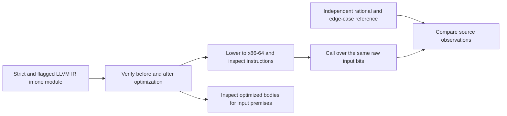

# RT-13 — LLVM floating-point flags and source observations

LLVM's verifier accepts `contract`, `nsz` and `nnan` on the tested operations. At O3 the first flag permits fusion, the second permits changing the observable sign of zero, and the third removes a NaN classification branch under its input premise. A strict split expression and the explicit FMA intrinsic match their separate source observations.

## Method

The prior [C, Rust and Java comparison](RT-13-BINARY64-CONTRACTION-2026-11-25.md) identifies 77 distinct observations between separate and fused binary64 rounding. This study reuses its 6,859 exact input triples and independently rounded rational reference while holding the target and file format fixed. One LLVM IR module contains both the strict and flagged expressions. A C host calls those functions through the same native ABI, passes raw operand bits, and records exact non-NaN result bits and NaN classifications.

Each profile assembles the module, checks it with `opt -passes=verify`, applies the O0 or O3 pipeline, verifies again, then lowers to x86-64 with FMA support using `llc`. The runner inspects the executed pipeline's instruction selection and records the optimized bodies for the sign and NaN controls. The C host uses Clang from the same Debian LLVM 19.1.7 toolset and checks the process rounding mode.



The tested flags carry different obligations. `contract` permits fusion of the multiplication and addition. `nsz` allows treating the sign of zero as insignificant. `nnan` assumes the comparison operands are not NaN. This last flag changes the admitted domain. The host runs the unrestricted classifier for all inputs and runs the restricted classifier only for non-NaN inputs. The inputs excluded from the restricted operation yield no runtime comparison. [LLVM 19.1.7 LangRef](https://github.com/llvm/llvm-project/blob/cd708029e0b2869e80abe31ddb175f7c35361f90/llvm/docs/LangRef.rst#fast-math-flags)

## Results

| Pipeline | Rows | Contract differences | Signed-zero differences under nsz | NaN inputs excluded for nnan |
| --- | ---: | ---: | ---: | ---: |
| O0 | 6,859 | 0 | 0 | 1,083 |
| O3 | 6,859 | 77 | 361 | 1,083 |

The unflagged split expression and the explicit `llvm.fma.f64` agree with their own references in all 6,859 rows per pipeline. O0 emits separate operations for the `contract` expression, and O3 emits `vfmadd213sd`. In the O3 output the contracted expression equals the one-rounding reference. The exact selected opcode is in the ledger.

For `fadd -0, +0`, the unflagged reference and machine program return positive zero. At O3 the `nsz` function reduces to returning its argument, which preserves negative zero instead. The 361 differing rows repeat the one negative-zero input across the other two corpus operands. The `nnan` body reduces to `ret i32 0` at O3 and agrees with the ordinary classifier on every admitted input. Its 1,083 excluded rows contain one of three NaN bit patterns in the first operand.

## Implications for implementation choice

A strict source profile can lower this fragment with separate unflagged arithmetic, an explicit fused operation where requested, and observable signs of zero. A profile authorizing relaxed arithmetic can carry only the freedoms its source contract grants. A `nnan` promise requires a proof or checked admission condition for the operands. A structurally valid LLVM module gives no evidence that these permissions reflect the source contract.

The result covers one arithmetic pattern, one zero operation, one classification, x86-64 FMA and round-to-nearest. It leaves dynamic rounding and exception state, additional fast-math flags, poison propagation, other targets and full source-to-IR proofs open.

## Reproduce

Use CPython 3.12.14 and Debian LLVM 19.1.7 with `clang`, `llvm-as`, `opt` and `llc` on an x86-64 FMA Linux target.

```sh
fixture=research/compiler-and-translation/RT-13/LLVM-FP-FLAGS-01
output=$(mktemp)
python3 "$fixture/run.py" --output "$output"
cmp "$fixture/evidence.json" "$output"
python3 "$fixture/chart.py"
```

[LLVM module](LLVM-FP-FLAGS-01/operations.ll) · [Native host](LLVM-FP-FLAGS-01/host.c) · [Evidence ledger](LLVM-FP-FLAGS-01/evidence.json)
