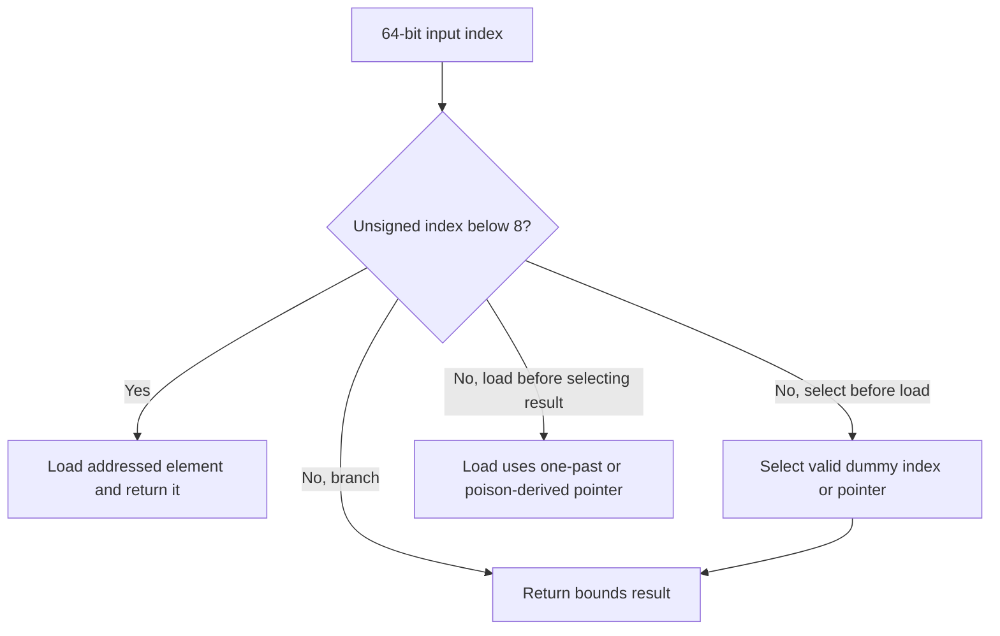

# RT-13 Inbounds pointer calculation and checked byte loads

**Issue** [#330](https://github.com/aivibeflow/LLMLang/issues/330)

A checked byte read from a fixed array returns a byte for an index in range and a bounds result otherwise. LLVM can express several control-flow and selection strategies for this operation. The important distinction is whether a valid pointer is established before the load. This study compares five strategies on an immutable eight-byte global and a 64-bit index carrier on Linux x86-64. [LLVM backend architecture](LLVM-BACKEND-ARCHITECTURE.md)

## Candidate lowerings and definedness

The source treats the index word as unsigned and checks whether it is below eight. The LLVM target uses a 64-bit pointer index, with two's-complement interpretation of array byte offsets. An `inbounds` GEP may form a pointer to the next byte after the array, but a one-byte load from there would exceed the allocation. An offset farther outside the object violates the selected `inbounds` contract and produces poison. `select` can discard poison in an unselected operand. It cannot undo a load already performed through an invalid pointer. `freeze` keeps the one-past pointer and yields a non-dereferenceable pointer if its operand is poison. [LLVM 19.1 reference for GEP](https://releases.llvm.org/19.1.0/docs/LangRef.html#i-getelementptr) · [Select](https://releases.llvm.org/19.1.0/docs/LangRef.html#i-select) · [Freeze](https://releases.llvm.org/19.1.0/docs/LangRef.html#i-freeze)

A branch can execute the load only on a successful check. A pointer-select implementation may calculate the candidate GEP earlier and discard its result for an invalid index, selecting the known valid element zero for the load. An index-select implementation can select zero before GEP and keep pointer formation in bounds throughout. Both select routes then mask the loaded value to the bounds result when the source index is invalid. The extra load of immutable initialized storage is permitted by the fixture's observable contract. It would need separate justification for volatile or otherwise observable reads.



The dummy-load routes choose initialized element zero, load it and return the bounds result. The last route carries an invalid memory access, even if the result selection would have hidden the loaded byte.

## Results

The analytic classification uses 264 index words, including 0–255 and eight high-bit or maximum-word controls. The exact variants and module layout are in [LLVM source](LLVM-INBOUNDS-LOAD-01/fixture.ll). The model distinguishes a valid load, a one-past load and a poison-derived pointer load. For the two invalid variants, native calls are limited to the eight valid indices. The same module passes LLVM's IR verifier at O0 and O3. Each optimized and linked build produces 808 native results, all agreeing with the byte-array oracle.

| Lowering | Analytically defined of 264 | One-past load | Load using poison or frozen poison |
| --- | ---: | ---: | ---: |
| Branch before pointer formation | 264 | 0 | 0 |
| Select valid pointer before load | 264 | 0 | 0 |
| Select valid index before GEP | 264 | 0 | 0 |
| Select final result after an unconditional load | 8 | 1 | 255 |
| Freeze calculated pointer, then load | 8 | 1 | 255 |

Independently of the sample, under the stated object premises the unsigned check allows exactly offsets 0 through 7 for a source data load. The one-past word 8 distinguishes pointer formation from memory safety. The maximal input word denotes offset −1 for the GEP and is rejected before the dereference in the preserving routes. The verifier accepts all variants because their typed IR shapes are valid. The extra precondition for each dynamic load comes from source bounds and object evidence.

The [ledger](LLVM-INBOUNDS-LOAD-01/evidence.json) stores all 1,616 exact native results, input words, per-variant classifications and IR and object hashes. No elapsed time was measured. This is a source-level definedness argument plus bounded native observations. General allocation identity and provenance, pointer-to-integer round trips, other data layouts, memory concurrency, volatile reads and independent mechanization remain open. No invalid native loads were executed.

## Reproduction

Use Debian LLVM 19.1.7 `opt` and `llc`, GCC 14.2.0-19, and CPython 3.12.14 from the repository root. The source baseline is `6b7d93f2a86fe5f8b0f3b142c693b4a70ffa145f`. Set the loader path for the LLVM installation if it is unpacked outside the system prefix. Seeds 1 and 2 reproduced the ledger byte for byte. Relative links and Mermaid syntax structure were checked locally. GitHub visual rendering was not manually verified.

```sh
study=research/compiler-and-translation/RT-13/LLVM-INBOUNDS-LOAD-01
LC_ALL=C PYTHONHASHSEED=1 python -B "$study/run.py" --opt "$OPT" --llc "$LLC" >/tmp/llmlang-inbounds-load.json
cmp "$study/evidence.json" /tmp/llmlang-inbounds-load.json
```
