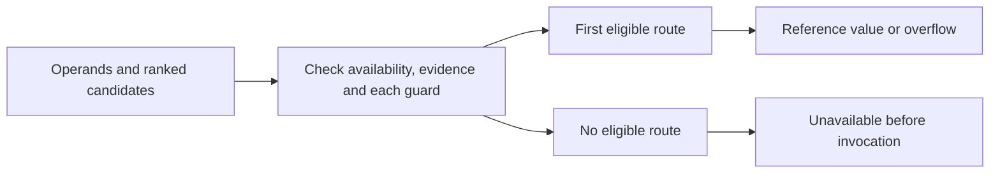

# RT-13 overlapping specialization guards and priority

A dispatcher can have more than one specialization for the same operation. Each specialization needs evidence for its actual applicability condition so that changing priority can change the implementation choice while preserving the operation result. This study defines priority over eligible routes and a separate refusal for a deployment without any eligible route. [Single guarded specialization](RT-13-GUARDED-SPECIALIZATION-2026-11-25.md) · [Typed selection constraints](RT-13-TYPED-SELECTION-CONSTRAINTS-2026-11-25.md)

The operation is checked signed 32-bit addition. The reference returns a value when the mathematical sum is representable and reports overflow otherwise. The first specialization returns the left operand for a zero right operand and representable left operand. The second directly computes the sum for two nonnegative operands at most 127. The baseline implements the reference. An eligible route must be available, carry checked evidence and satisfy its own guard for the current input. Priority uses the first eligible route. The observable dispatch result distinguishes refusal before invoking a route from an invoked operation that reports overflow.



## Checked results

Lean proves specialization refinement for every integer pair satisfying the respective guard, agreement of an eligible selection with the reference, priority invariance when the candidate membership and coverage are preserved, and refusal exactly when no eligible route exists. The proof checks the abstract result of the fixture. Its reported axioms are `propext`, `Classical.choice` and `Quot.sound`. [Lean model](MULTIVERSION-GUARDS-01/Multiversion.lean)

The finite oracle enumerates 11 boundary values per operand, all six priority orders, and ready, unavailable or unchecked states for each route. All 19,602 decisions match. There are 5,946 returned values, 1,512 invoked overflows and 12,144 refusals. In 510 decisions the dispatcher can choose among multiple eligible routes. With inputs 63 and 0, changing the order can choose either specialization and both return 63. With the baseline unavailable, maximal positive input plus 1 admits neither specialization and reports unavailable before invocation.

| Counterfactual | Observed violations |
| --- | ---: |
| Ignore the applicability guard | 8,170 selections of an ineligible route, including 7,512 differences in the reported reference or availability result |
| Allow unchecked routes | 6,972 choices of an unchecked route |

The scope is one result-or-overflow operation and a fixed evidence and availability state for an invocation. Extending a guard requires its own refinement evidence. Real specialization must also preserve the operation's full observations, including state and effects when applicable, and bind the executable variant and its guard to the current policy. Runtime costs, multiversion deployment, receipt authentication and changing state during invocation remain open. [Machine-readable ledger](MULTIVERSION-GUARDS-01/evidence.json)

## Reproduction

Use Lean 4.36.0 at revision `611c117bfaf7b7ae1cfcf246ce6fba31e8f509e9` and CPython 3.12.14.

```sh
study=research/compiler-and-translation/RT-13/MULTIVERSION-GUARDS-01
build=$(mktemp -d)
for seed in 37 75; do
  LC_ALL=C PYTHONHASHSEED="$seed" python "$study/run.py" --lean /path/to/lean \
    --output "$build/result-$seed.json"
done
cmp "$build/result-37.json" "$build/result-75.json"
cmp "$build/result-37.json" "$study/evidence.json"
```

[Runner](MULTIVERSION-GUARDS-01/run.py)
