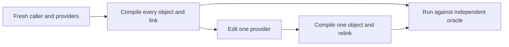
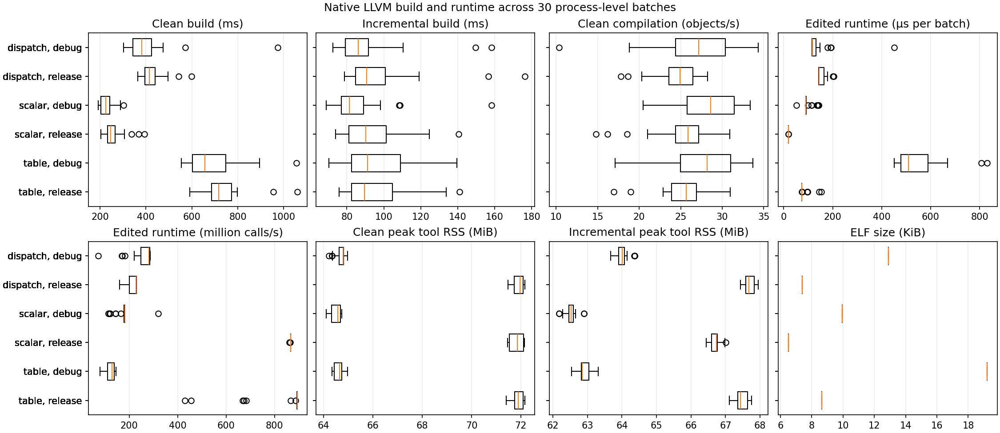

# RT-13 Native AOT build and runtime costs

A low JIT materialization cost and a low native AOT rebuild cost measure different work. This study measures native LLVM debug and release builds across three source shapes, then changes one provider and recompiles only that module before relinking. It records the cost of object compilation, full relinking, execution, artifact size and individual tool RSS. Existing Cranelift and LLVM ORC studies supply separate observations for JIT comparison.



| Family | Provider objects | Batch provider calls | Computation |
|---|---:|---:|---|
| Scalar | 4 | 16,384 | Unsigned multiply, add, shift and XOR |
| Dispatch | 8 | 32,768 | Four-way scalar dispatch |
| Table | 16 | 65,536 | Indexed local table and XOR |

Thirty batches randomize the six family/mode orders with seed `20261125`. A batch creates fresh build directories and invokes the serial compiler and linker subprocesses with no configured build cache. OS filesystem cache remains unmanaged. Each build checks three invocations before and after one deterministic provider edit. Each invocation compares an order-sensitive checksum of the entire input batch with a separately implemented Python oracle. The selected edit changes the checksum in all families and leaves every untouched object byte-identical during incremental linking.

| Family | Mode | Clean ms | Incremental ms | Edited runtime µs | Peak clean RSS MiB | ELF KiB |
|---|---|---:|---:|---:|---:|---:|
| dispatch | debug | 381.69 [335.58, 470.28] | 86.19 [74.48, 109.87] | 116.95 [114.74, 180.88] | 64.79 [64.34, 64.82] | 12.91 |
| dispatch | release | 414.73 [373.79, 471.04] | 90.77 [81.17, 108.63] | 144.29 [142.99, 172.37] | 71.96 [71.48, 72.15] | 7.41 |
| scalar | debug | 224.74 [202.77, 264.97] | 81.28 [74.97, 99.18] | 89.85 [89.85, 135.12] | 64.57 [64.25, 64.69] | 9.95 |
| scalar | release | 246.09 [223.87, 309.44] | 90.13 [79.62, 110.67] | 18.91 [18.91, 18.92] | 71.85 [71.46, 72.13] | 6.51 |
| table | debug | 656.55 [575.90, 779.20] | 91.28 [75.61, 122.35] | 509.12 [469.25, 634.33] | 64.64 [64.35, 64.84] | 19.22 |
| table | release | 716.85 [662.17, 793.60] | 89.61 [78.93, 124.14] | 73.34 [73.33, 97.32] | 71.89 [71.43, 72.15] | 8.64 |

Variable cells report median [p10, p90] for 30 independent batches. ELF sizes are identical across batches in each profile. Build includes compilation and link process wall time. Runtime is monotonic wall time inside each process around 4,096 inputs, with the median of three invocations retained for the batch. Binary size includes debug sections in the debug profile. On the shared runner, peak RSS is the maximum wait4 high-water of a sequential tool process, with no inference about parallel builds. Raw samples separate link, compile and runtime phases and retain throughput denominators. The chart includes throughput, memory and size. The release route is faster in the scalar and table workloads, while the dispatch median is higher at 144.29 µs versus 116.95 µs in debug. The data establishes the workload-specific difference without identifying its microarchitectural cause.



Debug `-O0 -g` retains a DWARF line section in all 90 edited artifacts. Release `-O3 -g0` omits it. Both compiler modes report the exact seeded missing provider at `invalid.c:1:40`. These observations complement archived source attribution and callback-unwind checks. Debugger stepping and broader diagnostic coverage remain open. [DWARF source origins](RT-13-DWARF-CALLBACK-SOURCE-ORIGINS-2026-11-24.md) · [JIT unwind](RT-13-JIT-UNWIND-AND-CALLBACK-ORIGINS-2026-11-25.md)

The AOT route uses a C frontend, one explicit compiler invocation per translation unit, an ELF linker and hosted C startup/time support. Its demonstrated target is native Linux x86-64. The Cranelift incremental JIT relay retains the caller across a provider edit with scoped correctness checks. Its materialization and fresh-process timings have distinct measurement boundaries. Cross-target support, backend-specific maintenance and representative workload comparisons remain separate. [Incremental Cranelift provider](RT-13-CRANELIFT-INCREMENTAL-PROVIDER-2026-11-25.md) · [Fresh-process JIT](RT-13-JIT-FRESH-PROCESS-2026-11-25.md) · [Target evidence matrix](RT-13-TARGET-SUPPORT-EVIDENCE-MATRIX-2026-11-25.md)

## Replay

The native shared-runner profile uses Debian Clang and LLD 19.1.7, CPython 3.12.14, GNU readelf 2.44 and glibc 2.41. The checker pins logical CPU 0 on an AMD EPYC 9V74 machine using overlayfs. The cgroup permits four CPU equivalents and 16 GiB of memory. [Raw sample ledger](AOT-BUILD-COST-01/samples.json)

```sh
p=research/compiler-and-translation/RT-13/AOT-BUILD-COST-01
LC_ALL=C PYTHONHASHSEED=37 python -B "$p/check.py" \
  --clang /path/to/clang-19 --linker /path/to/ld.lld-19 > /tmp/llmlang-aot-samples.json
LC_ALL=C MPLBACKEND=Agg MPLCONFIGDIR=/tmp python -B "$p/plot.py"
```

The plot uses Matplotlib 3.10.8 and the committed sample ledger. A new timing run produces different latency samples under the same conformance checks.
