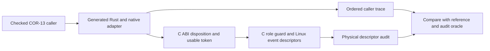

# RT-13 — Owned results across the native C ABI

Generated Rust callers linked to an independently compiled C provider matched the COR-13 reference on 125,952 observations in each of two optimization profiles. The provider created real Linux event descriptors. A single error status erased observable differences in 9,680 of 20,992 cases in the optimized retargeted recovery control.

## Boundary and method

COR-13 distinguishes a successful return, failed cleanup with a usable handle, a failure that consumed the handle, and an indeterminate close that requires reconciliation. The previous generated-Rust study implemented these outcomes in Rust. This study reuses its checked callers, transfer policies, alias inputs and exact ordered trace format, and routes acquisition and release through four symbols in a GCC-compiled C object.

The provider creates an `eventfd` for each admitted handle or scratch resource. Its guard models the existing shared source and exclusive destination roles. It checks the descriptor before a close and checks the live descriptors at the end of each trace. The eight-byte `repr(C)` outcome carries an explicit disposition and a usable token for retained errors. The C and Rust layouts are compile-time checked. An indeterminate response carries no usable token; the role footprint remains in reconciliation in both caller and provider.



Each source input executes twice. The C provider implements the same indeterminate response once with the descriptor still open and once after physically closing it. It retains the logical role footprint in both executions. The runner compares the complete language trace, second-call admission, forwarded obligations, live and pending masks, actual acquisition and release counts, and physical close counts against the reference and a separate expected audit.

## Results

| Caller and transfer rule | Rows per optimization profile | Different physical-state pairs | Second starts per physical mode |
| --- | ---: | ---: | ---: |
| forwarding/after_cleanup | 20,992 | 2,860 | 2,576 |
| forwarding/before_cleanup | 20,992 | 2,420 | 1,856 |
| recovery/after_cleanup | 20,992 | 3,135 | 2,996 |
| recovery/before_cleanup | 20,992 | 3,025 | 2,816 |
| retargeted/after_cleanup | 20,992 | 3,135 | 2,590 |
| retargeted/before_cleanup | 20,992 | 3,025 | 2,368 |

The C and Rust O0 builds match the C and Rust O3 builds in every row, giving 251,904 comparisons in total. In the counted pairs, the physical state differs despite the same caller-visible result, ordered trace and admission decision. The fixture closes any remaining descriptors after taking the audit, outside the source observation.

The error-bit control maps retained, consumed and indeterminate errors to the same consumed disposition after reading the native ABI. The compiled C provider is identical in this comparison. Changed trace and obligation rows reveal the loss of information at the adapter. The C provider independently maintains the reservation state when the response is indeterminate. Keeping the role footprint without a usable token lets the caller propagate the obligation while the provider preserves admission safety.

## Scope

The result establishes a Linux x86-64 ABI path for the existing checked caller fragment. The outcome provider scripts error dispositions while executing real descriptor operations and checking runtime state. The experiment leaves real third-party close-error contracts, asynchronous cancellation, reconciliation against a third-party provider, concurrent caller state and the general bootstrap chain open. Tokens identify fixture slots inside one sequential trial and carry no cross-trial authority.

## Reproduce

Use Linux x86-64, CPython 3.12.14, GCC 14.2.0, Rust 1.85.1 and GNU `nm` from the repository root. The runner compiles the C object first, verifies its four exact exports, links generated Rust, and compares the resulting native traces.

```sh
fixture=research/compiler-and-translation/RT-13/NATIVE-OWNED-ABI-01
output=$(mktemp)
python3 "$fixture/run.py" --output "$output"
cmp "$fixture/evidence.json" "$output"
python3 "$fixture/chart.py"
```

[C provider](NATIVE-OWNED-ABI-01/provider.c) · [Rust adapter](NATIVE-OWNED-ABI-01/adapter.rs) · [Runner](NATIVE-OWNED-ABI-01/run.py) · [Evidence ledger](NATIVE-OWNED-ABI-01/evidence.json) · [Generated Rust baseline](RESEARCH-SCENARIO-133-GENERATED-RUST-OWNED-RESULTS.md)
