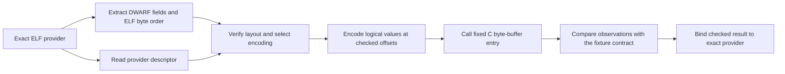

# Check native record layout and export behavior separately

This RT-13/24 experiment tests export admission when an exact operation is backed by a compiled provider with its own native record layout. A common exported symbol, record size and alignment can coexist with different sizes or offsets for individual fields. A verified record layout also leaves the function's behavior to be checked. The fixture compares direct use, a verified field adapter and a separately checked behavior contract.

## Native interface and evidence

The host expects a record with two 32-bit unsigned fields and one 16-bit unsigned field. Eight provider variants exercise same-size reordering, a packed layout, a widened field, incorrect metadata and changed behavior at the original layout. A fixed C entry receives a byte buffer and its length. The implementation checks the length and copies into its own correctly typed local record before reading fields. The test can therefore compare mismatched encodings as input data without calling functions with different C signatures.

Each shared library exposes a layout descriptor. GNU `readelf` independently reads the exact selected ELF file's DWARF structure size, member offsets, unsigned field widths, and ELF byte order. Alignment comes from the provider query. The debug extractor matches the one known structure and its immediate members under a pinned compiler and DWARF format. The experiment hashes the selected library bytes and extracted descriptor. A successful adapter uses the provider's field placement only after this comparison and requires the expected widths and non-overlapping regions.



Six policies compare symbol lookup, aggregate size/alignment, equality of reported descriptor to the host's expected layout, binary-checked direct layout, binary-checked adaptation, and adaptation with checked behavior. The oracle uses the authored numerical contract on the logical field values. It consumes the logical input tuple independently of the C structure or adapter.

## Results

Eight provider variants at O0 and O3 produce 16 exact shared libraries. Each library runs 64 inputs with the host's fixed encoding and with the reported layout encoding, for 2,048 native calls. The optimization levels agree on all observations within each variant. The last table column counts unsuccessful or wrong output vectors from artifacts admitted by each gate. Its denominator is the 64 inputs per admitted artifact under that gate's route.

| Admission gate | Accepted artifacts | Incorrect accepted vectors |
|---|---:|---:|
| Symbol | 16/16 | 606/1024 |
| Size and alignment | 14/16 | 478/896 |
| Provider descriptor | 8/16 | 240/512 |
| Binary-verified direct layout | 4/16 | 128/256 |
| Binary-verified layout adapter | 10/16 | 128/640 |
| Layout adapter plus exact native observations | 8/16 | 0/512 |

Same-size field reordering passes the aggregate gate and can interpret admitted bytes as different values. Stale descriptors pass descriptor equality and fail comparison with the binary's structure. The widened-field variant also demonstrates that the sampled logical values can agree at a physically different field width when the original padding is zero. The fixed-width ABI gate still rejects that layout.

The binary-verified adapter recovers reordered and packed providers with the exact requested field types. A behavior change that preserves layout then fails the exact observation check on all 64 inputs at each optimization level. Eight native artifacts satisfy both predicates. A layout receipt and behavior record are scoped to exact provider bytes, even when another build has identical observed results.

## Limits and replay

The comparison uses x86-64 Linux, one compiled C17 byte-buffer entry, unsigned fields, known endianness, and a fixed finite input corpus. The experiment compares two evidence surfaces produced in the same build and assumes compiler and debug artifact integrity. The fixture DWARF extractor is intentionally narrow. Separate linked calling conventions, aggregate-by-value calls, bit-fields, signed and floating layouts, stale library handles, production ABI claims, full behavioral proofs, and independent review remain open.

Use CPython 3.12.14, Debian GCC 14.2.0-19 with Binutils 2.44, and the logged x86-64 target. The initial baseline is `1cf35776f5856fa099ee35949e593a201aa4593c`. The runner normalizes build paths and records exact source and library SHA-256 values. Run from the repository root.

```bash
fixture=research/compiler-and-translation/RT-13/NATIVE-RECORD-LAYOUT-01
PYTHONHASHSEED=1 python3 -B "$fixture/run.py" > /tmp/llmlang-rt13-native-record.json
cmp "$fixture/evidence.json" /tmp/llmlang-rt13-native-record.json
python3 "$fixture/chart.py"
```

See the [compiled provider](NATIVE-RECORD-LAYOUT-01/provider.c), [native runner](NATIVE-RECORD-LAYOUT-01/run.py), [measured ledger](NATIVE-RECORD-LAYOUT-01/evidence.json), and [table generator](NATIVE-RECORD-LAYOUT-01/chart.py).
