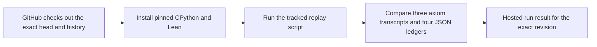

# RT-13 — Reproducible replay of optimization research fixtures

One replay checks the exact source archive, runtime versions, Lean axiom outputs and machine-readable results for four optimization studies. Independent proof verification and the CI command are separate from adoption of a production compiler profile. [PLAN §2.5](../../../PLAN.md#25-correctness-of-optimization-and-translation) · [Issue #297](https://github.com/aivibeflow/LLMLang/issues/297)

| Fixture | Replayed evidence |
| --- | --- |
| [Graph occurrence preservation](RT-13-GRAPH-OCCURRENCE-PRESERVATION-2026-11-25.md) | Lean graph/tree correspondence, 9,210 graph observations, exact source archives and memoization controls. |
| [Exhaustive evidence boundary](RT-13-EXHAUSTIVE-EVIDENCE-BOUNDARY-2026-11-25.md) | Lean coverage and observation lifting, plus the full 128-case scope discriminator and archived evidence digests. |
| [Differential shrinking](RT-13-DIFFERENTIAL-SHRINKING-2026-11-25.md) | Four seeds, 28 first and minimized witnesses, and source/target small-step checks. |
| [Compiler pass composition](RT-13-COMPILER-PASS-COMPOSITION-2026-11-25.md) | Lean transitivity and exact bridge composition, with full results for 57,132 locally valid chains. |

The local replay matched all three Lean transcripts and all four JSON ledgers byte for byte. The [Actions workflow](../../../.github/workflows/rt13-optimization-research-replay.yml) invokes the same command on matching pushes to `research/all`. It fetches the branch history for the three archive-bound fixtures. The hosted result and the workflow correction are recorded below.

The replay trusts the Git object reader, CPython execution, and the Lean kernel and recorded dependencies for the exact declarations. It checks the Lean revision and Python patch release before execution. The source wire and small-step models are archived research semantics. General LLMLang parser, canonical SPG and backend preservation remain open. The workflow uses the GitHub runner and Lean installation supply chain for the hosted execution.

## Hosted execution

The first three hosted attempts completed with no jobs or replay logs. A local actionlint 1.7.11 check found that the workflow used the `runner` context in job-level environment configuration. The workflow correction moved `runner.temp` to the Lean install step and exported `ELAN_HOME` through the runner environment file for subsequent steps. Actionlint accepted the corrected workflow, and the same replay command still passed locally. [Workflow correction](https://github.com/aivibeflow/LLMLang/commit/f4d6de046d0294a7611e1e1546069f90131c162c)



The diagram shows the hosted replay after workflow parsing succeeds. Run 45609190644 verified the exact head `f4d6de046d0294a7611e1e1546069f90131c162c`; setup, installation, replay and cleanup all succeeded. The replay log identifies Lean commit `611c117bfaf7b7ae1cfcf246ce6fba31e8f509e9` and reports all three Lean checks and four ledger comparisons. The [hosted receipt](OPTIMIZATION-REPLAY-01/hosted-ci.json) records the run and job outcome. It establishes replay for this branch revision and the four named fixtures. The initial workflow failures remain part of the historical record. [Successful run](https://github.com/aivibeflow/LLMLang/actions/runs/45609190644) · [Initial failed run](https://github.com/aivibeflow/LLMLang/actions/runs/45608943214)

## Reproduce

Use a checkout of `research/all` with its archive commits available, CPython 3.12.14 and Lean 4.36.0 at `611c117bfaf7b7ae1cfcf246ce6fba31e8f509e9`. Run from the repository root.

```sh
bash research/compiler-and-translation/RT-13/OPTIMIZATION-REPLAY-01/replay.sh
```
