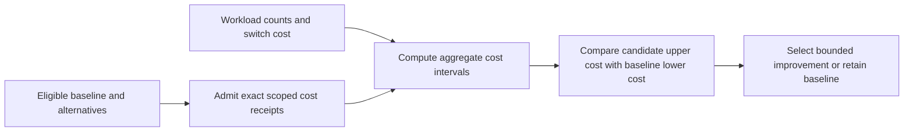

# RT-13 profile-guided cost ranking for eligible implementations

A specialization can reduce cost on one workload and increase it on another. Initializing or switching providers can also outweigh a per-call benefit. This study checks a ranking rule that starts with semantic eligibility and an eligible baseline. Its input is a workload mix with per-bucket cost intervals tied to the exact artifact, operation, target, measurement environment and metric. Mandatory performance and authorization remain eligibility gates upstream. An incomparable optional cost receipt does not change compatibility. [Typed selection constraints](RT-13-TYPED-SELECTION-CONSTRAINTS-2026-11-25.md) · [Benchmark protocol](RT-13-BACKEND-BENCHMARK-PROTOCOL-2026-11-25.md)



For a workload with counts \(n_i\) and per-invocation cost intervals \([l_i, u_i]\), the rule computes \([\sum_i n_i l_i + s, \sum_i n_i u_i + s]\), where \(s\) is the one-time switching cost for the invocation batch. The counts must be nonnegative and at least one must be positive. The candidate qualifies for a switch when its upper bound plus a margin is strictly below the baseline's lower bound. Rank such candidates by upper bound and then stable artifact identity. If the baseline is eligible but lacks a comparable cost receipt, keep it. An ineligible baseline yields control to the ordinary eligibility/fallback layer without ranking a switch. Independent metrics such as memory, latency and size need explicitly stated goals and measurement profiles.

## Checked result

The experiment uses synthetic integer cost intervals, two workload buckets, switch costs of 0, 5 and 9, and margin 2. No measurements were taken for these values. For each mix a separate oracle enumerates the combinations of interval endpoints and checks whether every cost scenario clears the margin. The implementation and oracle agree for all 2,592 combinations of mixes and receipt or eligibility states. Reversing candidate enumeration preserves each decision. A deliberate tie chooses the first artifact identity in the stable ordering. Empty, zero-total and negative workload counts are rejected.

| Workload counts, short/long | Baseline interval | Short specialization | Long specialization | Selected |
| --- | --- | --- | --- | --- |
| 1 / 0 | 7–9 | 8–9 | 17–19 | Baseline |
| 16 / 0 | 112–144 | 53–69 | 137–169 | Short specialization |
| 0 / 16 | 160–208 | 213–245 | 73–105 | Long specialization |
| 16 / 16 | 272–352 | 261–309 | 201–265 | Long specialization |

The rule selects a bounded switch in 114 cases, retains an eligible baseline in 1,614 cases and delegates ranking failure for an ineligible baseline in 864 cases. Absent, malformed or mismatched optional receipts are kept outside numerical comparison. Qualification assumes the intervals bound comparable costs and that addition models the workload. Interaction, caches, changing workload, setup overlap and contention can invalidate those assumptions. Production ranking would need approved workload profiles, empirical estimates, a change policy and validation of the selected artifact at use time. [Ledger and worked mixes](PROFILE-GUIDED-RANKING-01/evidence.json)

## Reproduction

Use CPython 3.12.14.

```sh
study=research/compiler-and-translation/RT-13/PROFILE-GUIDED-RANKING-01
build=$(mktemp -d)
for seed in 37 75; do
  LC_ALL=C PYTHONHASHSEED="$seed" python "$study/run.py" --output "$build/result-$seed.json"
done
cmp "$build/result-37.json" "$build/result-75.json"
cmp "$build/result-37.json" "$study/evidence.json"
```

[Runner](PROFILE-GUIDED-RANKING-01/run.py)
