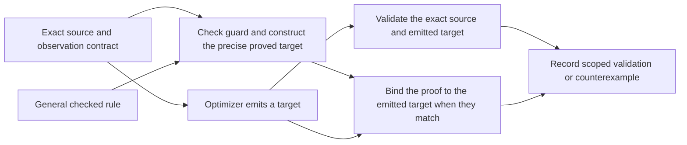

# RT-13 — A checked optimizer rule and exact translation validation for ordered writes

**Scope:** PLAN §2.5 and [#297](https://github.com/aivibeflow/LLMLang/issues/297), based on `5ad921e8656559108ccd211f658704c89360d73f` in `research/all`. The experiment compares proof reuse and per-pair validation through a small semantic graph rewrite.

A compiler can prove a general rewrite rule and check its side condition where it applies. A translation validator can instead compare an exact source with the target actually produced. This study distinguishes the evidence each route provides. Reordering two writes gives a compact case because disjoint writes can still be observable in a different order.

## Observation contract and rule

A write selects a natural-number cell, stores an integer and optionally appends a visible event containing that cell and value. The program executes both writes in isolation with no failures or external observation of intermediate states. The observation includes every final cell and the ordered visible events. Two adjacent writes can swap exactly if both conditions hold.

- Their cells differ or their values agree. This preserves the final cell mapping.
- At least one write has no visible event, or both events have the same cell and value. This preserves the ordered event list.

The [Lean theorem](WRITE-SWAP-VALIDATION-01/Swap.lean) proves both criteria and their conjunction for any initial heap in the model. The final-heap proof checks the cells where writes can change values. The trace proof enumerates the two visibility flags and compares the projected lists. Lean reports only `propext` for all three theorems. This is a proof of the rewrite rule over the modeled operations. A proof of the optimizer itself would also have to connect its actual pattern matching, effect summaries, rewrite construction and compilation to this rule.



The upper route reuses a rule proof only for the exact application. The lower route can check a pair even without knowing which rewrite produced it. Each depends on the selected observation contract and on correspondence between its model and the code to which it is applied.

## Finite translation-validation experiment

The validator independently interprets exact source and target sequences. It compares final heaps and events over two cells, two stored values and both visibility flags. Eight writes form 64 ordered source pairs. Each pair is checked with all four initial heaps. The ledger records the first witness for each invalid target.

| Target and criterion | Accepted pairs / 64 | Interpretation |
| --- | ---: | --- |
| Swap with full observation | 40 | Agrees with the proved guard on every pair |
| Swap with final heap alone | 48 | Eight additional pairs reverse visible events |
| Drop the first write with full observation | 16 | Eight valid targets have a swap that the guard would reject |

The last row shows how a concrete validator can apply to a different transformation. For example, when both writes target the same cell and the first is hidden, dropping the first can preserve both observations even if swapping the writes would change the final value.

The wrong-target control starts with hidden writes of 1 to cell 0 and −1 to cell 1. The swap is valid. A faulty optimizer could drop the write to cell 0 instead. At initial heap `(−1, −1)`, the source finishes at `(1, −1)` and the dropped-write target remains `(−1, −1)`. Evidence for the valid swap has a different subject digest from evidence for the target actually emitted. The fixture also changes the digest when it changes only the observation projection. Its comparison keys bind these exact fixture values and do not adopt a production proof format.

## Trade-offs and limits

A general rule proof covers all modeled heaps once the application satisfies its hypotheses. That can amortize proof work and give the optimizer a precise safe rewrite construction. The trusted application still has to establish the guard and confirm the resulting exact target or prove that the implementation constructs it. A validator can instead accept an unfamiliar exact target or reject an optimizer bug. Its conclusion is only as strong as its observation model and analyzed domain, and the check costs work for each pair where the result is unavailable for reuse. Under broader solvers, unsupported constructs or exceeded budgets would require an explicit unresolved result.

This finite validation uses sequential immediate stores and an explicit event projection. It does not cover LLMLang source extraction, alias or synchronization models, store faults, volatile operations, foreign effects, LLVM lowering or a complete optimizer implementation. The [previous observable rewrite theorem](../../formal-verification/RT-07/RT-07-OBSERVABLE-REWRITE-CORRECTNESS.md) studies preservation with a different expression model. The [checked-add translation validation](RT-13-LLVM-CHECKED-ADD-OBSERVATIONS-2026-11-24.md) exercises exact LLVM modules under separate assumptions. No language or optimizer architecture is selected here.

## Reproduce

Use CPython 3.12.14 and Lean 4.36.0 at `611c117bfaf7b7ae1cfcf246ce6fba31e8f509e9`. The [runner](WRITE-SWAP-VALIDATION-01/run.py) kernel-checks the rule proof, exhausts both finite target families, and records witnesses and exact subject digests in the [ledger](WRITE-SWAP-VALIDATION-01/evidence.json). Mermaid syntax was inspected directly. No elapsed time was measured.

```sh
fixture=research/compiler-and-translation/RT-13/WRITE-SWAP-VALIDATION-01
LC_ALL=C PYTHONHASHSEED=1 python3 -B "$fixture/run.py" \
  --lean "$(command -v lean)" > /tmp/llmlang-write-swap.json
cmp "$fixture/evidence.json" /tmp/llmlang-write-swap.json
```
