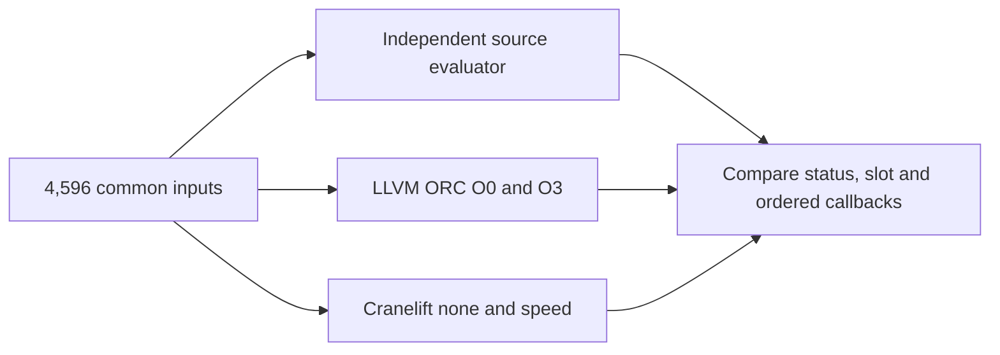

# RT-13 shared JIT conformance for checked addition

This experiment sends the same checked-add inputs and faults through two JIT pipelines. Earlier studies checked the preserving route and selected faulty witnesses. Here both LLVM ORC and Cranelift execute all three fault variants over the same corpus. This tests whether a shared oracle and its observation fields can admit preserving artifacts and detect semantic differences in each route used for JIT timing. [Checked-add fixture](RT-13-CRANELIFT-CHECKED-ADD-2026-11-24.md) · [Fresh-process experiment](RT-13-JIT-FRESH-PROCESS-2026-11-25.md)

The source emits the first input through a callback, checks signed addition when enabled, and emits and stores the successful value. Overflow returns status 1 and preserves the output slot. The oracle compares status, final slot bits and the ordered callback payloads. A finite comparison uses 500 edge combinations and 4,096 seeded triples. Each candidate uses the same ABI and receives those triples in the same order.



## Results

All four profiles match the preserving reference in every row. For each mutant they produce the same full observation rows across the four profiles. The table gives the count of disagreements against the preserving reference per profile.

| Variant | Full observation | Omit status | Omit slot | Omit callback effects |
| --- | ---: | ---: | ---: | ---: |
| Preserving | 0 | 0 | 0 | 0 |
| Drop the overflow check | 885 | 885 | 885 | 885 |
| Reverse the callback order | 3,661 | 3,661 | 3,661 | 0 |
| Store zero on overflow | 885 | 885 | 0 | 885 |

A status and value comparison alone admits every reordered case. A status and effects comparison admits every erroneous store. Dropping the overflow check changes multiple observation fields. The example supports keeping effect and output-slot observations in the candidate conformance gate. The ledger records a first counterexample for each variant, hashes of the case and reference streams, LLVM input IR and Cranelift finalized bytes and CLIF. The ORC path checks native executions of the verified and optimized module. Its in-memory object bytes are outside this ledger. Scope is one operation, one ABI and four compiler configurations. Whole-domain proof for the JIT code, exceptions, concurrent or state-inspecting callbacks, and other workload families remain open. [Machine-readable evidence](JIT-SHARED-CONFORMANCE-01/evidence.json)

## Reproduction

Use Debian LLVM 19.1.7, GCC 14.2.0, Rust 1.85.1 with Cranelift 0.116.1 and CPython 3.12.14 on x86-64 Linux. Build the ORC probe as in the fresh-process study. Build the original Cranelift harness, whose command line accepts the fault policy and exports the finalized bytes.

```sh
study=research/compiler-and-translation/RT-13/JIT-SHARED-CONFORMANCE-01
cranelift=research/compiler-and-translation/RT-13/cranelift-checked-add
build=$(mktemp -d)
CARGO_TARGET_DIR="$build/target" CARGO_BUILD_JOBS=2 CARGO_PROFILE_RELEASE_OPT_LEVEL=1 \
  cargo rustc --locked --release --manifest-path "$cranelift/Cargo.toml" -- -D warnings
for seed in 37 75; do
  LC_ALL=C PYTHONHASHSEED="$seed" PYTHONDONTWRITEBYTECODE=1 python "$study/run.py" \
    --orc /path/to/latency-orc --probe "$build/target/release/llmlang-rt13-cranelift-probe" \
    --output "$build/result-$seed.json"
done
cmp "$build/result-37.json" "$build/result-75.json"
cmp "$build/result-37.json" "$study/evidence.json"
```

[Runner](JIT-SHARED-CONFORMANCE-01/run.py)
