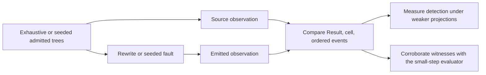

# Differential test coverage for state and Result rewrites

## Property and controls

Compare each admitted source tree with the candidate's emitted tree using the exact Result tag and payload, final cell and ordered read/write events. The candidate selects a known branch or eliminates a leading `skip` in a strict or Result sequence. The runner checks both original and emitted trees against an independent small-step evaluator. Each negative control modifies one rewrite rule, then runs the resulting output through the same candidate simplifier. The smallest recorded witnesses in each finite set also agree with the small-step evaluator. Candidate and control are research implementations over admitted trees. [Executable semantics](../../formal-verification/RT-07/RT-07-STATE-RESULT-REFERENCE-ENTRY-2026-11-25.md)



The comparison uses both initial cell values. The bounded exhaustive set uses the existing 4,105 reference trees. Each seeded generator draws 2,048 trees up to depth seven, then deduplicates them. The general generator admits every leaf. The success-only generator omits explicit failure. All five observation projections use the same emitted tree and reference observation. The event-multiset projection retains result and cell with event multiplicity and erases event order.

## Results

Both interpreters agree on source and candidate observations for all 12,896 program/cell pairs, counting each corpus separately. The runner evaluates 77,376 mutant observations and compares each under five projections. The table reports differing program/cell pairs per mutation in the bounded exhaustive corpus. [Machine-readable evidence](STATE-RESULT-MUTATIONS-01/evidence.json) · [Table generator](STATE-RESULT-MUTATIONS-01/chart.py)

| Mutation | Result | Cell | Result and cell | Event multiset | Ordered observation |
| --- | ---: | ---: | ---: | ---: | ---: |
| `ignore_left_failure` | 514 | 152 | 524 | 560 | 560 |
| `short_circuit_strict` | 560 | 164 | 568 | 584 | 584 |
| `drop_overwritten_write` | 0 | 0 | 0 | 240 | 240 |
| `exchange_write_order` | 8 | 104 | 104 | 104 | 120 |
| `drop_read` | 1514 | 0 | 1514 | 2562 | 2562 |
| `run_skipped_branch` | 1778 | 1176 | 2438 | 4734 | 4734 |

| Corpus | Program/cell pairs | Mutant comparisons | Detected mutations |
| --- | ---: | ---: | ---: |
| `bounded_exhaustive` | 8210 | 49260 | 6 |
| `seeded_general` | 2362 | 14172 | 6 |
| `seeded_success_only` | 2324 | 13944 | 4 |

The complete observation detects 240 exhaustive mismatches from removing an overwritten write that the result and final cell cannot see. For exchange of write order, treating events as a multiset loses 16 mismatches. One witness swaps writes of zero and one before a third write of zero. The result remains successful unit, the cell ends at zero, and the event counts are unchanged. Both error-propagation mutations survive the success-only generator even when comparison uses the full observation. The general generator and bounded enumeration detect both.

These checks support reporting the tested input space, exact emitted artifact, complete observation, refusal classes and known distinguishing controls alongside a coverage count. The passing candidate comparisons give finite evidence. General equivalence, production parser or optimizer correspondence, and observations outside these admitted state/Result trees require separate evidence. Wire refusal is checked by the reference entry's own replay.

## Reproduction

From the repository root, use CPython 3.12.14. The evidence records exact interpreter and runner source digests and the ordered digest of each comparison stream.

```sh
set -eu
fixture=research/compiler-and-translation/RT-13/STATE-RESULT-MUTATIONS-01
out=$(mktemp)
trap 'rm -f "$out"' EXIT
python3 -B "$fixture/run.py" > "$out"
cmp "$fixture/evidence.json" "$out"
python3 -B "$fixture/chart.py"
```

[PLAN §2.5](../../../PLAN.md#25-correctness-of-optimization-and-translation) · [Issue #297](https://github.com/aivibeflow/LLMLang/issues/297)
