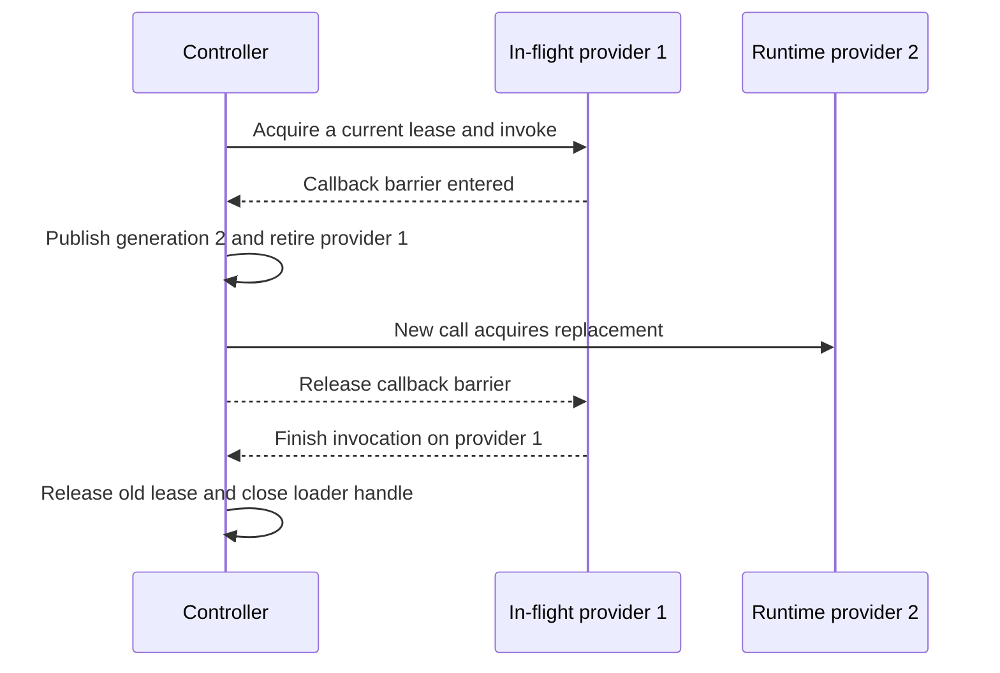

# RT-13 static binding and runtime dispatch during provider replacement

A static binding chooses an implementation when linking an artifact. Runtime dispatch chooses against the current catalog when a new invocation starts. Both routes can implement the same operation, while changing the runtime catalog introduces a separate lifetime for calls that already started. The experiment covers ordinary replacement with draining of existing calls. [Catalog and binding model](RT-13-CATALOG-DISCOVERY-AND-BINDING-2026-11-25.md) · [Selection constraints](RT-13-TYPED-SELECTION-CONSTRAINTS-2026-11-25.md)

The linked probe contains provider 1's `step` symbol as object code. It also loads two independently built shared providers using `dlopen` and resolves their entries through their own handles. Both providers implement one callback with the original input and return `3 × input + 1` modulo \(2^{32}\). The diagnostic provider identity stays outside the operation result. The runtime route binds a candidate and catalog generation and acquires a lease before invocation. The lease holds its loader handle until the invocation completes. Its tests assume already eligible providers.



A pthread barrier pauses the old invocation inside its callback. The controller then replaces the catalog, marks the old provider retired and routes a fresh call to provider 2. Positioning the barrier inside the callback ensures that execution must return to the old shared code before the earlier call finishes. A control submits the replacement with a stale generation. Another submits the retired provider under the current generation. Both are rejected before invocation. The static call continues using provider 1's linked object through all phases. [Native probe](STATIC-RUNTIME-BINDING-01/probe.c)

## Checked traces

| Phase | Static binding | Runtime binding |
| --- | --- | --- |
| Before replacement | Provider 1 | The worker acquires provider 1 |
| After replacement | Provider 1 | A fresh call uses provider 2. A stale or retired request is rejected |
| Previously started invocation | Static symbol remains unchanged | The retained provider 1 invocation returns and its handle is closed after release |
| Catalog without an eligible provider | Provider 1 | Reports no binding before invocation |

GCC 14.2.0 and Clang 23.1.1 each matched all ten independently predicted observations in 16 separate processes. For input 9 both implementations return 28 and report one callback carrying 9. The suspended old call returns 4,294,967,294 and reports one callback carrying 4,294,967,295. After the old lease drains, `dlclose` succeeds and a Linux `RTLD_NOLOAD` query finds no old shared object at that path. The linked executable has its own defined `step` symbol and no direct dependency on either provider shared object. [Evidence](STATIC-RUNTIME-BINDING-01/evidence.json)

Use the static form when a build or deployment pins a target artifact and all changes go through deployment. Use the runtime form when a call needs live selection for the current catalog and can report no eligible binding. The demonstrated lifetime policy keeps new admissions on the current catalog while retaining an already-started ordinary invocation. A reload implementation with multiple concurrent readers needs a synchronization and lifetime protocol. This fixture serializes admissions and explicitly coordinates one worker. It leaves multi-writer arbitration, abrupt revocation, ABI adapters, authenticated receipts and loader behavior on other platforms open.

## Reproduction

Use GCC 14.2.0, glibc 2.41, GNU Binutils 2.44, CPython 3.12.14 and Clang 23.1.1 from Lean 4.36.0 at LLVM revision `6dfe1677ab8dffbc6ec13d53a1e0215d75147689` on Linux x86-64. The runner supplies the GCC C include directory to the Clang distribution.

```sh
study=research/compiler-and-translation/RT-13/STATIC-RUNTIME-BINDING-01
build=$(mktemp -d)
for seed in 37 75; do
  LC_ALL=C PYTHONHASHSEED="$seed" python "$study/run.py" --clang /path/to/clang \
    --output "$build/result-$seed.json"
done
cmp "$build/result-37.json" "$build/result-75.json"
cmp "$build/result-37.json" "$study/evidence.json"
```

[Runner](STATIC-RUNTIME-BINDING-01/run.py)
