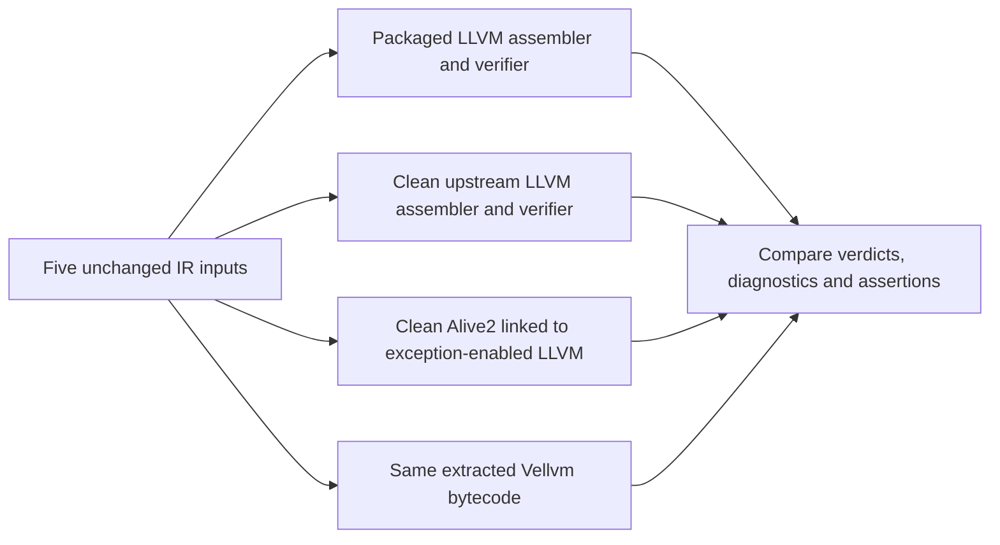

# RT-13 — Replay Alive2 with stock exception-enabled LLVM

**Evidence** — Two clean upstream revisions and a repeat of the five-module RT-13 validator comparison.

## Question and result

The initial experiment used the exact Alive2 revision with a build-only CMake patch to accept Debian LLVM compiled without C++ exceptions. That combination established the comparison corpus. To determine whether the result depends on that compatibility adjustment, build the clean Alive2 revision against the clean LLVM 19.1.7 revision configured with exception handling and RTTI. Keep the bytecode Vellvm interpreter, test modules and comparison runner fixed. [Initial comparison](RT-13-ALIVE2-VELLVM-COVERAGE-2026-11-24.md) · [Original build notes](LLVM-VALIDATORS-01/BUILD.md)



Using the packaged assembler and verifier, the stock Alive2 run produces the exact previously recorded ledger. Using the upstream assembler and verifier from the same exception-enabled build as Alive2, the only ledger difference is the issuer line emitted by `opt --version`. The original runners also check that both LLVM tools accept every fixture structurally.

| Fixture | Verified Alive2 observation | Unchanged Vellvm checks |
| --- | --- | ---: |
| Scalar identity | Valid transformation | 4 |
| Changed signed-overflow semantics | Refuted at signed i8 boundary, with new poison | 4 |
| Reordered aliased stores | Refuted, source reads 9 and target reads 7 | 4 |
| Local atomic read-modify-write | Unsupported `atomicrmw add` | 4 |
| Acquire fence | Unsupported `fence acquire` | 2 |
| Mutated assertion in scalar module | No Alive2 claim exercised | 3 pass, 1 expected failure |

The clean upstream build confirms that the observed edge cases do not depend on the original build workaround. Alive2's unsupported results still leave the atomic and fence transformations without a translation validation verdict. Vellvm's assertions explore concrete sequential observations, including the intentionally wrong assertion. Neither this study nor the earlier one validates generalized concurrency semantics, the LLMLang-to-LLVM mapping or arbitrary LLVM transformations.

## Build and replay

Use pristine upstream checkouts at the following revisions. Both tracked source trees were clean before the run. The observed build used x86-64 Debian 13, GCC/G++ 14.2.0, GNU binutils 2.44, CMake 3.31.6, Ninja 1.12.1, re2c 4.1 and Z3 4.13.3. It used the Debian base image at SHA-256 `8aa5a7bf5a1955bddbe7d74fcdd0b91ab30e74362a8b73af672b0481b35b44a0` with distribution development packages. The run used host Debian glibc 2.41 and the same Vellvm bytecode hash as the original comparison.

| Checked artifact | Exact revision or SHA-256 |
| --- | --- |
| LLVM source | `cd708029e0b2869e80abe31ddb175f7c35361f90` |
| Alive2 source | `84041960f183aec74d740ff881c95a4ce5234d3d` |
| Clean Alive2 `alive-tv` | `20e1a35650a6f7bf1d9f15b6ccde531d6764bc243c04add9b049450e2ef8b096` |
| Upstream `opt` | `21834bcde08fd4d4007a7319a6d156f3b2cc8906672beb5ae4c77d4f09a96b93` |
| Upstream `llvm-as` | `fa33fe50b674b1671524c941674bf14b7f0738afbcf92dbdd76053f3f4df20a4` |
| Vellvm bytecode | `74f92fd9196514171d2cef05373dd752b1a41920687bab4206d4b097ab134237` |

Keep the build directories in the same locations for incremental builds. The measured LLVM build used X86 only, static LLVM libraries and the following flags. Use the release compiler defaults for Alive2. Set the two checkout paths before running the commands. [LLVM source](https://github.com/llvm/llvm-project/tree/cd708029e0b2869e80abe31ddb175f7c35361f90) · [Alive2 source](https://github.com/AliveToolkit/alive2/tree/84041960f183aec74d740ff881c95a4ce5234d3d)

```sh
cmake -S "$llvm_source/llvm" -B "$llvm_source/build" -G Ninja \
  -DCMAKE_BUILD_TYPE=Release '-DCMAKE_CXX_FLAGS_RELEASE=-O1 -DNDEBUG' \
  -DLLVM_TARGETS_TO_BUILD=X86 -DLLVM_ENABLE_EH=ON -DLLVM_ENABLE_RTTI=ON \
  -DLLVM_ENABLE_ZLIB=OFF -DLLVM_ENABLE_ZSTD=OFF -DLLVM_ENABLE_LIBXML2=OFF \
  -DLLVM_ENABLE_TERMINFO=OFF -DLLVM_INCLUDE_TESTS=OFF \
  -DLLVM_INCLUDE_BENCHMARKS=OFF -DLLVM_INCLUDE_EXAMPLES=OFF
cmake --build "$llvm_source/build" --target opt llvm-config llvm-as -j2
cmake -S "$alive_source" -B "$alive_source/build-stock-eh" -G Ninja \
  -DCMAKE_BUILD_TYPE=Release -DBUILD_LLVM_UTILS=ON \
  -DLLVM_DIR="$llvm_source/build/lib/cmake/llvm"
cmake --build "$alive_source/build-stock-eh" --target alive-tv -j1
```

The LLVM build finished its original Ninja invocation at 1,620 steps for `opt` and `llvm-config`. An incremental invocation built `llvm-as` in two additional steps. The first Alive2 build reached configuration and then Git's mounted-checkout ownership check. Setting Git's `safe.directory` for that path in the container process allowed the 44-step build to finish without changing the checkout or global Git configuration. The resulting Alive2 has no dynamic dependency on libLLVM. It links dynamically to the system Z3 and C++ runtime.

From the LLMLang repository root with CPython 3.12.14, Debian LLVM 19.1.7 and the Vellvm bytecode wrapper environment from the original build guide:

```sh
study=research/compiler-and-translation/RT-13/LLVM-VALIDATORS-01
python3 -B "$study/run.py" \
  --alive "$alive_source/build-stock-eh/alive-tv" --vellvm "$study/vellvm-byte.sh" \
  --output /tmp/rt13-stock-packaged.json
cmp "$study/evidence.json" /tmp/rt13-stock-packaged.json
python3 -B "$study/run.py" \
  --alive "$alive_source/build-stock-eh/alive-tv" --vellvm "$study/vellvm-byte.sh" \
  --asm "$llvm_source/build/bin/llvm-as" --opt "$llvm_source/build/bin/opt" \
  --output /tmp/rt13-stock-upstream.json
cmp "$study/stock-eh-evidence.json" /tmp/rt13-stock-upstream.json
```

Each tool combination produced five matching replays. The [packaged-tool ledger](LLVM-VALIDATORS-01/evidence.json) and [upstream-tool ledger](LLVM-VALIDATORS-01/stock-eh-evidence.json) preserve fixture digests and per-case results. The build identities describe this toolchain instance. Independently built binaries can have different hashes even when the comparison ledger matches.
