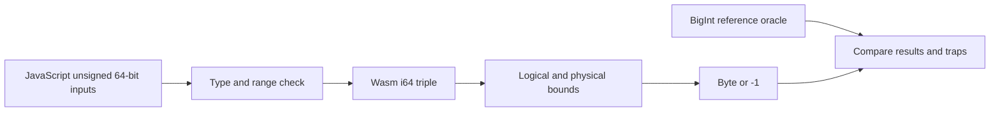

# RT-13 Wasm memory64 target and host profiles

A Wasm binary with a 64-bit memory can still narrow a logical address or mis-handle overflow in an end calculation. This study compares direct WAT and LLVM wasm64 for one read-only byte-view contract. It also checks whether the validator and host engine admit the exact binaries. The two-page memory deliberately keeps successful accesses small while exercising large rejected operands. A standalone module exports its memory and `view_byte` and uses no host imports or WASI.

For unsigned 64-bit operands `base`, `span` and `offset`, the source contract returns a byte when `offset < span` and the exclusive end `base + span` lies within memory. All other in-domain inputs return `-1`. The JS oracle adds using unbounded BigInt arithmetic. The emitted code uses `base <= capacity` and `span <= capacity - base` before a load, together with the logical offset check. A JavaScript admission wrapper separately checks operand types and width before calling Wasm.



## Observations

Each bundle ran on Node 22.23.5 and Node 24.22.3. Each engine checked the Cartesian product of 18 operand values across all three positions, including values beyond 32 bits, the unsigned sign bit, and values close to the 64-bit limit. Each build and engine had 5,832 rows, with 330 successful byte observations and 5,502 rule rejections in the oracle.

| Module | Wasm bytes | Wrong results per engine | Traps among wrong results |
| --- | ---: | ---: | ---: |
| Direct WAT | 101 | 0 | 0 |
| LLVM wasm64 O0 | 220 | 0 | 0 |
| LLVM wasm64 O3 | 124 | 0 | 0 |
| LLVM fault with 32-bit narrowing | 153 | 472 | 0 |
| LLVM fault with wrapping exclusive end | 109 | 456 | 258 |

All five binaries declare the same 64-bit memory and exported function type. WABT 1.0.36 rejects each module at its default feature setting and accepts each with `--enable-memory64`. Both Node engines validate and execute all five modules by default. In the tested Node 22 package, `--no-experimental-wasm-memory64` succeeds as a command-line option and `WebAssembly.validate` still admits the modules. Record an actual validation result for each consumer profile. The two compiler routes agree on this contract, while the smaller WAT binary covers one hand-written leaf. The LLVM module uses a linker-generated stack pointer global. The size data have no timing interpretation.

The narrowing fault turns offset `2^32` into zero and reads byte 211 at address zero. The wrapping-end fault accepts base 1, span `2^64 - 1` and offset 0 because the sum wraps to zero. JS-to-Wasm conversion of `2^64 + 256` also reaches the load at a low alias. The wrapper rejects that argument, a negative BigInt and a JavaScript Number, and admits the equivalent in-range BigInt triple. Structural validation, checked module arithmetic and host range admission require separate observations. [Oracle and host harness](WASM-MEMORY64-01/check.mjs) · [Evidence](WASM-MEMORY64-01/evidence.json)

The Wasm64 C fixture uses `-fno-delete-null-pointer-checks` to retain the target's readable zero address in this harness. General pointer provenance, memory growth, successful access above 4 GiB, WASI, production browsers, and application workload measurements remain open. One bounded protocol also leaves the overall dedicated-versus-LLVM toolchain choice open. [C fixture](WASM-MEMORY64-01/view.c) · [WAT fixture](WASM-MEMORY64-01/view.wat)

## Reproduction

Use Clang 23.1.1 from Lean 4.36.0 at LLVM revision `6dfe1677ab8dffbc6ec13d53a1e0215d75147689`, Debian wasm-ld 19.1.7 and WABT 1.0.36, CPython 3.12.14, and Node 22.23.5 and 24.22.3. The runner pins the initial and maximum memory to two Wasm pages and checks all five module shapes with `wasm-objdump`.

```sh
study=research/compiler-and-translation/RT-13/WASM-MEMORY64-01
build=$(mktemp -d)
for seed in 37 75; do
  LC_ALL=C PYTHONHASHSEED="$seed" python "$study/run.py" \
    --clang /path/to/clang-23.1.1 \
    --node /path/to/node-22.23.5 --node /path/to/node-24.22.3 \
    --output "$build/result-$seed.json"
done
cmp "$build/result-37.json" "$build/result-75.json"
cmp "$build/result-37.json" "$study/evidence.json"
```
